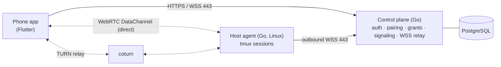

# ConnRelay

> **Status:** working end to end for Linux hosts and Android. Sign-in, pairing, grants and persistent terminals run on a real phone against the [local dev stack](docs/operations/deployment.md#local-development-stack). iOS, security hardening and the public AWS deployment are still open ([roadmap](docs/roadmap.md#current-status)). Not ready for production use.

ConnRelay gives your phones secure terminal access to your Linux computers from any network. It is self-hosted and works without a VPN client, a public SSH port or a third-party relay.

You can pair any number of phones and computers. Open a terminal on a computer from your phone, start Claude Code or Codex, and walk away. Sessions are tmux-backed, so they keep running when your phone loses signal, the app is killed or the agent restarts. When you reconnect, the terminal reattaches exactly where it was.

## Features (MVP)

- **Multi-device.** Any number of phones and Linux hosts under one account. Each device has its own key and can be revoked independently.
- **Explicit access.** A phone can reach a host only after you grant it access to that host. A device being online never implies permission.
- **QR pairing.** A host shows a one-time QR code, and the phone confirms the host's key fingerprint before enrolling it.
- **Persistent sessions.** Named tmux sessions that survive disconnects and agent restarts. Disconnecting is distinct from terminating.
- **Connectivity that adapts to the network:**
  1. Direct peer-to-peer WebRTC when possible.
  2. A self-hosted TURN relay when direct fails.
  3. A WebSocket relay on TCP 443 for networks that only allow HTTPS, including DPI and proxy networks.
- **End-to-end encrypted.** Terminal bytes are protected by DTLS, or by TLS 1.3 on the 443 fallback, between your phone and your host. The relay and the server never see plaintext.
- **Metadata-only audit.** The server records who connected where and when. It never records keystrokes or output.

Not in the MVP: full VPN or subnet routing, file transfer, port forwarding, and Windows or macOS hosts. See the [roadmap](docs/roadmap.md).

## How it works



1. **Sign in.** You sign in to the phone app with Google. Only allowlisted accounts can use the deployment.
2. **Pair.** On the computer, `connrelay-agent pair` shows a QR code. You scan it, check the fingerprint, and grant the phone terminal access.
3. **Get a ticket.** Tapping **Connect** gets a short-lived signed ticket. The peers then negotiate a connection through the control plane, trying direct, then TURN, then the WSS relay.
4. **Verify identities.** Each peer proves its enrolled device key over the encrypted channel before any terminal command is accepted.
5. **Attach.** The agent attaches you to a new or existing tmux session.

Details: [architecture overview](docs/architecture/overview.md).

## Repository layout

| Path | Contents | Status |
|---|---|---|
| `core/connrelaycore/` | Shared Go core: frames, flow control, attestation, tokens, WebRTC and WSS-relay transports, connection manager, phone connect and terminal clients, gomobile facade | ✔ |
| `services/control/` | Go control plane: Google sign-in, devices, pairing, grants, connection attempts, signaling, WSS relay, TURN credentials, revocation; migrations in `migrations/` | ✔ (no metrics or admin CLI yet) |
| `agents/host/` | Go Linux host agent: pairing CLI, tmux sessions, both transports, grant lease cache, systemd user unit | ✔ (no `.deb` yet) |
| `apps/mobile/` | Flutter phone app with the gomobile core and a vendored xterm fork | Android ✔ · iOS bridge open |
| `protocol/` | Golden test vectors (frames) | Partial |
| `deploy/dev/` | Local dev stack: Postgres, control plane and a Cloudflare quick tunnel | ✔ |
| `deploy/` (AWS) | Terraform, Compose, coturn, Caddy | Planned |
| `tests/` | Network lab (Docker), spike scripts, Phase 1 field run | ✔ |
| `docs/` | Project documentation | ✔ |

### Try it locally

```sh
deploy/dev/devstack.sh up            # Postgres + control plane + public HTTPS URL
connrelay-agent pair --server "$(cat ~/.local/share/connrelay-dev/public_url)" && connrelay-agent run
```

Then build the Android app against that URL. The full steps, including the Google client ID and the sign-in allowlist, are in [deployment](docs/operations/deployment.md#local-development-stack).

### Run the tests

```sh
make vet test-race              # all Go modules (needs tmux; Docker for database tests)
CONNRELAY_REQUIRE_DB=1 make test-race # same, failing instead of skipping without a database
make mobile                     # Flutter app: analyze + tests (incl. xterm fork and TUI replay)
make netlab                     # Docker NAT/TURN/HTTPS-proxy lab
make spike-s4                   # tmux survives agent restart under systemd --user
```

## Documentation

| Area | Docs |
|---|---|
| Architecture | [Overview](docs/architecture/overview.md) · [Decisions (ADRs)](docs/architecture/decisions.md) |
| Technical | [Protocol](docs/technical/protocol.md) · [Security](docs/technical/security.md) · [Data model](docs/technical/data-model.md) · [API](docs/technical/api.md) |
| Components | [Control plane](docs/components/control-plane.md) · [Host agent](docs/components/host-agent.md) · [Mobile app](docs/components/mobile-app.md) · [connrelaycore](docs/components/connrelaycore.md) |
| Operations | [Deployment](docs/operations/deployment.md) · [Runbooks](docs/operations/runbooks.md) |
| Development | [Contributing](docs/development/contributing.md) · [Testing](docs/development/testing.md) · [Spike results](docs/development/spike-results.md) |
| Planning | [Roadmap](docs/roadmap.md) |

## Tech stack

| Layer | Choice |
|---|---|
| Mobile | Flutter 3.41 / Dart 3.11, Riverpod, go_router, google_sign_in, xterm.dart (vendored fork), shared Go core via gomobile |
| Backend and agent | Go 1.26+ (toolchain go1.27.2), Pion WebRTC v4, pgx v5, goose, coder/websocket, creack/pty |
| Data | PostgreSQL 16+ |
| Relay | coturn ≥ 4.18 and a built-in WSS relay |
| Identity | Google OIDC; ECDSA P-256 device keys; Ed25519 server signing keys |
| Infrastructure | Planned: one AWS EC2 instance with two Elastic IPs, Docker Compose, Caddy, Terraform. Today: the local dev stack. |

## Security notes

The agent runs as your user, never as root. A terminal session has your user's privileges, so treat phone access like SSH access. Revoking a phone blocks new connections immediately and closes its live connections within about 30 seconds. Running tmux sessions are detached, not killed.

The server operator can see connection metadata (which devices connect, when, and how much data is relayed). The operator cannot see terminal content. See [security](docs/technical/security.md) for the full model and its limits.

## Contributing

See [contributing](docs/development/contributing.md). Commits are one-line [Conventional Commits](https://www.conventionalcommits.org/), and every commit is signed off and GPG-signed (`git commit -s -S`).
