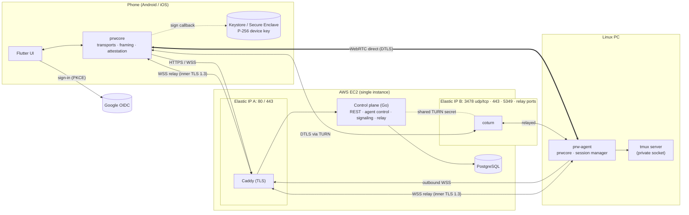
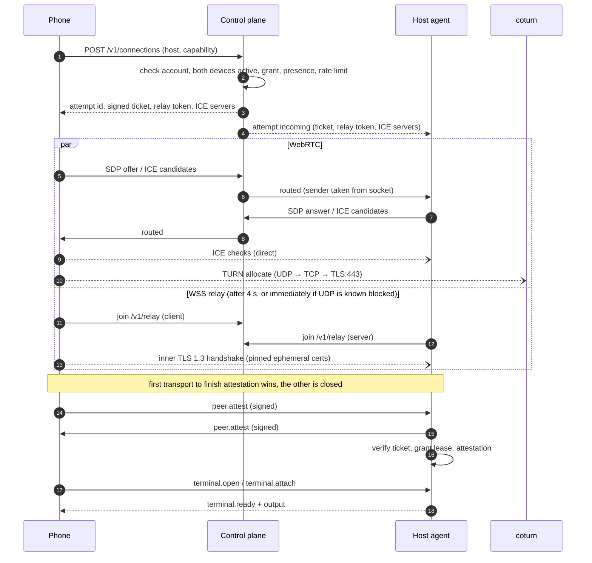
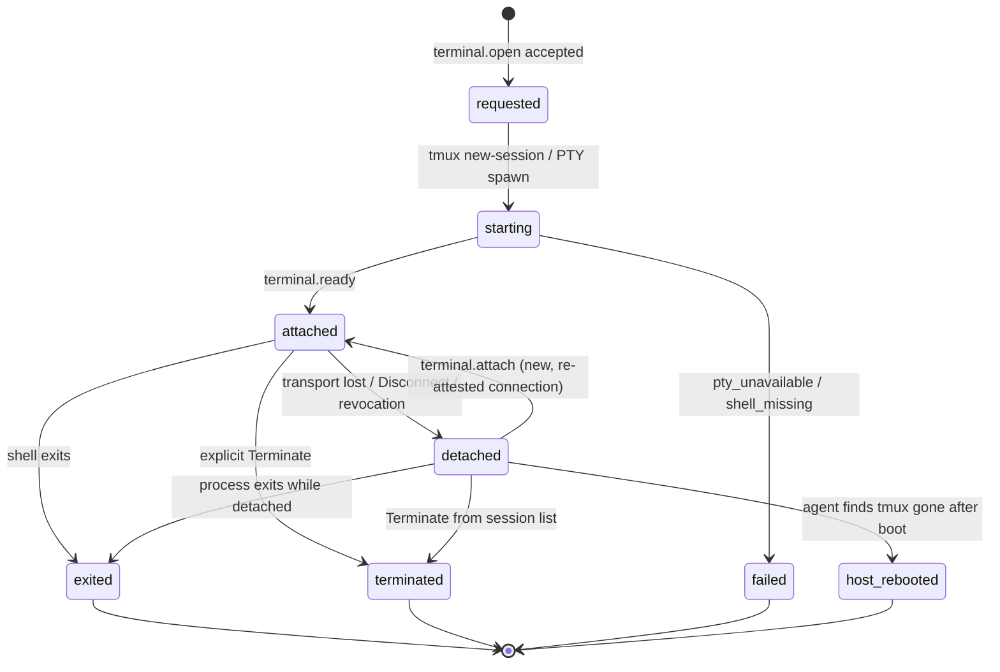
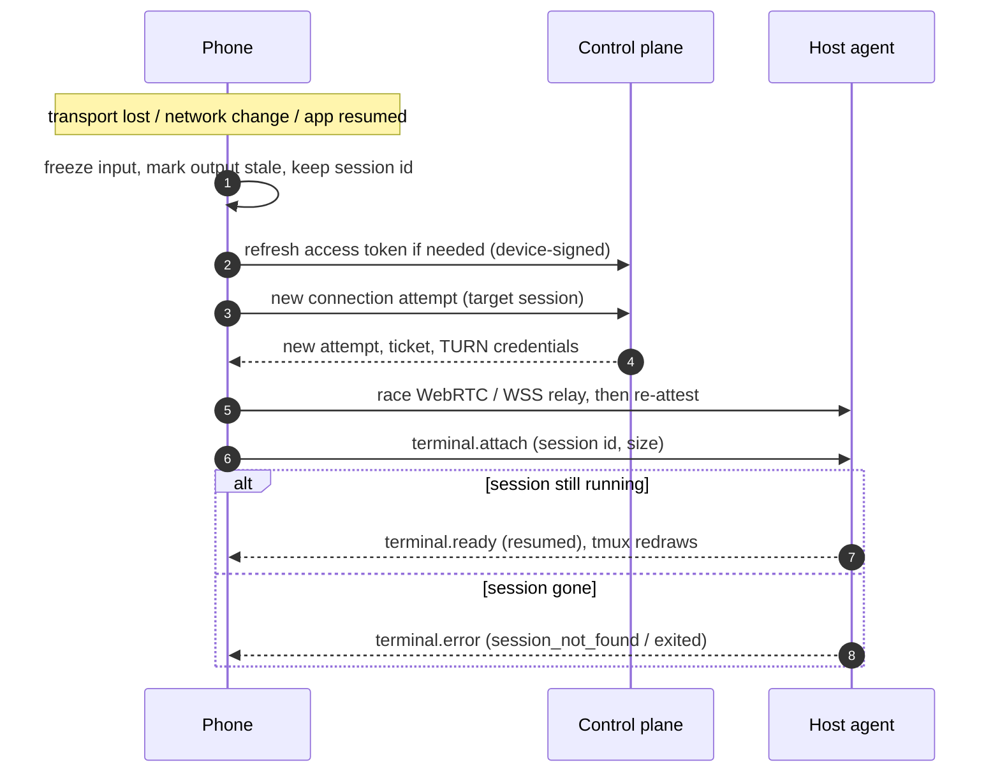
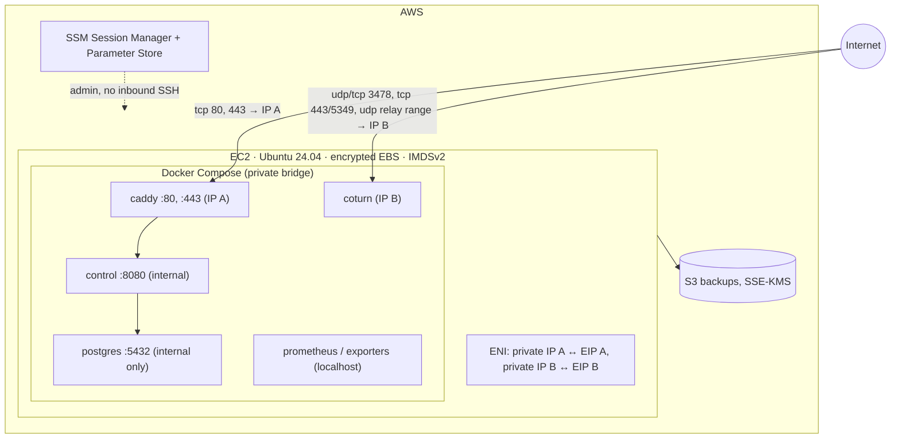

# Architecture Overview

> **Status:** design. Implementation has not started yet. Items marked *proposed* are recommended defaults that may change once the feasibility spikes report.

Private Remote Workspace (PRW) gives one operator secure terminal access from any number of their phones to any number of their Linux computers. It does not need a VPN product, a public SSH port or a third-party relay. All of the infrastructure is self-hosted.

## 1. Goals and non-goals

**Goals (V1)**

- Pair any number of Linux hosts and any number of phones to a single account. Each device has its own identity and can be revoked on its own.
- Allow access only through explicit per-phone → per-host grants. A device being online never means a phone may use it.
- Run interactive terminal sessions that **persist** through phone disconnects, app termination and host-agent restarts, which matters for long-running coding agents such as Claude Code or Codex.
- Prefer a direct peer-to-peer path. Fall back to a self-hosted TURN relay, and finally to a WebSocket relay on TCP/443 that works on DPI and HTTP-proxy networks.
- Keep terminal data end-to-end encrypted between phone and host on every path. The server never sees terminal plaintext.

**Non-goals (V1)**

| Non-goal | Notes |
|---|---|
| System VPN | No subnet routing, no DNS, no arbitrary TCP/port forwarding. |
| Windows or macOS host agents | Only Linux hosts in V1. |
| File transfer, remote desktop, screen sharing | Not in V1. |
| Multiple users, teams or sharing | Not in V1. |
| Sessions surviving a host reboot | Not supported. |
| Background terminal on the phone | Foreground use only. The app reconnects on resume. |

## 2. Component map

| Component | Technology | Runs on | Responsibility |
|---|---|---|---|
| **Phone app** | Flutter (Android + iOS), Riverpod, go_router, xterm.dart | Phone | Sign-in, device and grant management, pairing approval, terminal UI, connection state |
| **prwcore** *(proposed)* | Go module, linked into the app via gomobile, used directly by the agent | Phone and host | Transports (WebRTC, WSS relay), framing, flow control, identity attestation, connection manager |
| **Control plane** | Go single binary | EC2, behind Caddy | REST API, Google OIDC sign-in, devices, pairing, grants, connection tickets, TURN credentials, signaling, WSS relay splice, outbox, audit |
| **Host agent** (`prw-agent`) | Go, `systemd --user` service | Linux PC, as the user (never root) | Enrollment, outbound control channel, ticket/lease enforcement, session manager (tmux / PTY) |
| **PostgreSQL** | PostgreSQL 16+ | EC2 (Docker, private network) | Accounts, devices, grants, attempts, session metadata, audit, outbox |
| **coturn** | coturn ≥ 4.18 | EC2, second Elastic IP | STUN/TURN relay for WebRTC (UDP, TCP, TLS on 443) |
| **Caddy** | Caddy with ACME | EC2, first Elastic IP | TLS termination for REST and WebSockets on 443 |
| **Observability** | `slog` JSON, Prometheus and exporters | EC2, agent journald | Metrics, structured logs with redaction, alerts |

## 3. Overall architecture



**Plane separation**

- **Control plane** (REST, agent control socket, signaling). It carries identity, presence, pairing, grants, tickets and SDP/ICE. It **never** carries terminal bytes.
- **Data plane.** It carries terminal bytes over exactly one of three paths:
  1. direct WebRTC (DTLS);
  2. WebRTC through TURN (DTLS);
  3. the WSS relay, carrying a TLS 1.3 stream that the two peers encrypt end to end.

  The WSS relay runs inside the control-plane process but only copies opaque ciphertext.

## 4. Responsibilities and trust boundaries

| Boundary | Trusted for | Not trusted for | Enforcement |
|---|---|---|---|
| Phone ↔ control plane | Identity, grants, tickets, signaling | Terminal content (never sent) | TLS, Google ID token, device-bound refresh |
| Host ↔ control plane | Presence, attempt notifications, grant lease, revocations | Authorizing sessions alone | Device-key challenge; tickets and leases are signed and checked on the host |
| Phone ↔ host (data plane) | Terminal I/O | — | DTLS / TLS 1.3 plus signed identity attestation against pinned device keys |
| TURN relay and WSS relay | Forwarding packets | Confidentiality or authorization | Relays see only ciphertext; TURN and relay credentials are short-lived and scoped to one attempt |
| Agent ↔ host OS | Running a shell as the configured user | Root privileges | Non-root `systemd --user` service; argv-only process spawning |
| Control plane ↔ PostgreSQL | Durable state | — | Private Docker network, separate app and migrator roles |

A compromised control plane can deny service and observe metadata. It cannot silently impersonate an already-paired phone to a host, because peer attestation is checked against keys pinned on the devices themselves.

## 5. Device enrollment and pairing

```mermaid
sequenceDiagram
  autonumber
  participant H as prw-agent (host)
  participant S as Control plane
  participant P as Phone app
  H->>H: generate P-256 device key (if absent)
  H->>S: create pairing challenge (host public key, hostname, OS)
  S-->>H: challenge id, pairing ref, display code, expiry (5 min)
  H->>H: show QR (ref + key fingerprint) and code
  H->>S: wait for approval
  P->>S: resolve ref or code (signed in)
  S-->>P: hostname, OS, fingerprint, expiry
  P->>P: QR fingerprint must equal server fingerprint; user confirms
  P->>S: approve
  S-->>H: approved (nonce)
  H->>S: complete (signature with device key over nonce)
  S->>S: one transaction: verify, create host device, consume challenge, audit
  S-->>H: device id, server verification keys (pinned)
  P->>S: grant this phone → host "terminal" (explicit)
```

A newly enrolled host has no grants. A new phone signs in with Google, and the server checks the account against the operator allowlist. The phone also starts with no grants. **No extra approval step is required**, because access is controlled entirely by grants.

## 6. Connection establishment and fallback



If no transport is attested within 20 s, the attempt fails with `connect_timeout` and diagnostics. The 4 s and 20 s timings are *proposed*.

## 7. Terminal session lifecycle



The **network connection lifetime is independent of the process lifetime**.
- Each PRW session is a tmux session on a private socket, run in its own systemd scope. Disconnecting kills only the `tmux attach` client, and the shell keeps running.
- Reattaching starts a new attach client, and tmux redraws the screen.
- If tmux is missing, the agent falls back to a plain PTY. That session survives disconnects but not an agent restart, and the UI labels it "not persistent".

## 8. Revocation

```mermaid
sequenceDiagram
  autonumber
  participant U as Phone (owner)
  participant S as Control plane
  participant O as Outbox worker
  participant H as Host agent(s)
  participant L as Revoked phone
  U->>S: revoke device or grant
  S->>S: one transaction: mark revoked, revoke grants and refresh sessions, audit, outbox
  S-->>U: revoked
  Note over S: new tickets and refreshes for L are refused immediately
  O->>H: revoke_notice (control socket)
  H->>H: drop from lease; close L's connections within 30 s
  Note over H: tmux sessions are detached, not killed
  H-->>O: ack
  alt host offline or push lost
    O->>O: retry with backoff
    H->>H: grant lease expires (10 min, proposed) → refuse and close
  end
  L->>S: refresh / connect → 403 device_revoked
```

**Revocation detaches the affected sessions and never kills them.** The processes keep running on the host, and the owner can reattach from a phone that still has a grant, or end them explicitly.

## 9. Disconnect and reconnect



- **Backoff:** retries at 0.5 s, 1 s, 2 s, 4 s and 8 s, then every 15 s, each with ±20 % jitter. Automatic retries stop after 2 minutes.
- **Network changes:** when the network changes (for example Wi-Fi → cellular), the app opens the new connection before closing the old one.
- **No reuse:** tickets, TURN credentials and relay tokens are never reused.

## 10. Deployment and network boundaries



| Boundary | Allowed | Notes |
|---|---|---|
| Internet → EIP A | TCP 80 (ACME redirect), TCP 443 | Caddy only |
| Internet → EIP B | UDP/TCP 3478, TCP 443 (TURN-TLS), TCP 5349, UDP relay range (proposed 49160–49359) | coturn bound to IP B only |
| SSH | None | Administration through SSM |
| PostgreSQL | Docker network only | Never exposed |

Two public IPs let HTTPS and TURN-over-TLS both use port 443 without L4 multiplexing. The instance is a documented single point of failure for the private deployment.

## 11. User-visible states

The app keeps these six states separate and never infers one from another.

| # | State | Source of truth | Does **not** imply |
|---|---|---|---|
| 1 | **Device online** | Heartbeat freshness: online < 75 s, stale 75–150 s, otherwise offline | Permission, or that a connection will succeed |
| 2 | **Permitted** | An active, unexpired `terminal` grant for this phone → host, with both devices active | That the host is online |
| 3 | **Connecting** | The client's attempt state machine | That a transport exists |
| 4 | **Transport established** | Transport up **and** attestation verified both ways (shown as Direct / Relayed / Web relay) | That a terminal is open |
| 5 | **Authorized terminal session** | Host sent `terminal.ready` after its ticket, lease and policy checks | That the process will survive a disconnect |
| 6 | **Persistent process** | Host session record with backend `tmux`, status attached or detached | That the phone is connected |

Input is enabled only in state 5. Losing state 4 shows *Reconnecting* with stale output, while state 6 may still hold.

## 12. Failure behavior summary

| Failure | Effect | Behavior |
|---|---|---|
| Control plane / EC2 down | No sign-in, pairing, grants or new connections. WSS-relayed and TURN-relayed sessions drop. | Direct P2P sessions continue until the grant lease expires (10 min, *proposed*). Then the host closes them. tmux sessions keep running. |
| PostgreSQL down | API not ready (503) | Existing data-plane sessions unaffected until lease expiry |
| coturn down | No TURN path | ICE direct or WSS relay still work |
| WSS relay overloaded or down | No 443-only path | ICE paths still work. `relay_unavailable` is shown. |
| Phone network change | Transport lost | Make-before-break reconnect and reattach |
| App backgrounded or killed | OS suspends networking | Reconnect on resume. tmux session unaffected. |
| Host sleeps | Presence becomes stale or offline | Reconnect after wake. tmux sessions survive suspend. |
| Agent restart | Attach clients close | tmux survives because it runs in its own systemd scope. The phone reattaches. |
| Host reboot | Processes lost | Agent reconciles and reports `host_rebooted` |
| Revocation during a session | Affected connections close within 30 s | Sessions are detached, not killed |
| Output flood | Sender out of credit | The agent stops reading the PTY, so backpressure reaches the program. No data is dropped and memory stays bounded. |
