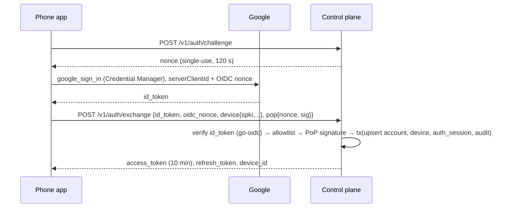
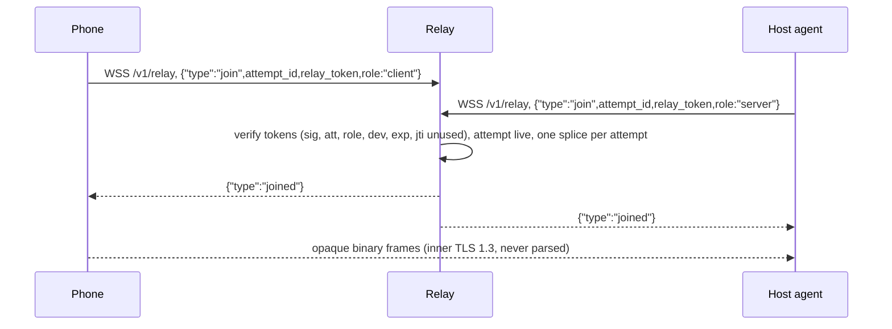

# Control Plane

> **Status:** Implemented for V1 and running against real phones and hosts. Items still on the roadmap are marked **(planned)**; everything else describes the code as it is.
> **Location:** `services/control/` · **Binary:** `prw-control`

The control plane is a single Go service. It handles:

- account sign-in and device identity
- pairing
- phone-to-host access grants
- connection tickets and TURN credentials
- signaling, and a WebSocket byte relay used as a last-resort data path

It **never** sees terminal plaintext. Terminal data either flows directly between the peers, through coturn (still DTLS-encrypted), or through the WSS relay. On the relay path it is wrapped in an end-to-end TLS 1.3 stream that the relay only copies.

The packages are split so that the relay could later run as its own process without a rewrite.

---

## 1. Package layout

```text
services/control/
  cmd/prw-control/main.go     # subcommands: serve (default) | check-config | keygen DIR
  cmd/prw-labserver/          # network-lab stand-in (no accounts); test networks only
  migrations/                 # goose SQL migrations 00001–00003, embedded into the binary
  internal/
    config/      env parsing + validation (reports every problem at once), secret-file loading
    db/          pgx pool, embedded goose migrations (run on every start)
    dbtest/      throwaway Postgres (Docker postgres:16-alpine) for tests
    httpx/       request IDs, JSON and error writers
    google/      Google ID-token verification (go-oidc), allowlist check
    auth/        challenges, sign-in exchange, refresh rotation, logout, /v1/me, access-token checks
    tokens/      access JWT issue/verify (EdDSA)
    nonce/       single-use in-memory nonce store
    inventory/   devices, presence derivation, rename, revoke, access grants
    pairing/     challenge create/wait/resolve/approve/complete/cancel, HMAC codes
    connections/ connection attempts: authorization, tickets, relay tokens, ICE servers, status
    turncred/    TURN REST credentials
    hub/         live sockets: /v1/agent/control and /v1/signaling, leases, revoke pushes
    relay/       /v1/relay splicer (opaque byte bridge, caps)
    outbox/      transactional outbox worker
    store/       hand-written pgx queries, transaction helper, audit writer
    server/      assembles everything; health, access log, panic recovery, IP rate limits
    apitest/     in-process test harness (sign in, add hosts)
```

### Library choices

| Concern | Choice | Why |
|---|---|---|
| HTTP routing | stdlib `net/http` `ServeMux` (method + path patterns) | No dependency needed; middleware is plain `func(http.Handler) http.Handler` |
| WebSocket | `github.com/coder/websocket` | Maintained, context-aware |
| Database | `pgx/v5` + `pgxpool`, `goose` (embedded) | Plain SQL, no ORM, forward-only migrations |
| OIDC | `github.com/coreos/go-oidc/v3` | Standard Google ID-token verification with JWKS caching |
| JWS / JWT | `github.com/go-jose/go-jose/v4` and the shared `prwcore/token` package | Vetted implementation; no hand-rolled JWS |
| IDs | `github.com/google/uuid` (UUIDv7) | Time-ordered primary keys |
| Rate limiting | `golang.org/x/time/rate` | Single instance, so in-memory is enough |
| Logs | `log/slog` (JSON to stdout) | |

---

## 2. Configuration

Configuration comes from environment variables, and secrets are read from files that must not be readable by group or others (`chmod 600`). `prw-control check-config` validates everything and exits; `prw-control keygen DIR` writes fresh signing keys and secrets for a new install.

| Variable | Default | Validation |
|---|---|---|
| `PRW_PUBLIC_BASE_URL` | — (required) | https, no path. `http://` only with `PRW_DEV_ALLOW_HTTP=1` (local tests). WSS URLs handed to clients are derived from it. |
| `PRW_LISTEN_ADDR` | `127.0.0.1:8080` | Fronted by a TLS proxy |
| `PRW_DATABASE_URL` / `PRW_DATABASE_URL_FILE` | — (required) | One of the two |
| `PRW_GOOGLE_CLIENT_IDS` | — (required) | Comma list of accepted `aud` values (the Web client ID the app passes as `serverClientId`, plus any others) |
| `PRW_ALLOWED_SUBJECTS` | — (required) | Comma list of `google:<sub>`. **If empty, the server refuses to start.** |
| `PRW_ACCESS_SIGNING_KEY_FILE`, `PRW_TICKET_SIGNING_KEY_FILE` | — (required) | Ed25519 PKCS#8 PEM; the two keys must differ |
| `PRW_PAIRING_HMAC_KEY_FILE` | — (required) | ≥ 32 bytes |
| `PRW_TURN_SHARED_SECRET_FILE` | — (required) | ≥ 32 bytes |
| `PRW_TURN_URLS` | — (required) | `turn:` / `turns:` URLs |
| `PRW_STUN_URLS` | empty | `stun:` URLs |
| `PRW_RELAY_MAX_BPS` | `2000000` | bits per second, ≥ 8000 |
| `PRW_LOG_LEVEL` | `info` | `debug`, `info`, `warn` or `error` |

Token lifetimes and limits are code constants: access tokens 10 min, refresh 30 d sliding / 90 d absolute, tickets 60 s, relay tokens 90 s, leases 10 min (renewed every 3 min), pairing challenges 5 min, TURN credentials 10 min, relay byte cap 2 GiB per attempt. The ticket-key rotation, metrics address and further tunables in §4.3 and §6 are **(planned)**.

---

## 3. HTTP stack and middleware

```text
requestid → accesslog → recover → ratelimit(ip, unauthenticated POSTs) → mux → handler (auth checked per route)
```

| Middleware | Behaviour |
|---|---|
| `requestid` | Generates a request ID (`req_…`), echoes it as `X-Request-Id` and attaches it to log lines and audit rows. |
| `accesslog` | At `PRW_LOG_LEVEL=debug` only: one `request` line with method, path, status, duration in ms and request ID. Query strings are never logged (they can carry cursors and codes); neither are headers or bodies. The wrapped writer supports `Unwrap`, so WebSocket upgrades pass through. |
| `recover` | A panic is logged with its path and answered with `internal_error`. |
| `ratelimit(ip)` | Per-IP token buckets on `POST /v1/auth/challenge` (1 per 2 s), `POST /v1/auth/exchange` (1 per 6 s) and `POST /v1/pairing/challenges` (1 per 2 min), all with burst 10. Behind a loopback proxy the client IP is the rightmost `X-Forwarded-For` hop. |
| auth | Each `/v1` handler verifies the bearer access token (EdDSA, `aud`, `exp`, `kid`) and loads the device; a revoked device gets `403 device_revoked`. Account context comes **only** from token claims. |
| Timeouts | `ReadHeaderTimeout` 5 s, `IdleTimeout` 60 s; graceful shutdown waits up to 10 s. |

### Rate limits **(planned beyond the IP limits above)**

| Key | Scope | Limit |
|---|---|---|
| IP | unauthenticated endpoints | 30/min, burst 10 |
| IP | `POST /v1/pairing/challenges` | 5 / 10 min, 50 / day |
| Account | `POST /v1/pairing/resolve` | 10 / 10 min; challenge locks after 5 failures |
| Phone | `POST /v1/connections` | 10/min, burst 3 |
| Device | `POST /v1/auth/refresh` | 6/min |
| Socket / attempt | signaling | 20 msg/s per socket; 100 msgs and 50 candidates per attempt |
| Account | all authenticated | 600/min |

A request over a limit gets `429` with `Retry-After`. It also increments a metric and writes a throttled `rate_limited` audit row.

---

## 4. Authentication

### 4.1 Google sign-in (the only identity provider)



**ID-token checks.** The server verifies the token with go-oidc and checks:

- `iss=https://accounts.google.com`
- `aud` is one of `PRW_GOOGLE_CLIENT_IDS`
- the signature against the cached Google JWKS
- `exp` (≤ 60 s skew)
- `nonce`
- `email_verified`, when an email is stored

**Allowlist.** The subject is `google:<sub>`. It is checked **before any account row is written**. A denial returns `403 account_not_allowed` and writes a `login_denied` audit row. It also logs a warning, `sign-in denied: subject not in PRW_ALLOWED_SUBJECTS; add it if this is you`, with the `google:<sub>` value, so the owner can find their own subject on first sign-in. There is no open sign-up.

**New phones.** A newly signed-in phone needs no extra approval: Google sign-in plus the allowlist is sufficient. The phone is registered as a device with **zero grants** and cannot reach any host until the owner grants access.

### 4.2 Tokens

| Token | Format | Notes |
|---|---|---|
| Access | EdDSA JWT, 10 min | Claims `iss`, `aud=prw-api`, `sub=account_id`, `dev`, `kind`, `sid`, `kid`, `iat`, `exp`, `jti`. Held in phone memory only. |
| Refresh | 256-bit opaque; stored as SHA-256 | Rotated on each use. Reuse of an old token revokes the whole family. **Device-bound:** refresh requires `pop{nonce, sig}`, an ES256 JWS over JCS `{purpose:"prw.refresh.v1", …}` signed by the phone's device key. |
| Auth nonce | 32 random bytes, in-memory TTL map (hashed) | Lost on restart; the client simply requests a new one. |
| Agent session | Authenticated control socket | Signed challenge on connect, re-challenged every 15 min. |

`POST /v1/auth/logout` revokes only the current phone's auth session.

### 4.3 Signing keys and rotation **(rotation planned)**

Today each purpose has exactly one key, and agents pin the ticket key's JWKS at pairing and again from `auth.ok`. The rotation design below is not implemented yet.

There are two key purposes:

- **`access`**, for access JWTs
- **`ticket`**, for tickets, leases, relay tokens and `jwks.update`

Each purpose has one **active** key and up to two **verify-only** keys. Private keys exist only as files provisioned from the secret store.

To rotate the ticket key (`prw-control keys rotate --purpose ticket`):

1. Generate the new key and deploy it as verify-only.
2. Push `jwks.update`, signed by the currently pinned key, to all agents. Agents pin the new `kid`.
3. Once agents have acknowledged and at least 24 h have passed, promote the new key to active.
4. Retire the old key after the longest token lifetime has passed.

Agents that were offline during a rotation receive the current key set in `auth.ok` on their next connect.

Rotating the access key only needs a short overlap, because access tokens live for 10 minutes.

---

## 5. Domain services

### 5.1 Devices and presence

- The hub tracks each host's live control socket; `last_seen_at` is updated on agent heartbeats.
- Presence is reported as online, stale or offline, derived from `last_seen_at` with thresholds of 75 s and 150 s (`inventory.StaleAfter`, `OfflineAfter`). A host without a live control socket is reported offline. Presence is never stored as an administrative status.
- **Revoke** runs one transaction that updates the device, revokes its grants and auth sessions, marks its live connection attempts `revoked` (attempts that already ended keep their final status), writes an audit row and writes an outbox row. After commit the worker is kicked to deliver immediately; the outbox guarantees delivery if the process crashes in between.

### 5.2 Pairing

| Item | Value |
|---|---|
| `pairing_ref` | 16 random bytes, base64url (embedded in the QR code) |
| `display_code` | 8 chars of Crockford base32 from `crypto/rand`, shown as `XXXX-XXXX` |
| `wait_token` | 32 bytes; authenticates the host's `/wait` and `/complete` calls |
| Storage | HMAC-SHA-256 with a server pepper; raw values are never stored |
| TTL | 5 min. A sweeper moves stale challenges to `expired` every minute. |

The flow:

1. The host creates a challenge without authentication; this endpoint is rate-limited by IP.
2. The phone resolves the challenge by `pairing_ref` or by `display_code`.
3. The phone approves.
4. The host's long-poll on `GET /v1/pairing/challenges/{id}/wait` (25 s hold) returns `nonce2`.
5. The host signs completion, and the server consumes the challenge in a single row-locked transaction.

### 5.3 Grants and leases

Grants are explicit phone→host records with the `terminal` capability and an optional `expires_at`. `grants.LeaseFor(host)` builds a **signed** lease (EdDSA JWS over JCS):

```json
{"lease_id":"…","expires_at":"now+10m",
 "grants":[{"grant_id":"…","phone_device_id":"…","phone_key_spki":"…","caps":["terminal"],"grant_expires_at":null}]}
```

The lease is pushed:

- on agent `auth.ok`
- on any grant or device change that affects the host
- every 3 minutes, as a renewal

The agent verifies the signature against its pinned keys.

### 5.4 Connection attempts, tickets and relay tokens

`POST /v1/connections` re-reads authorization from the database every time; nothing is cached. It checks:

- the account
- that both devices are active
- an active, unexpired grant with `terminal`
- that the host is online
- the agent version
- rate limits

It then mints:

| Artifact | Contents |
|---|---|
| **Ticket** | Compact JWS, `alg=EdDSA`, `typ=prw-ticket+jwt`. Claims: `iss`, `aud=host`, `sub=phone`, `acct`, `att`, `cap`, `sess?`, `nonce`, `jti`, `iat`, `nbf`, `exp=+60s`, `pv`. Only the `jti` is persisted. |
| **Relay tokens** | One per role (`client`, `server`). Claims: `att`, `role`, `dev`, `exp=+90s`, single-use `jti`. Valid only on `/v1/relay`. |
| **ICE servers** | STUN plus TURN UDP, TCP and TLS-on-443 URLs, with ephemeral credentials. |

The host receives `attempt.incoming` over its control socket; this carries the ticket, the server-role relay token, the ICE servers and a hash of the attestation nonce.

Attempt status is updated from three sources:

- the phone, via `PATCH /v1/connections/{id}`
- the host, via `attempt.status`
- relay events

Every transition is validated against the attempt state machine.

When a connected session closes, the host reports `attempt.status` with status `ended`. The server then sets `ended_at` on the attempt and keeps its `connected_*` status, so the row still records which path it used. `ended_at` is also set when an attempt fails, is canceled or is revoked.

### 5.5 TURN credentials (coturn `use-auth-secret`)

```text
username   = "<unix_expiry>:<attempt_id>"
credential = base64(HMAC-SHA1(TURN_SHARED_SECRET, username))
```

- HMAC-SHA1 is what coturn's REST credential mechanism specifies. It authenticates relay allocations only; confidentiality comes from DTLS.
- Because the username embeds the attempt ID, coturn logs can be correlated with attempts without any user data.
- Secret rotation: add the new `static-auth-secret` to coturn and reload, switch issuance to the new secret, wait one TTL, then remove the old secret.

### 5.6 Signaling hub

**Phones** connect to `/v1/signaling`. The first frame must be `{"type":"auth","access_token":…}`; anything else closes the socket with 4401. **Agents** multiplex signaling over their control socket.

The envelope is `{v, message_id, attempt_id, to_device_id, type, sent_at, payload}`. Rules:

- `from_device_id` is always derived from the socket. Any client-supplied value is overwritten.
- `(from, to)` must be the phone/host pair of a live, unexpired attempt.
- Types: `offer`, `answer`, `ice_candidate`, `ice_complete`, `tls_fingerprint`, `attempt_cancel`. The server additionally emits `attempt_status` and `revoke_notice`.
- Limits: 64 KiB per frame, 100 messages and 50 candidates per attempt. Exceeding them closes the socket with `signaling_limit` (4429). JSON Schema validation, `message_id` deduplication, a per-second rate and an idle timeout for phone sockets are **(planned)**.
- Host messages for a phone whose signaling socket has not connected yet are buffered (≤ 32 messages, ≤ 15 s); the app opens signaling before creating the attempt.
- SDP is never logged; only a hash and per-type counters.

### 5.7 WSS relay splicer



Two goroutines copy binary WebSocket messages unchanged.

| Limit | Value |
|---|---|
| Join wait | 15 s |
| Idle | 120 s |
| Message size | ≤ 64 KiB |
| Per-attempt rate | token bucket at `PRW_RELAY_MAX_BPS` (2 Mbit/s) |
| Per-attempt total | 2 GiB |
| Concurrent splice caps | **(planned)**: 16 per account and a global limit |

A revoke closes the splice for the affected attempt with code 4403.

### 5.8 Agent control hub (`/v1/agent/control`)

**Handshake.**

1. The server sends `auth.challenge`.
2. The agent replies with `auth.response`: an ES256 JWS over JCS with purpose `prw.agent.v1`.
3. The server sends `auth.ok`, then `grant.lease` and `jwks.update`.

One socket per host is allowed: a newer socket supersedes the old one, which is closed with 4400. A revoked device is closed with 4403. Periodic re-challenge every 15 minutes is **(planned)**.

**Liveness.** Agents heartbeat every 25 s. A socket that delivers nothing for 75 s (`hub.AgentSilence`) is treated as half-open and closed with 4408 (`no heartbeat`), so the host's presence goes stale instead of looking connected; the agent's own silence timeout makes it reconnect.

| Direction | Messages |
|---|---|
| Agent → server | `heartbeat` (25 s), `session.event` (metadata only), `attempt.status`, signaling, `revoke_notice.ack` |
| Server → agent (allowlist) | `auth.*`, `heartbeat.ack`, `attempt.incoming`, `attempt.cancel`, `grant.lease`, `revoke_notice`, `jwks.update`, `pairing.approved`, `server.notice`, relayed signaling |

On SIGTERM the HTTP server shuts down gracefully; agents reconnect with jittered backoff. A `server.notice{kind:"shutdown"}` broadcast is **(planned)**.

### 5.9 Outbox worker

- Every 500 ms, or immediately when kicked after a commit, it claims pending rows with `SELECT … FOR UPDATE SKIP LOCKED LIMIT 50` and pushes leases and `revoke_notice` messages to connected sockets.
- Delivery is best effort: targets that are offline are covered by the fresh lease they get on reconnect, plus fresh authorization checks.
- Backoff and dead-lettering of failed rows are **(planned)**; the schema already has `available_at` and `dead_lettered_at`.

### 5.10 Audit

`audit.Write(ctx, Event{Type, Outcome, Reason, Actor, Target, Meta})`:

- Metadata passes a **per-event-type key allowlist**. Unknown keys are dropped and counted, and values are capped at 128 bytes.
- The audit row is written in the same transaction as the mutation.
- Event types: `login`, `login_denied`, `logout`, `refresh_reuse`, `device_enrolled`, `device_renamed`, `device_revoked`, `pairing_created`, `pairing_failed`, `pairing_locked`, `grant_created`, `grant_updated`, `grant_revoked`, `connection_attempt`, `connection_denied`, `peer_identity_failed`, `session_started`, `session_attached`, `session_detached`, `session_terminated`, `rate_limited`, `key_rotated`.

Terminal input, terminal output, tokens, pairing secrets and SDP are never written.

### 5.11 Retention jobs **(planned)**

The jobs run on an in-process ticker and take a Postgres advisory lock.

| Data | Retention (default) |
|---|---|
| Pairing challenges | 24 h after expiry or use |
| Connection attempts | 30 d |
| Terminal session metadata | 90 d |
| Audit events | 180 d |
| Expired or revoked auth sessions | 30 d |
| Idempotency keys | 24 h |
| Processed outbox rows | 7 d |

---

## 6. Observability

### Logging

- slog JSON goes to stdout (journald or the platform's log collector picks it up).
- Request logs (debug level, see §3) carry `method`, `path`, `status`, `ms` and `request_id`.
- Error logs include the error, never bodies, tokens or SDP.

### Metrics **(planned)**

The metrics below are the target set; no `/metrics` endpoint exists yet.

| Metric | Type | Labels |
|---|---|---|
| `prw_http_requests_total` | counter | `route`, `method`, `code` |
| `prw_ws_connections` | gauge | `endpoint` |
| `prw_agents_online` | gauge | — |
| `prw_attempts_total` | counter | `outcome` |
| `prw_attempt_connect_seconds` | histogram | `path_type` |
| `prw_relay_bytes_total` | counter | `direction` |
| `prw_relay_active_splices` | gauge | — |
| `prw_revoke_propagation_seconds` | histogram | — |
| `prw_outbox_pending` | gauge | — |
| `prw_build_info` | gauge | `version`, `commit` |

Device IDs will never be used as metric labels.

### Correlation

The **connection attempt ID** is the cross-component correlation key. It appears in:

- phone diagnostics
- agent logs
- coturn usernames
- relay logs
- audit rows

This makes a failed connection investigable without any terminal data.

---

## 7. Error mapping

Domain errors are typed values:

```go
var ErrGrantMissing = apperr.New("access_grant_missing", http.StatusForbidden, false,
    "This phone is not authorized to open a terminal on this computer.")
```

`httpx.WriteError` renders this envelope:

```json
{"error":{"code":"access_grant_missing","message":"…","retryable":false,"request_id":"req_…","details":{}}}
```

- Unmapped errors become `internal_error` (500). The cause is logged with the request ID and never returned to the client.
- Lookups of another account's resources always map to `not_found`, so callers cannot enumerate resources.

| Code | HTTP |
|---|---|
| `unauthenticated` | 401 |
| `account_not_allowed`, `device_revoked`, `access_grant_missing` | 403 |
| `not_found` / `host_not_owned` | 404 |
| `pairing_expired`, `pairing_used`, `pairing_locked`, `attempt_expired`, `attempt_canceled`, `agent_offline`, `invalid_transition`, `precondition_failed` | 409 (`precondition_failed` 412) |
| `unsupported_agent_version` | 426 |
| `rate_limited`, `host_capacity_reached` | 429 |
| `relay_unavailable` | 503 |
| `internal_error` | 500 |

---

## 8. Process model

- The service is a single process; every goroutine is tied to a root context.
- **Startup** loads and validates config, opens the pool and applies migrations before listening.
- **SIGTERM/SIGINT** cancels the root context (stopping the outbox worker and hub loops) and `http.Server.Shutdown` drains for up to 10 s.
- **State in memory:** live sockets, buffered signals, nonces and relay splices live in the process. The service must run as **exactly one instance**.
- **Authorization** is not cached: ticket issuance always re-reads the database.

---

## 9. Testing

Tests run against a real Postgres started in Docker by `dbtest`; `PRW_REQUIRE_DB=1` turns a missing database into a failure instead of a skip.

| Layer | Coverage |
|---|---|
| Unit | Config validation (all problems reported at once). Access tokens. Pairing codes and normalisation. TURN credential vector. Nonce single use and expiry. Error envelope hides internal errors. |
| Integration (Postgres) | Sign-in: new phone gets no grants, allowlist denial is audited, nonce and possession checks, refresh rotation and reuse detection, device-bound refresh, logout scope, revoked device loses access. Pairing by QR and typed code, fingerprint mismatch locks, expiry and cancel. Inventory isolation, pagination, optimistic rename, grant lifecycle, device revoke cascade, last-phone confirmation. Schema constraints (same-account grants, device kinds, one active grant per pair, no hard deletes with history). Idempotent attempt retry. |
| Integration (WSS) | Agent login, lease and presence. Attempts end to end. Signaling isolation. Revocation reaches the agent. Silent agents are dropped (`TestSilentAgentIsDropped`). Relay: end-to-end frames, tamper detection, bad and reused tokens, same role twice, closing an attempt ends the splice, CONNECT proxy, rate and byte caps. Assembled server, including the debug access log and a WebSocket upgrade through it. |
| End to end (`internal/e2e`) | A real agent with tmux and the Go client: pin mismatch refused, direct WebRTC shell, `ended_at` recorded on disconnect, reattach over the WSS relay to the same shell, grant revoke drops the phone within 30 s and leaves the tmux session running. Also the gomobile facade as the app uses it. |
| Static | `go vet` and `govulncheck` in CI. |
| Load, fuzz **(planned)** | Heartbeating-agent and relay load tests; fuzzing of WS message decoders and the ticket parser. |
