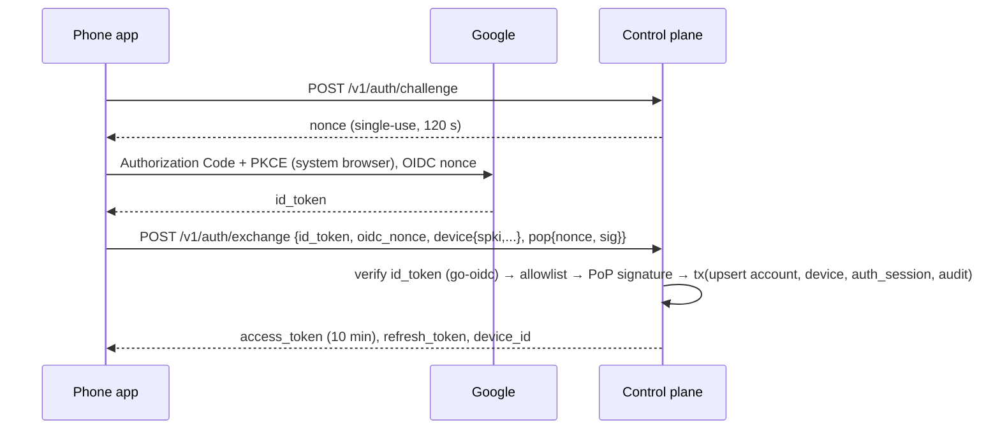
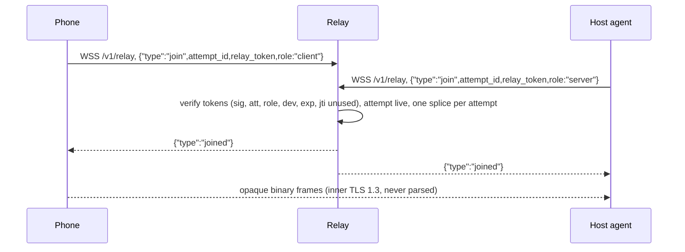

# Control Plane

> **Status:** Target design. This document describes how the service is meant to be built and is updated as it is implemented.
> **Location:** `services/control/` · **Binary:** `prw-control`

The control plane is a single Go service. It handles:

- account sign-in and device identity
- pairing
- phone-to-host access grants
- connection tickets and TURN credentials
- signaling, and a WebSocket byte relay used as a last-resort data path

It **never** sees terminal plaintext. Terminal data either flows directly between the peers, through coturn (still DTLS-encrypted), or through the WSS relay. On the relay path it is wrapped in an end-to-end TLS 1.3 stream that the relay only copies.

The packages are split so that the relay could later run as its own process without a rewrite.

---

## 1. Package layout

```text
services/control/
  cmd/prw-control/main.go     # subcommands: serve | migrate | keys (generate/rotate) | check-config
  internal/
    config/      env parsing + validation (fail fast), secret-file loading
    httpx/       router, middleware chain, error writer
    authn/       Google ID-token verification, access JWTs, refresh rotation, auth challenges, PoP verification
    keys/        Ed25519 signing key ring: load, rotate, publish, kid selection
    devices/     inventory, rename, revoke, presence derivation
    pairing/     challenge create/resolve/approve/complete, HMAC lookup, lockout
    grants/      grant CRUD, signed lease builder
    attempts/    connection-attempt authorization, ticket + relay-token minting, idempotency
    turncred/    TURN REST credential generation
    agentctl/    /v1/agent/control hub (handshake, heartbeat, lease push, attempts, revocations)
    signaling/   /v1/signaling router (attempt-scoped, pair-checked)
    relay/       /v1/relay splicer (opaque byte bridge, caps, metrics)
    sessions/    terminal-session metadata ingest + read APIs
    audit/       audit writer with per-event metadata allowlist; read API
    outbox/      transactional outbox worker
    retention/   pruning jobs
    ratelimit/   keyed token buckets
    presence/    in-memory registry of live agent/phone sockets
    store/       sqlc-generated queries (pgx v5), tx helper, embedded goose migrations
    obs/         slog setup + redaction, Prometheus registry and metric definitions
  queries/*.sql  # sqlc input
  sqlc.yaml
```

### Library choices

| Concern | Choice | Why |
|---|---|---|
| HTTP routing | stdlib `net/http` `ServeMux` (method + path patterns) | No dependency needed; middleware is plain `func(http.Handler) http.Handler` |
| WebSocket | `github.com/coder/websocket` | Maintained, context-aware |
| Database | `pgx/v5` + `pgxpool`, `sqlc`, `goose` (embedded) | Typed queries, no ORM, forward-only migrations |
| OIDC | `github.com/coreos/go-oidc/v3` | Standard Google ID-token verification with JWKS caching |
| JWS / JWT | `github.com/go-jose/go-jose/v4` | Vetted implementation; no hand-rolled JWS |
| IDs | `github.com/google/uuid` (UUIDv7) | Time-ordered primary keys |
| Rate limiting | `golang.org/x/time/rate` + keyed LRU | Single instance, so in-memory is enough |
| Metrics / logs | `prometheus/client_golang`, `log/slog` (JSON) | |

---

## 2. Configuration

Configuration comes from environment variables, and secrets are read from files. `prw-control check-config` validates everything and exits; deploys run it before restarting the service.

| Variable | Default | Validation |
|---|---|---|
| `PRW_PUBLIC_BASE_URL` | — (required) | https, no path |
| `PRW_LISTEN_ADDR` | `127.0.0.1:8080` | Fronted by Caddy |
| `PRW_METRICS_ADDR` | `127.0.0.1:9090` | Must not be public |
| `PRW_DATABASE_URL` / `PRW_DATABASE_URL_FILE` | — (required) | `sslmode=disable` only on local/Docker network |
| `PRW_GOOGLE_CLIENT_IDS` | — (required) | Comma list of accepted `aud` values (Android + iOS OAuth clients) |
| `PRW_ALLOWED_SUBJECTS` | — (required) | Comma list of `google:<sub>`. **If empty, the server refuses to start.** |
| `PRW_ACCESS_SIGNING_KEY_FILE`, `PRW_TICKET_SIGNING_KEY_FILE` | — (required) | Ed25519 PKCS#8, mode 0400/0600 |
| `PRW_PAIRING_HMAC_KEY_FILE` | — (required) | ≥ 32 bytes |
| `PRW_TURN_SHARED_SECRET_FILE` | — (required) | ≥ 32 bytes |
| `PRW_TURN_URLS`, `PRW_TURN_REALM` | — (required) | URLs parse |
| `PRW_TURN_CRED_TTL` | `10m` | 1–60 min |
| `PRW_RELAY_MAX_BPS` / `PRW_RELAY_MAX_BYTES` / `PRW_RELAY_MAX_SPLICES` | `2Mbit` / `2GiB` / `64` | |
| `PRW_ACCESS_TOKEN_TTL` | `10m` | |
| `PRW_REFRESH_TTL` | `30d` sliding / `90d` absolute | |
| `PRW_TICKET_TTL` | `60s` | |
| `PRW_LEASE_TTL` | `10m` | |
| `PRW_PAIRING_TTL` | `5m` | |
| `PRW_LOG_LEVEL` | `info` | |

---

## 3. HTTP stack and middleware

```text
recover → requestid → accesslog → bodylimit → ratelimit(ip) → authn → ratelimit(account/device) → handler
```

| Middleware | Behaviour |
|---|---|
| `requestid` | Accepts an inbound `X-Request-Id` matching `^[A-Za-z0-9_-]{8,64}$`, otherwise generates one. The ID is echoed in the response and attached to every log line and audit row. |
| `accesslog` | Records method, **route pattern** (not the raw path), status, duration, bytes, request ID and device ID. Never records query strings, `Authorization` or bodies. |
| `bodylimit` | 16 KiB by default, 4 KiB on `/v1/pairing/*`. JSON is decoded with `DisallowUnknownFields`. |
| `authn` | Verifies the bearer token: EdDSA signature against the key ring, `aud`, `exp` (60 s leeway) and `kid`. Then loads the device row (5 s cache, invalidated on revoke). A non-active device gets `403 device_revoked`. Account context comes **only** from token claims. |
| Headers | `Cache-Control: no-store` on all `/v1` responses. No CORS. WSS requests that carry an `Origin` header are rejected. |
| Timeouts | `ReadHeaderTimeout` 5 s, `ReadTimeout` 15 s (REST), `IdleTimeout` 60 s. |

### Rate limits (defaults, configurable)

| Key | Scope | Limit |
|---|---|---|
| IP | unauthenticated endpoints | 30/min, burst 10 |
| IP | `POST /v1/pairing/challenges` | 5 / 10 min, 50 / day |
| Account | `POST /v1/pairing/resolve` | 10 / 10 min; challenge locks after 5 failures |
| Phone | `POST /v1/connections` | 10/min, burst 3 |
| Device | `POST /v1/auth/refresh` | 6/min |
| Socket / attempt | signaling | 20 msg/s per socket; 100 msgs and 50 candidates per attempt |
| Account | all authenticated | 600/min |

A request over a limit gets `429` with `Retry-After`. It also increments a metric and writes a throttled `rate_limited` audit row.

---

## 4. Authentication

### 4.1 Google sign-in (the only identity provider)



**ID-token checks.** The server verifies the token with go-oidc and checks:

- `iss=https://accounts.google.com`
- `aud` is one of `PRW_GOOGLE_CLIENT_IDS`
- the signature against the cached Google JWKS
- `exp` (≤ 60 s skew)
- `nonce`
- `email_verified`, when an email is stored

**Allowlist.** The subject is `google:<sub>`. It is checked **before any account row is written**. A denial returns `403 account_not_allowed` and writes a `login_denied` audit row with a hashed subject. There is no open sign-up.

**New phones.** A newly signed-in phone needs no extra approval: Google sign-in plus the allowlist is sufficient. The phone is registered as a device with **zero grants** and cannot reach any host until the owner grants access.

### 4.2 Tokens

| Token | Format | Notes |
|---|---|---|
| Access | EdDSA JWT, 10 min | Claims `iss`, `aud=prw-api`, `sub=account_id`, `dev`, `kind`, `sid`, `kid`, `iat`, `exp`, `jti`. Held in phone memory only. |
| Refresh | 256-bit opaque; stored as SHA-256 | Rotated on each use. Reuse of an old token revokes the whole family. **Device-bound:** refresh requires `pop{nonce, sig}`, an ES256 JWS over JCS `{purpose:"prw.refresh.v1", …}` signed by the phone's device key. |
| Auth nonce | 32 random bytes, in-memory TTL map (hashed) | Lost on restart; the client simply requests a new one. |
| Agent session | Authenticated control socket | Signed challenge on connect, re-challenged every 15 min. |

`POST /v1/auth/logout` revokes only the current phone's auth session.

### 4.3 Signing keys and rotation

There are two key purposes:

- **`access`**, for access JWTs
- **`ticket`**, for tickets, leases, relay tokens and `jwks.update`

Each purpose has one **active** key and up to two **verify-only** keys. Private keys exist only as files provisioned from the secret store.

To rotate the ticket key (`prw-control keys rotate --purpose ticket`):

1. Generate the new key and deploy it as verify-only.
2. Push `jwks.update`, signed by the currently pinned key, to all agents. Agents pin the new `kid`.
3. Once agents have acknowledged and at least 24 h have passed, promote the new key to active.
4. Retire the old key after the longest token lifetime has passed.

Agents that were offline during a rotation receive the current key set in `auth.ok` on their next connect.

Rotating the access key only needs a short overlap, because access tokens live for 10 minutes.

---

## 5. Domain services

### 5.1 Devices and presence

- `presence.Registry` maps each device ID to its live sockets and last heartbeat (monotonic clock).
- `last_seen_at` is persisted at most once per 60 s per device.
- Presence is reported as online, stale or offline; the default thresholds are 75 s and 150 s.
- Presence is **derived** from the registry, falling back to the database after a restart. It is never stored as an administrative status.
- **Revoke** runs one transaction that updates the device, revokes its grants and auth sessions, writes an audit row and writes an outbox row. After commit the service also pushes immediately in process; the outbox guarantees delivery if the process crashes in between.

### 5.2 Pairing

| Item | Value |
|---|---|
| `pairing_ref` | 16 random bytes, base64url (embedded in the QR code) |
| `display_code` | 8 chars of Crockford base32 from `crypto/rand`, shown as `XXXX-XXXX` |
| `wait_token` | 32 bytes; authenticates the host's `/wait` and `/complete` calls |
| Storage | HMAC-SHA-256 with a server pepper; raw values are never stored |
| TTL | 5 min. A sweeper moves stale challenges to `expired` every minute. |

The flow:

1. The host creates a challenge without authentication; this endpoint is rate-limited by IP.
2. The phone resolves the challenge by `pairing_ref` or by `display_code`.
3. The phone approves.
4. The host's long-poll on `GET /v1/pairing/challenges/{id}/wait` (25 s hold) returns `nonce2`.
5. The host signs completion, and the server consumes the challenge in a single row-locked transaction.

### 5.3 Grants and leases

Grants are explicit phone→host records with the `terminal` capability and an optional `expires_at`. `grants.LeaseFor(host)` builds a **signed** lease (EdDSA JWS over JCS):

```json
{"lease_id":"…","expires_at":"now+10m",
 "grants":[{"grant_id":"…","phone_device_id":"…","phone_key_spki":"…","caps":["terminal"],"grant_expires_at":null}]}
```

The lease is pushed:

- on agent `auth.ok`
- on any grant or device change that affects the host
- every 3 minutes, as a renewal

The agent verifies the signature against its pinned keys.

### 5.4 Connection attempts, tickets and relay tokens

`POST /v1/connections` re-reads authorization from the database every time; nothing is cached. It checks:

- the account
- that both devices are active
- an active, unexpired grant with `terminal`
- that the host is online
- the agent version
- rate limits

It then mints:

| Artifact | Contents |
|---|---|
| **Ticket** | Compact JWS, `alg=EdDSA`, `typ=prw-ticket+jwt`. Claims: `iss`, `aud=host`, `sub=phone`, `acct`, `att`, `cap`, `sess?`, `nonce`, `jti`, `iat`, `nbf`, `exp=+60s`, `pv`. Only the `jti` is persisted. |
| **Relay tokens** | One per role (`client`, `server`). Claims: `att`, `role`, `dev`, `exp=+90s`, single-use `jti`. Valid only on `/v1/relay`. |
| **ICE servers** | STUN plus TURN UDP, TCP and TLS-on-443 URLs, with ephemeral credentials. |

The host receives `attempt.incoming` over its control socket; this carries the ticket, the server-role relay token, the ICE servers and a hash of the attestation nonce.

Attempt status is updated from three sources:

- the phone, via `PATCH /v1/connections/{id}`
- the host, via `attempt.status`
- relay events

Every transition is validated against the attempt state machine.

### 5.5 TURN credentials (coturn `use-auth-secret`)

```text
username   = "<unix_expiry>:<attempt_id>"
credential = base64(HMAC-SHA1(TURN_SHARED_SECRET, username))
```

- HMAC-SHA1 is what coturn's REST credential mechanism specifies. It authenticates relay allocations only; confidentiality comes from DTLS.
- Because the username embeds the attempt ID, coturn logs can be correlated with attempts without any user data.
- Secret rotation: add the new `static-auth-secret` to coturn and reload, switch issuance to the new secret, wait one TTL, then remove the old secret.

### 5.6 Signaling hub

**Phones** connect to `/v1/signaling`. The first frame must be `{"type":"auth","access_token":…}`; anything else closes the socket with 4401. **Agents** multiplex signaling over their control socket.

The envelope is `{v, message_id, attempt_id, to_device_id, type, sent_at, payload}`. Rules:

- `from_device_id` is always derived from the socket. Any client-supplied value is overwritten.
- `(from, to)` must be the phone/host pair of a live, unexpired attempt.
- Types: `offer`, `answer`, `ice_candidate`, `ice_complete`, `tls_fingerprint`, `attempt_cancel`. The server additionally emits `attempt_status` and `revoke_notice`.
- Each message is validated against a JSON Schema. `message_id` is deduplicated with an LRU of 1024 entries per socket.
- Limits: 64 KiB per frame, 100 messages per attempt, 20 messages per second, 50 candidates per attempt. Exceeding them closes the attempt with `signaling_limit` (4429).
- Messages for a peer that has not joined yet are buffered (≤ 32 messages, ≤ 15 s).
- Phone sockets idle with no attempt are closed after 60 s.
- SDP is never logged; only a hash and per-type counters.

### 5.7 WSS relay splicer



Two goroutines copy binary WebSocket messages unchanged.

| Limit | Value |
|---|---|
| Join wait | 15 s |
| Idle | 120 s |
| Message size | ≤ 64 KiB |
| Per-attempt rate | token bucket at `PRW_RELAY_MAX_BPS` (2 Mbit/s) |
| Per-attempt total | 2 GiB |
| Concurrent splices | 16 per account; global `PRW_RELAY_MAX_SPLICES` (503 `relay_unavailable` before upgrade when full) |
| Buffering | ≤ 1 MiB per direction |

A revoke closes the splice for the affected attempt with code 4403.

### 5.8 Agent control hub (`/v1/agent/control`)

**Handshake.**

1. The server sends `auth.challenge`.
2. The agent replies with `auth.response`: an ES256 JWS over JCS with purpose `prw.agent.v1`.
3. The server sends `auth.ok`, then `grant.lease` and `jwks.update`.

The socket is re-challenged every 15 minutes. One socket per host is allowed: a newer socket supersedes the old one, which is closed with 4400. A revoked device is closed with 4403.

| Direction | Messages |
|---|---|
| Agent → server | `heartbeat` (25 s), `session.event` (metadata only), `attempt.status`, signaling, `revoke_notice.ack` |
| Server → agent (allowlist) | `auth.*`, `heartbeat.ack`, `attempt.incoming`, `attempt.cancel`, `grant.lease`, `revoke_notice`, `jwks.update`, `pairing.approved`, `server.notice`, relayed signaling |

On SIGTERM the server broadcasts `server.notice{kind:"shutdown", reconnect_after_ms}` with a 1–5 s jitter to avoid a reconnect stampede.

### 5.9 Outbox worker

- Every 500 ms it claims pending rows with `SELECT … FOR UPDATE SKIP LOCKED LIMIT 50` and hands them to the in-process notifier, which pushes to connected sockets.
- Targets that are offline are covered by the lease plus fresh authorization checks.
- Failed deliveries back off exponentially. After 20 attempts a row is dead-lettered, which raises an alert.

### 5.10 Audit

`audit.Write(ctx, Event{Type, Outcome, Reason, Actor, Target, Meta})`:

- Metadata passes a **per-event-type key allowlist**. Unknown keys are dropped and counted, and values are capped at 128 bytes.
- The audit row is written in the same transaction as the mutation.
- Event types: `login`, `login_denied`, `logout`, `refresh_reuse`, `device_enrolled`, `device_renamed`, `device_revoked`, `pairing_created`, `pairing_failed`, `pairing_locked`, `grant_created`, `grant_updated`, `grant_revoked`, `connection_attempt`, `connection_denied`, `peer_identity_failed`, `session_started`, `session_attached`, `session_detached`, `session_terminated`, `rate_limited`, `key_rotated`.

Terminal input, terminal output, tokens, pairing secrets and SDP are never written.

### 5.11 Retention jobs

The jobs run on an in-process ticker and take a Postgres advisory lock.

| Data | Retention (default) |
|---|---|
| Pairing challenges | 24 h after expiry or use |
| Connection attempts | 30 d |
| Terminal session metadata | 90 d |
| Audit events | 180 d |
| Expired or revoked auth sessions | 30 d |
| Idempotency keys | 24 h |
| Processed outbox rows | 7 d |

---

## 6. Observability

### Logging

- slog JSON goes to stdout and is picked up by journald.
- A redaction handler only lets allowlisted attribute keys through.
- Request logs carry `request_id`, `route`, `status`, `dur_ms` and `device_id`.
- Error logs include the error chain, never bodies.

### Metrics

Metrics are served on `127.0.0.1:9090/metrics` only.

| Metric | Type | Labels |
|---|---|---|
| `prw_http_requests_total` | counter | `route`, `method`, `code` |
| `prw_http_request_duration_seconds` | histogram | `route` |
| `prw_ws_connections` | gauge | `endpoint` |
| `prw_agents_online` | gauge | — |
| `prw_signaling_messages_total` | counter | `type`, `result` |
| `prw_attempts_total` | counter | `outcome` |
| `prw_attempt_connect_seconds` | histogram | `path_type` |
| `prw_relay_bytes_total` | counter | `direction` |
| `prw_relay_active_splices` | gauge | — |
| `prw_relay_splice_duration_seconds` | histogram | — |
| `prw_turn_credentials_issued_total` | counter | — |
| `prw_pairing_total` | counter | `outcome` |
| `prw_revocations_total` | counter | `scope` |
| `prw_revoke_propagation_seconds` | histogram | — |
| `prw_ratelimit_hits_total` | counter | `bucket` |
| `prw_outbox_pending`, `prw_outbox_dead_letters` | gauge | — |
| `prw_db_pool_acquire_seconds` | histogram | — |
| `prw_audit_dropped_keys_total` | counter | `event_type` |
| `prw_build_info` | gauge | `version`, `commit` |

Device IDs are never used as metric labels.

### Correlation

The **connection attempt ID** is the cross-component correlation key. It appears in:

- phone diagnostics
- agent logs
- coturn usernames
- relay logs
- audit rows

This makes a failed connection investigable without any terminal data.

---

## 7. Error mapping

Domain errors are typed values:

```go
var ErrGrantMissing = apperr.New("access_grant_missing", http.StatusForbidden, false,
    "This phone is not authorized to open a terminal on this computer.")
```

`httpx.WriteError` renders this envelope:

```json
{"error":{"code":"access_grant_missing","message":"…","retryable":false,"request_id":"req_…","details":{}}}
```

- Unmapped errors become `internal_error` (500). The cause is logged with the request ID and never returned to the client.
- Lookups of another account's resources always map to `not_found`, so callers cannot enumerate resources.

| Code | HTTP |
|---|---|
| `unauthenticated` | 401 |
| `account_not_allowed`, `device_revoked`, `access_grant_missing` | 403 |
| `not_found` / `host_not_owned` | 404 |
| `pairing_expired`, `pairing_used`, `pairing_locked`, `attempt_expired`, `attempt_canceled`, `agent_offline`, `invalid_transition`, `precondition_failed` | 409 (`precondition_failed` 412) |
| `unsupported_agent_version` | 426 |
| `rate_limited`, `host_capacity_reached` | 429 |
| `relay_unavailable` | 503 |
| `internal_error` | 500 |

---

## 8. Process model

- The service is a single process; every goroutine is tied to a root context.
- **SIGTERM** sends WSS shutdown notices, then `http.Server.Shutdown` drains for up to 20 s, and the outbox worker stops last.
- **pgxpool** allows at most 20 connections.
- **`store.WithTx(ctx, fn)`** retries serialization failures and deadlocks up to 3 times.
- **Authorization** is never cached for more than 5 s, and ticket issuance always re-reads the database.

---

## 9. Testing

| Layer | Coverage |
|---|---|
| Unit | Config validation matrix. Token issue/verify (bad `kid`, `alg` confusion, expiry). Refresh rotation and reuse detection. Pairing-code normalisation. TURN credential vector. Rate-limit buckets. Audit allowlist. Presence thresholds. Error mapping. |
| Integration (testcontainers Postgres) | Every endpoint, happy path and error path. Pairing race (parallel complete). Grant uniqueness. Idempotent attempts. Outbox delivery and dead-lettering. Retention jobs. Migration up, down, up. OpenAPI response validation. |
| Integration (WSS) | Agent handshake (bad signature, revoked, superseded). Lease push on grant change. Signaling: wrong pair, duplicate `message_id`, expired attempt. Relay: mismatched attempt, replayed token, third socket, rate and byte caps, revoke closes the splice. |
| Security | Two-account isolation matrix generated from the route table. Forged `from_device_id`. Oversize bodies and frames. Unknown fields. Pairing brute force reaches lockout. Ticket replay. Revoked-device token rejected within 5 s. Log-capture test (no tokens, codes, SDP or IPs). |
| Load | 100 heartbeating agents, 20 attempts/s with signaling bursts, 32 relay splices at 2 Mbit/s. |
| Fuzz | JSON decoders for all WS messages, the ticket parser, the pagination cursor decoder. |
| Static | `go vet`, `staticcheck`, `govulncheck`, `gosec`, `sqlc vet`. |
