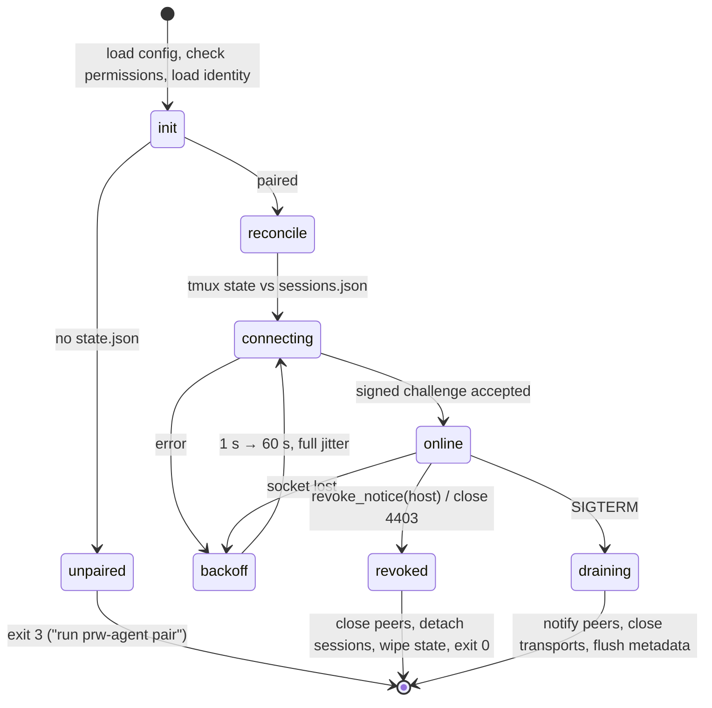
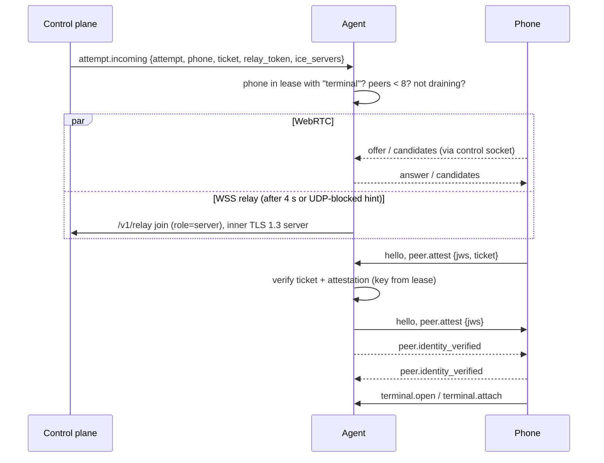

# Host Agent

> **Status:** Target design. This document describes intended behaviour and is updated as the agent is implemented.
> **Location:** `agents/host/` · **Binary:** `prw-agent` · **Platforms:** Linux amd64/arm64 (Ubuntu 22.04 / 24.04 baseline)

The host agent is a small, **non-root** daemon running on each Linux computer. Its jobs:

- Enroll the computer.
- Keep an authenticated outbound control connection to the control plane.
- Accept phone connections, but only after verifying the ticket, the signed grant lease and the peer's identity.
- Bridge terminal streams to persistent tmux sessions.

It is built as a static Go binary (`CGO_ENABLED=0`).

## Principles

| Principle | Consequence |
|---|---|
| Never root | Runs as the user's `systemd --user` service with lingering enabled. Refuses to start when `euid == 0`. |
| Fail closed | No PTY without a valid lease, ticket, attestation and local policy match. |
| Process lifetime ≠ connection lifetime | tmux runs outside the agent's cgroup. Restarting or upgrading the agent never kills a session. |
| No terminal content leaves the data channel | Logs, metrics and the control socket carry metadata only. |
| No shell string building | Every process is started with `exec.Command(argv...)`. The shell comes from the passwd entry and must be listed in `/etc/shells`. |

---

## 1. Package layout

```text
agents/host/
  cmd/prw-agent/main.go
  internal/
    config/     load + validate TOML, XDG paths, defaults
    identity/   P-256 key generation/loading (0600), fingerprint, signer
    enroll/     pairing flow, terminal QR rendering, key pinning
    control/    control WSS client: auth, heartbeat, lease, attempts, revocations, signaling
    lease/      grant-lease cache (memory + on-disk snapshot)
    ticket/     EdDSA ticket verification against pinned keys, jti replay cache
    peer/       per-attempt peer manager on top of prwcore (WebRTC + WSS relay)
    session/    Manager, tmux backend, PTY backend, reconciliation, limits
    term/       PTY attach bridge, framing, credit flow control
    policy/     local policy (shell, max sessions, idle rules)
    redact/     slog handler with allowlisted attributes
    doctor/     environment checks
  packaging/    nfpm.yaml, prw-agent.service, maintainer scripts, man page
```

The transport, framing and attestation code comes from the shared core (see [prwcore](prwcore.md)).

---

## 2. CLI

| Command | Purpose |
|---|---|
| `prw-agent pair [--api URL] [--name NAME]` | Creates the identity key if it is missing and opens a pairing challenge. Prints a QR code, an 8-character code and the full key fingerprint. Long-polls for approval for up to 5 min, then completes with a signed proof of possession and pins the server's verification keys. Refuses if already paired unless `--force-reenroll` is passed, which creates a new key and therefore a new device. |
| `prw-agent run` | Foreground daemon; this is what the systemd unit executes. |
| `prw-agent status` | Paired state, device ID, fingerprint, control-connection state, lease expiry, sessions and version compatibility. Talks to the daemon over `$XDG_RUNTIME_DIR/prw/agent.sock` (0600, peer UID checked). |
| `prw-agent sessions [list \| kill ID]` | Local session administration. The computer's owner always has local authority. |
| `prw-agent logs [-f]` | Wraps `journalctl --user -u prw-agent`. |
| `prw-agent doctor` | Checks tmux ≥ 3.0, linger, the user manager, clock skew (< 30 s), DNS, outbound 443, TURN UDP 3478, TURN-TLS 443, key permissions and protocol compatibility. Prints a fix for each failure. |
| `prw-agent unpair` | Revokes this device on the server (signed request) and deletes local state. Asks before killing any PRW tmux sessions; the default is no. |
| `prw-agent install-service` / `uninstall-service` | Installs and enables the user unit, and prompts for `sudo loginctl enable-linger $USER`, the only privileged step. |
| `prw-agent version` | Version, supported protocol range and commit. |

---

## 3. Configuration and files

| Path | Content | Mode |
|---|---|---|
| `$XDG_CONFIG_HOME/prw/agent.toml` | User configuration | 0600 |
| `$XDG_CONFIG_HOME/prw/identity.key` | ECDSA P-256 private key, PKCS#8 PEM | 0600 (directory 0700) |
| `$XDG_STATE_HOME/prw/state.json` | Device ID, account ID, pinned verification keys, API URL | 0600 |
| `$XDG_STATE_HOME/prw/sessions.json` | Session ID → tmux handle and metadata; written atomically via rename | 0600 |
| `$XDG_STATE_HOME/prw/lease.json` | Last verified grant lease, so an agent restart during a control-plane outage still honours an unexpired lease | 0600 |
| `$XDG_RUNTIME_DIR/prw/tmux.sock` | Private tmux server socket | 0600 (directory 0700) |
| `$XDG_RUNTIME_DIR/prw/agent.sock` | Local admin socket | 0600 |

The agent refuses to start if the key or state files are readable by group or others.

```toml
# ~/.config/prw/agent.toml
api_url = "https://api.example.invalid"
display_name = "workstation"

[terminal]
backend = "auto"              # auto | tmux | pty
default_shell = ""            # empty = passwd shell (must be in /etc/shells)
start_dir = "~"
max_sessions = 20
idle_detached_ttl = "0"       # 0 = never auto-kill detached sessions
env_allowlist = ["LANG", "LC_ALL", "TZ"]

[limits]
max_attached_streams = 8
output_buffer_bytes = 1048576

[policy]
allow_concurrent_attach = true
on_revoke = "detach"          # revocation closes connections; tmux sessions keep running
lease_grace = "10m"

[log]
level = "info"
```

---

## 4. systemd user unit

```ini
# /usr/lib/systemd/user/prw-agent.service
[Unit]
Description=Private Remote Workspace host agent
After=network-online.target
Wants=network-online.target

[Service]
Type=notify
ExecStart=/usr/bin/prw-agent run
Restart=on-failure
RestartSec=2s
RestartPreventExitStatus=0
# Only the agent process is stopped on restart; tmux lives in its own scope (§6.2).
KillMode=process
TimeoutStopSec=10s
WatchdogSec=60s
NoNewPrivileges=yes
LockPersonality=yes
RestrictRealtime=yes
SystemCallArchitectures=native
MemoryMax=512M
TasksMax=256
UMask=0077

[Install]
WantedBy=default.target
```

Notes on the unit:

- `loginctl enable-linger` keeps the user manager running without a login session, which keeps the agent and tmux alive. `doctor` verifies that it is enabled.
- `ProtectHome` and `PrivateTmp` are deliberately **not** set. Shells must see the real home directory, and they are not children of this unit anyway.
- `systemctl --user restart prw-agent` must leave every tmux session alive. This is covered by an integration test.

---

## 5. Lifecycle



| Signal | Behaviour |
|---|---|
| `SIGTERM` / `SIGINT` | Graceful drain within 10 s. Peers are told the session was detached, `sessions.json` is flushed, and tmux is untouched. |
| `SIGHUP` | Reload limits and log level. Changes to identity or API URL need a restart. |
| `SIGQUIT` | Goroutine dump to the journal. Contains no terminal content. |

---

## 6. Session manager

```go
type Backend interface {
    Name() string     // "tmux" | "pty"
    Persistent() bool
    Create(ctx context.Context, spec SessionSpec) (Handle, error)
    Attach(ctx context.Context, h Handle, cols, rows int) (Stream, error) // io.ReadWriteCloser + Resize
    List(ctx context.Context) ([]Handle, error)
    Terminate(ctx context.Context, h Handle, grace time.Duration) (exitCode *int, err error)
    Status(ctx context.Context, h Handle) (State, error) // running | exited(code) | gone
}
```

### 6.1 tmux backend (default when tmux ≥ 3.0)

The agent runs its own tmux server on a private socket. The user's own tmux server is never touched, and only sessions named `prw-<uuid>` are managed.

| Operation | Command (argv; never via a shell) |
|---|---|
| Server options | `tmux -S $SOCK -f /dev/null start-server`, then `set -g`: `default-terminal tmux-256color`, `history-limit 50000`, `window-size latest`, `remain-on-exit on`, `status off`, `set-titles off`, `escape-time 10`, `allow-passthrough off`, `set-clipboard off` |
| Create | `tmux -S $SOCK new-session -d -s prw-<uuid> -x C -y R -c <dir> -e TERM=… -- <shell> -l` |
| Attach | Allocate a PTY (`creack/pty`), set its size, and run `tmux -S $SOCK attach-session -t prw-<uuid>` on it. Bridge the PTY bytes to the terminal stream. tmux repaints the full screen on attach, so the screen is correct after a reconnect. |
| Detach | Close the attach PTY. The tmux client exits and the session keeps running. |
| Resize | `pty.Setsize` (`TIOCSWINSZ`) on the attach PTY. With `window-size latest`, tmux follows the most recent client. |
| List / status | `list-sessions -F '#{session_name}\t#{session_created}\t#{session_attached}\t#{pane_dead}\t#{pane_dead_status}\t#{pane_pid}'` |
| Terminate | `kill-session` (sends SIGHUP to the pane process group). If the process is still alive after 5 s, send SIGKILL to the `pane_pid` group. |
| Exit detection | When `pane_dead=1`, read `pane_dead_status`, report `exited(code)`, then kill the dead session. |

Several phones may attach to the same session at once, and every attached phone can type.

### 6.2 Process isolation

The tmux server is started inside its own transient scope:

```text
systemd-run --user --scope --unit=prw-tmux --slice=prw.slice -p MemoryMax=… -p TasksMax=… tmux -S $SOCK …
```

Shells therefore live in `prw.slice`, outside the agent's cgroup. Restarting the agent cannot reap them, and optional per-slice limits apply. The limits are unlimited by default, because coding agents need memory. If `systemd-run` is unavailable, the agent falls back to `setsid` and `doctor` prints a warning.

### 6.3 PTY fallback (no tmux)

When tmux is unavailable, the agent spawns the shell directly on a PTY (`Setsid`, `Setctty`). It keeps a 256 KiB output ring buffer and supports detach and reattach. On reattach it replays the ring buffer after `ESC c`; this replay is best effort.

These sessions are reported with `persistent: false` and **do not survive an agent restart**; the app labels them "non-persistent". On shutdown the agent sends SIGHUP to each PTY process group.

### 6.4 Reconciliation

Reconciliation runs on start and every 60 s:

1. Compare `tmux list-sessions` with `sessions.json`.
2. Adopt any unknown `prw-*` sessions as `detached`. This covers recovery after an agent crash.
3. Mark sessions that are known but missing as `exited`. If `/proc/sys/kernel/random/boot_id` changed, mark them `host_rebooted` instead.
4. Send the differences to the server as `session.event` metadata.

Sessions do not survive a host reboot.

### 6.5 Limits

| Limit | Default | Enforced in |
|---|---|---|
| Sessions per host | 20 | Manager `Create` → `host_capacity_reached` |
| Attached streams per host | 8 | Peer layer |
| Concurrent peer connections | 8 | Peer layer |
| Output buffer per stream | 1 MiB | Term bridge (stops reading the PTY when full) |
| Control message size | 16 KiB | prwcore |
| Session creation rate | 10/min per phone | Manager |

---

## 7. Control connection

| Aspect | Design |
|---|---|
| Transport | `coder/websocket` to `wss://api.example.invalid/v1/agent/control`, subprotocol `prw.v1`, system TLS roots. No credentials in the URL. |
| Auth | The server sends `auth.challenge{nonce}`. The agent replies `auth.response{device_id, sig, agent_version, proto{min,max}}`, where `sig` is an ES256 JWS over JCS `{purpose:"prw.agent.v1", nonce, device_id, iat}`. The server answers `auth.ok`, then `grant.lease` and `jwks.update`. The server re-challenges every 15 min, and every reconnect does full re-authentication. |
| Inbound allowlist | `auth.*`, `heartbeat.ack`, `attempt.incoming`, `attempt.cancel`, `grant.lease`, `revoke_notice`, `jwks.update`, `pairing.approved`, `server.notice`, plus signaling for this host's live attempts. Any other type is dropped and logged as a security event. |
| Heartbeat | Every 25 s: `{sessions_count, tmux_available, agent_version, peers}`. |
| Backoff | 1 s, doubling to a 60 s cap, with full jitter. Reset after 60 s of stable connection. |
| Signaling | `offer`, `answer`, `ice_candidate`, `ice_complete`, `tls_fingerprint` and `attempt_cancel` are multiplexed on the control socket. |
| Key rotation | `jwks.update` is accepted only over the authenticated socket and only when signed by a currently pinned key. |

### 7.1 Grant lease

The server pushes `grant.lease` on connect, on any grant or device change, and every 3 minutes. The lease is an **EdDSA-signed** document that lists, for each permitted phone, its device ID, its public key and its capabilities. It expires 10 minutes after issue.

The agent:

- Verifies the lease signature against the pinned keys, replaces its cache atomically and persists it to `lease.json`.
- Uses **only the phone key in the lease**, never a key supplied by the peer, to verify phone attestations.
- Re-checks every 30 s, and on every lease update, that each connected phone is still listed. If a phone is no longer listed, it sends `session.revoked` and closes that phone's connection.

**Control-plane outage.** Existing connections continue until the lease expires. After that the agent refuses `terminal.open` and `terminal.attach` with `lease_expired` and closes its peers. tmux sessions keep running. New connections are impossible while the control plane is down, because both signaling and the relay depend on it.

### 7.2 Revocation

When the agent receives `revoke_notice{scope, ids, dedupe_key}`:

1. Update the lease cache immediately.
2. Send `session.revoked` to, and close, every connection belonging to the revoked phone or grant. If the host itself was revoked, close every connection. The target is under 1 s, and the hard limit is 30 s.
3. **Detach** the affected tmux sessions. They are not killed; processes keep running and remain reachable from phones that are still authorized.
4. Acknowledge with `revoke_notice.ack{dedupe_key}`.

---

## 8. Accepting a connection

The wire details are specified in [protocol.md](../technical/protocol.md).



### Ticket checks

The ticket's signature must verify against a pinned `kid`, and all of these must hold:

- `aud` is this host, `sub` is the phone, `att` is this attempt.
- `cap` is `terminal`.
- `nbf` and `exp` are valid within ±30 s.
- The `jti` has not been seen before; seen values are cached until `exp + 30 s`.
- `sub` is in the lease.
- `pv` is supported.

Any failure → `ticket_invalid`.

### Attestation checks

- The ES256 JWS verifies with the phone key from the lease.
- `att`, `nonce`, `from` and `to` match.
- The attested certificate fingerprint equals the one actually observed on the transport.

Any failure → `peer_identity_mismatch`.

Until both sides have sent `peer.identity_verified`, any message other than the handshake causes `protocol_error` and the connection is closed. Every failure is also reported to the server as `attempt.status{failed, failure_code}`.

---

## 9. Terminal bridge and flow control

- One peer connection carries one control stream and N terminal streams. Every frame has a 12-byte header and a payload of at most 16 KiB.
- **PTY → phone.** The agent reads from the PTY only while it holds OUTPUT credit. The phone grants 256 KiB windows and re-grants as it renders. With no credit the agent stops reading. The kernel PTY buffer then fills and tmux blocks writes to that one client; the process and other attached clients are unaffected, and tmux's scrollback keeps all output. No bytes are dropped, and agent memory stays at or below 1 MiB per stream.
- **Phone → PTY.** Input frames are written to the PTY master. The agent grants 64 KiB of INPUT credit and re-grants once those bytes have been written.
- Bytes pass through unchanged. The agent performs no UTF-8 or escape-sequence processing.

---

## 10. Logging and privacy

- slog writes JSON to stdout, which goes to the journal.
- A redaction handler only emits allowlisted attribute keys:
  - `attempt_id`, `session_id`, `device_id`
  - `path_type`, `reason`, `duration_ms`
  - `bytes_in`, `bytes_out`
  - `cols`, `rows`, `backend`
  - `exit_code`, `error_code`
- **Never logged:** tickets, tokens, nonces, signatures, SDP, candidate IPs, environment variables, argv beyond the shell's basename, working directories, terminal bytes. Candidate *types* can be logged at debug level behind `--debug-network`.
- A unit test pushes marked secrets through every log site and asserts that none of them appear in the output.

---

## 11. Packaging, release and upgrades

| Item | Design |
|---|---|
| Build | `goreleaser`, linux/amd64 + linux/arm64, `-trimpath`, version injected at build time |
| Packages | `.deb` (via `nfpm`) containing `/usr/bin/prw-agent`, `/usr/lib/systemd/user/prw-agent.service`, a man page and the licence. `tmux (>= 3.0)` is *Recommends*. A tarball is also published. |
| Signing | `SHA256SUMS` signed with minisign, plus an SPDX SBOM (syft). The verification command is documented in the install guide. |
| Install | Download the `.deb` → verify the signature → `sudo apt install ./prw-agent_*.deb` → `prw-agent install-service` → `prw-agent pair`. There is no `curl \| sh` installer. |
| Upgrade | Manual for now: install the new package, then `systemctl --user restart prw-agent`. Sessions survive the restart. The agent reports its version in every heartbeat, and the server flags agents older than N−1. |
| Compatibility | The server supports protocol versions N and N−1. An agent that is too old is rejected with `426`; it keeps retrying with backoff, and `status` explains why. |

Automatic updates, with a signed manifest and rollback, are planned for later.

---

## 12. Testing

| Layer | Coverage |
|---|---|
| Unit | Config validation, file-permission checks, the ticket verification table (bad signature, wrong `aud`/`sub`/`att`/`cap`, expiry, skew, replay, unknown `kid`), lease expiry, attestation (including fingerprint mismatch), frame codec golden vectors, credit accounting, redaction, backoff. |
| Integration (real tmux) | Create, attach, `echo`, detach, reattach and compare the screen. Resize, then `stty size`. Terminate with an exit code. A 50 MB flood with a slow consumer (bounded memory, checksum intact). Reconciliation after `kill -9`. Agent restart under `systemd --user` keeps sessions. PTY fallback when tmux is absent. |
| Integration (with control plane) | Pair a headless agent through an API-driven phone simulator. Lease delivery. Revoke closes the peer in under 30 s. Lease expiry during a simulated outage. An attempt for an ungranted phone is rejected. A tampered lease or key update is rejected. |
| Security | Refuses root. Refuses a world-readable key. Cross-host session IDs are rejected. Messages before `identity_verified` are rejected. Oversized frames are rejected. Session titles containing shell metacharacters stay inert. |
| Performance | Idle RSS ≤ 64 MiB. Echo latency over loopback. 8 concurrent streams under flood. |
| Operations | `doctor` on clean Ubuntu 22.04 and 24.04. Package install, upgrade and uninstall. Warning when linger is missing. |
| Fuzz | Frame decoder, control JSON decoder, ticket parser, tmux `list-sessions` parser. |
