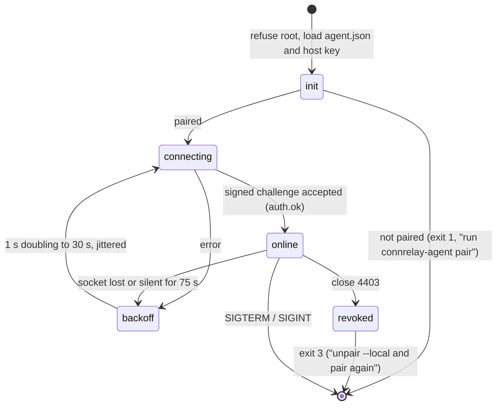

# Host Agent

> **Status:** Implemented for V1 and in daily use. Items still on the roadmap are marked **(planned)**; everything else describes the code as it is.
> **Location:** `agents/host/` · **Binary:** `connrelay-agent` · **Platforms:** Linux amd64/arm64 (Ubuntu 22.04 / 24.04 baseline)

The host agent is a small, **non-root** daemon running on each Linux computer. Its jobs:

- Enroll the computer.
- Keep an authenticated outbound control connection to the control plane.
- Accept phone connections, but only after verifying the ticket, the signed grant lease and the peer's identity.
- Bridge terminal streams to persistent tmux sessions.

It is a single Go binary (`go build ./agents/host/cmd/connrelay-agent`).

## Principles

| Principle | Consequence |
|---|---|
| Never root | Runs as the user, normally as a `systemd --user` service. `connrelay-agent run` refuses to start when `euid == 0`. |
| Fail closed | No PTY without a valid lease, ticket, attestation and local policy match. |
| Process lifetime ≠ connection lifetime | tmux is a separate server process and the unit uses `KillMode=process`, so restarting or upgrading the agent never kills a session. |
| No terminal content leaves the data channel | Logs, metrics and the control socket carry metadata only. |
| No shell string building | Every process is started with `exec.Command(argv...)`. The shell is `$SHELL -l` (falling back to `/bin/sh`). Checking it against `/etc/shells` is **(planned)**. |

---

## 1. Package layout

```text
agents/host/
  cmd/connrelay-agent/main.go   # CLI: pair | run | status | unpair --local | version
  internal/
    agentcfg/    config directory, P-256 host key (0600), agent.json state (server, device, pinned JWKS)
    pairclient/  pairing flow against /v1/pairing/*, terminal QR rendering
    runtime/     control-socket client: auth, heartbeat, silence detection, lease, attempts, revocations, signaling
    lease/       verified grant-lease cache
    termserver/  terminal protocol server for one verified peer (open, attach, list, terminate, detach)
    termstream/  PTY ↔ data-channel stream bridge with credit flow control
    tmux/        private tmux server: create, attach, list, kill
    ptyproc/     PTY process start and resize (dimensions clamped to 1–1000)
  packaging/     connrelay-agent.service (systemd --user unit), install.sh
```

The transport, framing, attestation, ticket and connection-manager code comes from the shared core (see [connrelaycore](connrelaycore.md)).

---

## 2. CLI

| Command | Purpose |
|---|---|
| `connrelay-agent pair --server URL [--name NAME] [--json]` | Creates the identity key if it is missing and opens a pairing challenge. Prints a QR code, an 8-character code and the key fingerprint, then long-polls until the phone approves (the challenge expires after 5 min). Completes with a signed proof of possession and saves the server URL, device ID and pinned verification keys. `--server` must be https (plain http only for loopback). `--json` prints the challenge for automation. Refuses if already paired. |
| `connrelay-agent run` | Foreground daemon; this is what the systemd unit executes. Exits with status 3 if the computer was revoked. |
| `connrelay-agent status` | Paired state, server, device ID and key fingerprint. |
| `connrelay-agent unpair --local` | Forgets the enrolment on this machine. Revoke the computer from the app first. |
| `connrelay-agent version` | Version. |

`sessions`, `logs`, `doctor`, `install-service` and a server-side `unpair` are **(planned)**.

---

## 3. Configuration and files

| Path | Content | Mode |
|---|---|---|
| `$XDG_CONFIG_HOME/connrelay/host_key.pem` (default `~/.config/connrelay/`) | ECDSA P-256 private key | 0600 (directory 0700) |
| `$XDG_CONFIG_HOME/connrelay/agent.json` | Server URL, control WebSocket URL, device ID, account ID, pinned ticket-key JWKS | 0600 |
| `$XDG_RUNTIME_DIR/connrelay/tmux.sock` | Private tmux server socket | 0600 (directory 0700) |

`CONNRELAY_AGENT_CONFIG_DIR` overrides the configuration directory (tests, several agents on one machine). The agent has no configuration file yet: limits are code constants (§6.3). A TOML configuration file, a persisted lease snapshot and a local admin socket are **(planned)**.

---

## 4. systemd user unit

`agents/host/packaging/install.sh path/to/connrelay-agent` installs the binary to `~/.local/bin` and the unit below to `~/.config/systemd/user/`, without root.

```ini
# ~/.config/systemd/user/connrelay-agent.service
[Unit]
Description=ConnRelay host agent
After=network-online.target
Wants=network-online.target

[Service]
Type=exec
ExecStart=%h/.local/bin/connrelay-agent run
Restart=always
RestartSec=3
KillMode=process
NoNewPrivileges=yes
PrivateTmp=no
UMask=0077

[Install]
WantedBy=default.target
```

Notes on the unit:

- `KillMode=process` is required: tmux is started by the agent, and only the agent process may be stopped on restart. `tests/spikes/s4_systemd_restart.sh` (`make spike-s4`) verifies that `systemctl --user restart connrelay-agent` leaves sessions alive.
- `loginctl enable-linger $USER` keeps the user manager running without a login session, which keeps the agent and tmux alive while logged out.
- `ProtectHome` and `PrivateTmp` are deliberately **not** set. Shells must see the real home directory.

---

## 5. Lifecycle



| Signal | Behaviour |
|---|---|
| `SIGTERM` / `SIGINT` | Cancels the root context: peers are closed, attach clients detach, and tmux is untouched. |

Graceful drain notices to peers, `SIGHUP` reload and session reconciliation on start are **(planned)**.

---

## 6. Sessions (tmux)

The agent runs its own tmux server (≥ 3.0) on a private socket. The user's own tmux server is never touched, and only sessions named `connrelay-<id>` are managed. If tmux is missing or too old, the agent still connects and pairs, but terminal sessions are disabled and it logs a warning; a plain-PTY fallback is **(planned)**.

| Operation | Command (argv; never via a shell) |
|---|---|
| Create | `tmux -S $SOCK new-session -d -s connrelay-<id> -x C -y R …` running `$SHELL -l` in the home directory, then per-session options: `status off`, `history-limit 50000`, `remain-on-exit off`, `window-size latest`, `aggressive-resize on` |
| Attach | Allocate a PTY, set its size, and run `tmux attach-session -t connrelay-<id>` on it. Bridge the PTY bytes to the terminal stream. tmux repaints the full screen on attach, so the screen is correct after a reconnect. |
| Detach | Close the attach PTY. The tmux client exits and the session keeps running. Every attach is detached when the transport drops. |
| Resize | `TIOCSWINSZ` on the attach PTY, clamped to 1–1000 cells. With `window-size latest`, tmux follows the most recent client. |
| List | `list-sessions` on the private socket. |
| Terminate | `kill-session` (explicit user action only). |

Several phones may attach to the same session at once, and every attached phone can type.

### 6.1 Process isolation

tmux runs as its own server process. Under the systemd unit (`KillMode=process`) an agent restart stops only the agent, so shells survive. Moving the tmux server into its own `systemd-run --user --scope` slice with optional limits is **(planned)**.

### 6.2 Persistence

Sessions survive disconnects and agent restarts; after an agent restart they are found again with `list-sessions`. They do not survive a host reboot.

### 6.3 Limits

| Limit | Value | Enforced in |
|---|---|---|
| Sessions per host | 20 | `termserver` (`host_capacity_reached`) |
| Concurrent peer connections | 8 (`runtime.MaxPeers`) | runtime (`host_capacity_reached`) |
| Connect window per attempt | 30 s | runtime |
| Terminal dimensions | 1–1000 cols/rows | `ptyproc` |
| Frame payload | 16 KiB | connrelaycore `frame` |

---

## 7. Control connection

| Aspect | Design |
|---|---|
| Transport | `coder/websocket` to the `control_ws_url` saved at pairing (`wss://…/v1/agent/control`), subprotocol `connrelay.v1`, system TLS roots. No credentials in the URL. |
| Auth | The server sends `auth.challenge{nonce}`. The agent replies `auth.response` with an ES256 JWS over JCS `{purpose:"connrelay.agent.v1", nonce, device_id, iat}`. The server answers `auth.ok`, then `grant.lease`. Every reconnect does full re-authentication. |
| Inbound allowlist | `grant.lease`, `revoke_notice`, `attempt.incoming`, `attempt.cancel`, `signal`, `heartbeat.ack`, `jwks.update`, `server.notice`, `pairing.approved`. Any other type is dropped and logged. |
| Heartbeat | Every 25 s: `{agent_version, capabilities{tmux, peers}}`. The server answers `heartbeat.ack`. |
| Silence detection | Each read has a 75 s deadline (`runtime.SilenceLimit`, 3 heartbeats). A socket that delivers nothing for that long is treated as half-open (for example after a NAT remap or a proxy drop), abandoned and re-dialled. The server applies the same limit from its side and closes silent agent sockets with 4408. |
| Backoff | 1 s, doubling to a 30 s cap, jittered. Reset after a connection that stayed up. |
| Signaling | WebRTC offers, answers and candidates, `tls_fingerprint` and `attempt_cancel` are multiplexed on the control socket as `signal` messages. |
| Attempt status | `attempt.status` reports `failed` (with a failure code), `connected_direct` / `connected_relay` / `connected_wss` and, when the terminal session closes, `ended`. |
| Key rotation | `jwks.update` is accepted but not yet applied; rotation is **(planned)**. |

### 7.1 Grant lease

The server pushes `grant.lease` on connect, on any grant or device change, and every 3 minutes. The lease is an **EdDSA-signed** document that lists, for each permitted phone, its device ID, its public key and its capabilities. It expires 10 minutes after issue.

The agent:

- Verifies the lease signature against the pinned keys and replaces its in-memory cache atomically. Persisting it across restarts is **(planned)**.
- Uses **only the phone key in the lease**, never a key supplied by the peer, to verify phone attestations.
- On every lease update, closes the connections of phones that are no longer listed. Every 5 s it checks that the lease is still valid; once it expires, every peer is closed with `lease_expired`.

**Control-plane outage.** Existing connections continue until the lease expires. After that the agent closes its peers and refuses new ones. tmux sessions keep running. New connections are impossible while the control plane is down, because both signaling and the relay depend on it.

### 7.2 Revocation

When the agent receives `revoke_notice{scope, ids, dedupe_key}`:

1. Update the lease cache immediately.
2. Close every connection belonging to the revoked phone or grant (`access_revoked`). If the host itself is revoked, the server closes the control socket with 4403 and the agent exits. The target is under 1 s, and the hard limit is 30 s (tested end to end).
3. **Detach** the affected tmux sessions. They are not killed; processes keep running and remain reachable from phones that are still authorized.

`revoke_notice.ack` is **(planned)**.

---

## 8. Accepting a connection

The wire details are specified in [protocol.md](../technical/protocol.md).

```mermaid
sequenceDiagram
  participant S as Control plane
  participant A as Agent
  participant P as Phone
  S->>A: attempt.incoming {attempt, phone, ticket, relay_token, ice_servers}
  A->>A: ticket valid for this host? phone in lease with "terminal"?
  par WebRTC
    P-->>A: offer / candidates (via control socket)
    A-->>P: answer / candidates
  and WSS relay (offered at once; the phone picks the winner)
    A->>S: /v1/relay join (role=server), inner TLS 1.3 server
  end
  P->>A: hello, peer.attest {jws, ticket}
  A->>A: verify ticket + attestation (key from lease)
  A->>P: hello, peer.attest {jws}
  A-->>P: peer.identity_verified
  P-->>A: peer.identity_verified
  P->>A: terminal.open / terminal.attach
```

### Ticket checks

The ticket's signature must verify against a pinned `kid`, and all of these must hold:

- `aud` is this host, `sub` is the phone, `att` is this attempt.
- `cap` is `terminal`.
- `nbf` and `exp` are valid within ±30 s.
- The `jti` has not been seen before; seen values are cached until `exp + 30 s`.
- `sub` is in the lease.
- `pv` is supported.

Any failure → `ticket_invalid`.

### Attestation checks

- The ES256 JWS verifies with the phone key from the lease.
- `att`, `nonce`, `from` and `to` match.
- The attested certificate fingerprint equals the one actually observed on the transport.

Any failure → `peer_identity_mismatch`.

Until both sides have sent `peer.identity_verified`, any message other than the handshake causes `protocol_error` and the connection is closed. Every failure is also reported to the server as `attempt.status{failed, failure_code}`. After the phone's session closes, the agent reports `attempt.status{ended}` so the server records `ended_at`.

---

## 9. Terminal bridge and flow control

- One peer connection carries one control stream and N terminal streams. Every frame has a 12-byte header and a payload of at most 16 KiB.
- **PTY → phone.** The agent reads from the PTY only while it holds OUTPUT credit. The phone grants 256 KiB windows and re-grants as it renders. With no credit the agent stops reading. The kernel PTY buffer then fills and tmux blocks writes to that one client; the process and other attached clients are unaffected, and tmux's scrollback keeps all output. No bytes are dropped, and agent memory stays at or below 1 MiB per stream.
- **Phone → PTY.** Input frames are written to the PTY master. The agent grants 64 KiB of INPUT credit and re-grants once those bytes have been written.
- Bytes pass through unchanged. The agent performs no UTF-8 or escape-sequence processing.

---

## 10. Logging and privacy

- slog writes JSON to stderr, which goes to the journal under systemd.
- Log sites only use metadata attributes. A redaction handler that enforces an allowlist is **(planned)**; the target allowlist is:
  - `attempt_id`, `session_id`, `device_id`
  - `path_type`, `reason`, `duration_ms`
  - `bytes_in`, `bytes_out`
  - `cols`, `rows`, `backend`
  - `exit_code`, `error_code`
- **Never logged:** tickets, tokens, nonces, signatures, SDP, candidate IPs, environment variables, argv beyond the shell's basename, working directories, terminal bytes. Candidate *types* can be logged at debug level behind `--debug-network`.
- A unit test that pushes marked secrets through every log site is **(planned)**.

---

## 11. Packaging, release and upgrades

| Item | Today | Planned |
|---|---|---|
| Build | `go build -o ~/.local/bin/connrelay-agent ./agents/host/cmd/connrelay-agent` | `goreleaser`, linux/amd64 + linux/arm64, `-trimpath`, version injected |
| Install | `agents/host/packaging/install.sh`, then `connrelay-agent pair --server URL` and `systemctl --user enable --now connrelay-agent` | `.deb` via `nfpm`, with `tmux (>= 3.0)` as *Recommends*, plus a tarball |
| Signing | — | `SHA256SUMS` signed with minisign, plus an SPDX SBOM |
| Upgrade | Replace the binary, then `systemctl --user restart connrelay-agent`. Sessions survive. | Signed update manifest with rollback |

The agent reports its version in every heartbeat.

---

## 12. Testing

| Layer | Coverage |
|---|---|
| Unit | Key and state files (permissions), lease verification and expiry, PTY start and dimension clamping, termstream credit flow. |
| Integration (real tmux) | Create, attach, type, detach, reattach and compare the screen; resize; terminate; sessions survive transport loss (`tmux`, `termserver`, `termclient` tests). |
| Runtime | The agent re-dials a control socket that goes silent (`TestReconnectsWhenServerGoesSilent`). |
| With control plane (`services/control/internal/e2e`) | Pairing, lease delivery, direct WebRTC and WSS-relay connections, `ended_at` on disconnect, reattach to the same shell, revoke drops the phone within 30 s and leaves tmux running. |
| systemd | `make spike-s4`: tmux survives `systemctl --user restart connrelay-agent`. |
| Fuzz, packaging **(planned)** | Frame decoder, control JSON decoder, ticket parser; package install, upgrade and uninstall. |
