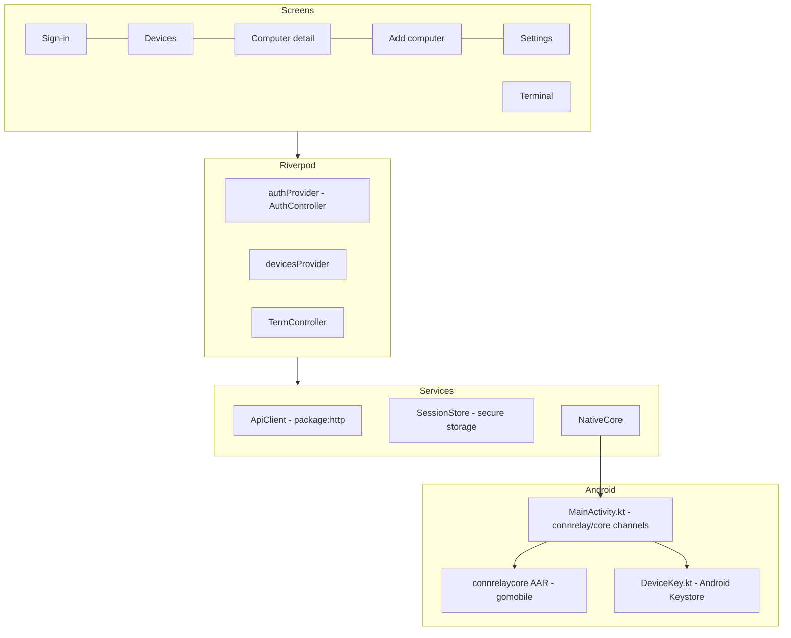
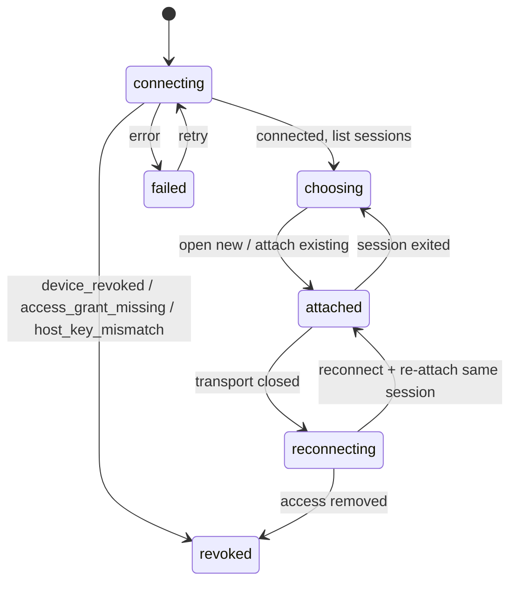

# Mobile App

> **Status:** Implemented for Android and in daily use against a real host. The iOS bridge and the larger design below marked **(planned)** are not built yet.
> **Location:** `apps/mobile/` · **Platforms:** Android (iOS planned), foreground use · **Toolchain:** Flutter 3.41 / Dart 3.11

The phone app is how users interact with ConnRelay. It handles:

- sign-in with Google
- pairing computers
- deciding which phones may reach which computers
- opening, switching and resuming terminal sessions
- reconnecting after the connection drops

The app holds no server secrets. Its only long-lived credentials are a refresh token in secure storage and a hardware-backed device key.

---

## 1. Architecture



All protocol work runs in the shared Go core (see [connrelaycore](connrelaycore.md)), bound with gomobile: the path race between WebRTC and the WSS relay, inner TLS, attestation, framing and flow control. Dart only sees a verified session.

### Folder structure

```text
apps/mobile/
  pubspec.yaml  analysis_options.yaml
  lib/
    main.dart
    app/        app.dart, config.dart (--dart-define), router.dart, theme.dart
    core/       api.dart (ApiClient, models), auth.dart (AuthController, Google ID tokens),
                native.dart (NativeCore → MethodChannel), session_store.dart (secure storage)
    features/
      signin/     signin_screen.dart
      devices/    devices_screen.dart, device_detail_screen.dart, devices_providers.dart
      pairing/    pair_screen.dart, pairing_logic.dart
      terminal/   terminal_screen.dart, terminal_controller.dart, accessory_bar.dart
      settings/   settings_screen.dart
    widgets/    error_view.dart, status_badge.dart
  android/app/src/main/kotlin/dev/connrelay/app/
    MainActivity.kt   # MethodChannel connrelay/core, EventChannel connrelay/core/events
    DeviceKey.kt      # Android Keystore P-256 identity key
  gocore/build-aar.sh # builds android/app/libs/connrelaycore.aar (gitignored)
  third_party/xterm/  # vendored xterm.dart fork
  test/
```

### Packages

| Concern | Package | Notes |
|---|---|---|
| State | `flutter_riverpod` 2.6 | Providers are overridden with fakes in tests |
| Routing | `go_router` 17 | One redirect guard (§2) |
| HTTP | `http` | Small `ApiClient`: bearer token, one refresh-and-retry on 401, error envelopes, idempotency keys |
| Google sign-in | `google_sign_in` 7.2 | `GoogleSignIn.instance.initialize(serverClientId, nonce)` then `authenticate()`; the ID token is issued to the control plane's Web client ID |
| Secure storage | `flutter_secure_storage` | Refresh token, device ID and pinned host fingerprints |
| Terminal | `xterm` 4.0.0, overridden by the fork in `third_party/xterm` | Upstream is inactive; the fork fixes buffer and input bugs found in spike S5 (see its `CHANGELOG.md`) |
| QR scanning | `mobile_scanner` | |

Analytics and crash-reporting SDKs are deliberately excluded.

### Build configuration

Values are passed at build time; none are secrets.

```sh
apps/mobile/gocore/build-aar.sh          # Go core → android/app/libs/connrelaycore.aar
cd apps/mobile
flutter build apk --release \
  --dart-define=CONNRELAY_API=https://api.example.invalid \
  --dart-define=CONNRELAY_GOOGLE_SERVER_CLIENT_ID=<web-client-id>.apps.googleusercontent.com
```

The AAR build uses `GOWORK=off`, Android API 26, `-javapkg dev.connrelay.core` (so the facade is `dev.connrelay.core.mobile`) and `-ldflags=-checklinkname=0`, which Pion's Android interface enumeration needs.

---

## 2. Routing and guards

| Route | Screen |
|---|---|
| `/signin` | Google sign-in |
| `/devices` | Computers list (start page) |
| `/devices/:id` | Computer detail: presence, fingerprint, agent version, access for this phone, remove |
| `/pair` | Add computer: scan the QR code or type the code, confirm the fingerprint |
| `/terminal/:id` | Terminal for computer `:id` |
| `/settings` | Account, server, phones, sign out |

The redirect waits while the session is being restored, sends a signed-out user to `/signin`, and sends a signed-in user away from `/signin` to `/devices`.

**Deep links never grant access.** Route parameters are identifiers only; every action is authorized by the server and, for terminals, by the host.

---

## 3. Authentication

```mermaid
sequenceDiagram
  participant App
  participant G as Google
  participant API
  App->>API: POST /v1/auth/challenge → nonce
  App->>G: google_sign_in authenticate (serverClientId, nonce)
  G-->>App: id_token
  App->>App: Keystore key → SPKI + fingerprint; sign PoP (purpose connrelay.auth.v1, nonce, spki_fp) in the Go core
  App->>API: POST /v1/auth/exchange
  API-->>App: access token, refresh token, device_id
```

Google is the only identity provider. The server accepts only allowlisted Google subjects; anyone else sees a plain "this Google account is not allowed" message.

**A newly signed-in phone needs no further approval, but has no access to any computer** until the owner grants it.

| Item | Behaviour |
|---|---|
| Access token | Held by `AuthController`; restored with the session |
| Refresh token | Secure storage. On rotation, the new token is saved before it is used. |
| Refresh | `ApiClient` refreshes once on `401 unauthenticated` and retries the request once. Concurrent refreshes share one call. The refresh signs a server nonce with the device key (`connrelay.refresh.v1`). A 401/403 from refresh signs the phone out locally. |
| Logout | `POST /v1/auth/logout` revokes this phone's session only. The device key is kept, so the next sign-in re-associates the same device. |

---

## 4. Device key

| Platform | Implementation |
|---|---|
| Android | `DeviceKey.kt`: ECDSA P-256 in the `AndroidKeyStore` with `PURPOSE_SIGN`. StrongBox when available (API 28+), otherwise TEE. It implements the Go `Signer` interface, so the Go core asks Kotlin to sign SHA-256 digests and never sees the private key. |
| iOS **(planned)** | Secure Enclave key (`kSecAttrTokenIDSecureEnclave`, `…AfterFirstUnlockThisDeviceOnly`) behind the same channel. |

The fingerprint is the hex SHA-256 of the SPKI, shown grouped in blocks of four.

---

## 5. Native bridge

`NativeCore` (Dart) talks to `MainActivity.kt` over `MethodChannel('connrelay/core')`; output and lifecycle events arrive on `EventChannel('connrelay/core/events')`.

| Method | Go facade call (`dev.connrelay.core.mobile`) |
|---|---|
| `publicKey`, `fingerprint`, `signPoP` | Keystore SPKI, `Mobile.fingerprint`, `Mobile.signPoP` |
| `connect` | `Mobile.connect(api, accessToken, deviceId, hostId, pinnedFp, mode="auto", 30 s, key, events)`; returns the path (`direct`, `turn` or `wss_relay`) |
| `open`, `attach`, `list`, `terminate` | Session methods; results are JSON |
| `input`, `resize`, `detach`, `close` | Session methods |

Events are `output` (bytes for a stream), `exit` (session ID), `revoked` (reason) and `closed` (error text, empty on a clean close). Blocking calls run off the UI thread. Error codes from the core (`host_key_mismatch`, `access_grant_missing`, `device_revoked`, …) arrive as `PlatformException.code`.

---

## 6. Computers list

- `devicesProvider` loads every device of the account (paged, hosts first, sorted by name).
- While the list is on screen it refetches every **30 s** (`devicesPollInterval`), so presence and "seen X ago" stay current. The provider is auto-disposed, so polling stops when nothing watches it, and a failed load retries on the next tick.
- **Pull to refresh** works in every state (loading, error, empty and loaded). Each state is a scrollable list, so the gesture always starts even when the content is short.
- Each host shows a `StatusBadge` (online, stale, offline or revoked, as icon plus word) and a Connect button that is enabled only when the host is online and this phone has a grant.

---

## 7. Connection and reconnect

`TermController` owns one connection to one host.



- Before connecting, the access token is refreshed so a long-lived connection starts with a fresh token.
- The host's fingerprint is pinned at pairing (secure storage). `connect` refuses a host whose key does not match it (`host_key_mismatch`), before any terminal traffic.
- **Reconnect** waits 0.5, 1, 2, 4, 8, then 15 s between tries and re-attaches the same terminal session, so the shell's state is preserved. Every retry creates a new attempt, so tickets and TURN credentials are never reused.
- Revocation (`revoked` event or a revoked error) stops retrying and shows why.
- **Disconnect** means detach: the shell keeps running on the computer.

Make-before-break on network changes, reconnect on app resume and several hosts at once are **(planned)**.

---

## 8. Terminal

| Concern | Implementation |
|---|---|
| Renderer | One xterm.dart `Terminal` in a `TerminalView`, from the vendored fork |
| Output | Bytes are decoded as UTF-8 (malformed sequences replaced) and written to the terminal |
| Input | Soft keyboard and IME text, plus hardware keys mapped to VT sequences; arrows honour application cursor mode (DECCKM) |
| Accessory bar | Esc, Tab, sticky Ctrl, arrows, PgUp/PgDn, ^C, ^D, `\|`, `~` and more |
| Paste guard | A paste with a newline or longer than 200 characters asks for confirmation. Pastes are wrapped in bracketed-paste markers when the remote enabled that mode. |
| Resize | Columns and rows follow the view and are sent as `resize` |
| Persistence | tmux repaints the screen on attach, so a reattached session shows the current screen |

OSC filtering (clipboard, titles, links), configurable fonts and scrollback, and the reconnect overlay are **(planned)**.

---

## 9. Screens

| Screen | What it does today |
|---|---|
| Sign-in | One Google button, a note that the phone gets its own hardware key and no access by default, and an inline error (including **account not allowed**) |
| Computers | List with status, last seen and Connect; empty state explains `connrelay-agent pair`; error view with retry; pull to refresh; 30 s polling |
| Add computer | QR scan (or typed code) → shows the computer name and fingerprint → "Give this phone terminal access" (on by default) → approve. A QR fingerprint that does not match the server's is a hard stop. |
| Computer detail | Presence, last seen, key fingerprint, agent version, grant or revoke this phone's access, remove the computer |
| Terminal | Connecting, session picker (open new or attach), attached, reconnecting, failed (retry), revoked |
| Settings | Account, server URL, phones (remove a lost phone, with confirmation), sign out of this phone |

The UI keeps separate signals for presence, permission, connection state, path and session persistence; it never collapses them into one "connected" flag.

---

## 10. Testing

| File | Coverage |
|---|---|
| `test/core_test.dart` | `ApiClient` refresh-once-and-retry, error envelopes; QR payload parsing; fingerprint mismatch is a hard failure; paste rule; Ctrl mapping; error copy |
| `test/auth_terminal_test.dart` | Sign-in binds the Google token, nonce and hardware key; disallowed account message; terminal connect → open → type → drop → re-attach the same session; a revoked grant stops retrying |
| `test/widgets_test.dart` | Signed-out routing; status words and when Connect is enabled; empty state; pull to refresh in short, empty and failed lists; the list refreshing itself while open |
| `test/xterm_fork_test.dart` | Fork fixes: scroll-region line feeds keep lines attached; DECCKM arrows |
| `test/xterm_tui_test.dart` | Key encoding and bracketed paste; replays real Claude Code / Codex captures recorded with `tests/spikes/s5_capture_tui.sh` (skipped when no fixtures are present) |

`make mobile` runs `flutter analyze` and `flutter test`; CI runs the same. End-to-end behaviour of the Go side of the app is covered by `TestMobileFacade` in `services/control/internal/e2e`.

---

## 11. Planned

The target design keeps these for later phases:

- **iOS**: Secure Enclave key and the `connrelay/core` channel in Swift, using the same Go facade built for iOS.
- **Connection**: app-lifecycle reconnect on resume, make-before-break on Wi-Fi ↔ cellular changes, several hosts connected at once, status reports from the phone (`PATCH /v1/connections/{id}`).
- **Terminal**: byte-level OSC filter (OSC 52 opt-in, title limits, OSC 8 confirmation), bundled monospace font, scrollback divider on reconnect, mouse-mode toggle, F-key row.
- **Screens**: sessions and activity tabs, trust introduction, diagnostics with a redacted export, theme and terminal settings, per-phone access management with expiry.
- **Quality**: golden tests, accessibility guideline checks, ARB localization, device-lab network tests.
