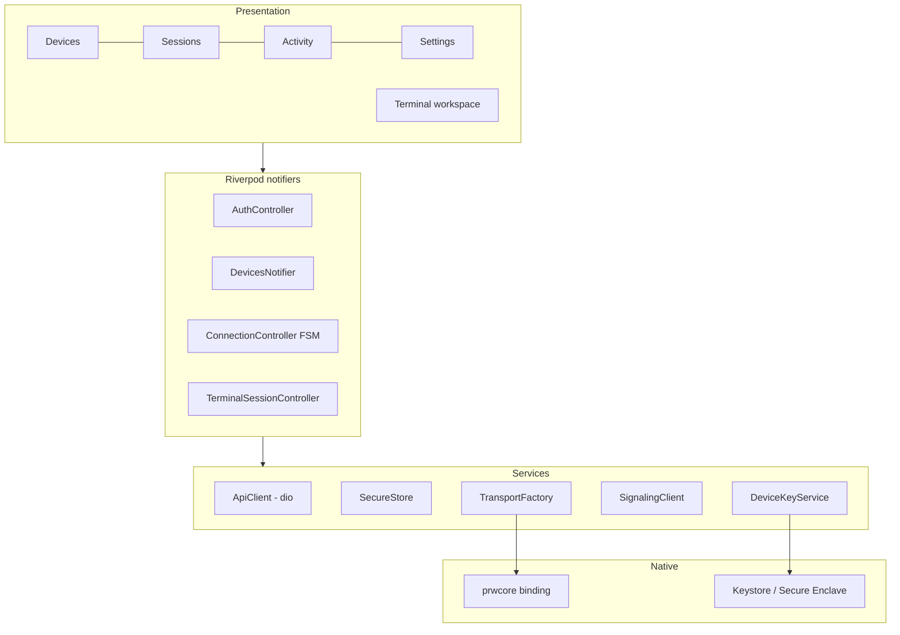
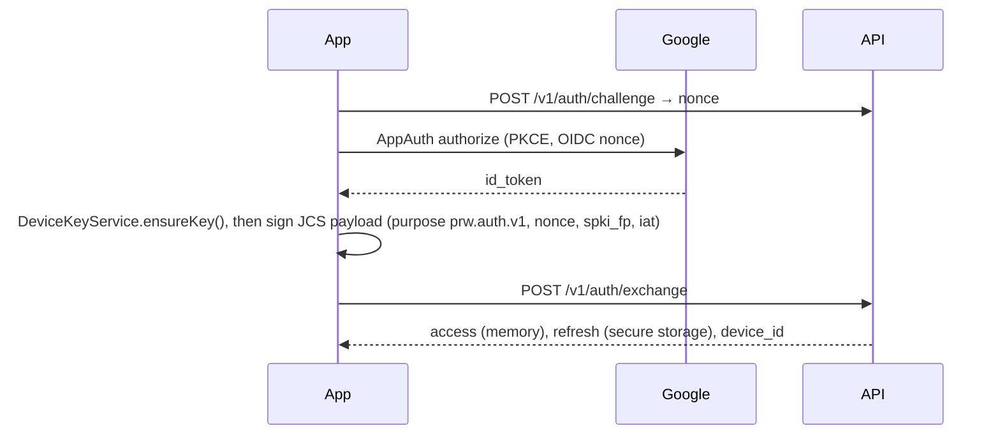
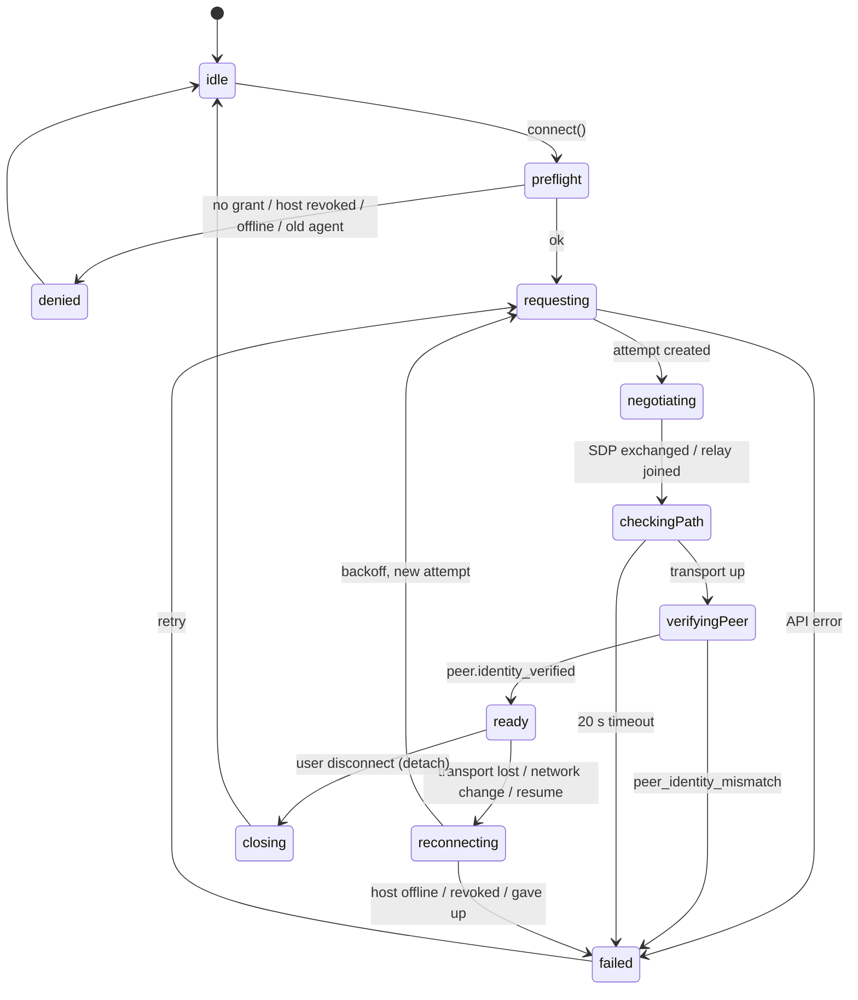

# Mobile App

> **Status:** Target design. This document describes intended behaviour and is updated as the app is implemented.
> **Location:** `apps/mobile/` · **Platforms:** Android and iOS (foreground use) · **Toolchain:** Flutter 3.41 / Dart 3.11

The phone app is how users interact with PRW. It handles:

- sign-in with Google
- pairing computers
- deciding which phones may reach which computers
- opening, switching and resuming terminal sessions
- reconnecting after network changes

The app holds no server secrets. Its only long-lived credentials are a refresh token in secure storage and a hardware-backed device key.

---

## 1. Architecture



### Folder structure (feature-first)

```text
apps/mobile/
  pubspec.yaml  analysis_options.yaml  l10n.yaml
  lib/
    main.dart  app.dart  bootstrap.dart
    core/
      config/      env.dart (API base URL via --dart-define; no secrets)
      api/         api_client.dart, interceptors (auth, request-id, retry), error_mapper.dart
      auth/        auth_controller.dart, google_sign_in_service.dart, token_store.dart
      crypto/      device_key_service.dart, fingerprint.dart
      transport/   transport.dart, prwcore_transport.dart, fake_transport.dart
      connection/  connection_controller.dart, connection_state.dart, network_monitor.dart
      lifecycle/   app_lifecycle_observer.dart
      routing/     router.dart, guards.dart
      theme/       tokens.dart, theme.dart, terminal_theme.dart
      l10n/        app_en.arb
      widgets/     status_badge, inline_error, empty_state, destructive_confirm_sheet,
                   loading_skeleton, connection_timeline, diagnostic_report
    features/
      onboarding/  welcome_screen, trust_intro_screen
      devices/     devices_screen, device_card, host_detail_screen, access_tab, add_computer/
      phones/      phones_screen
      connection/  preflight, connection_progress_screen
      terminal/    terminal_screen, accessory_bar, paste_guard, osc_filter,
                   session_picker_sheet, create_session_sheet
      sessions/    sessions_screen
      activity/    activity_screen
      settings/    settings_screen, security, appearance, diagnostics
  android/ ios/    device-key platform channel
  test/ integration_test/
```

### Packages

| Concern | Package | Notes |
|---|---|---|
| State | `flutter_riverpod` + `riverpod_annotation` | Easy to override with fakes in tests |
| Routing | `go_router` | Declarative guards, `StatefulShellRoute` for the bottom navigation |
| HTTP | `dio` | Queued refresh interceptor, request IDs, retry/backoff, cancel tokens |
| Models | `freezed` + `json_serializable` | Sealed unions make the state machines exhaustive |
| Google sign-in | `flutter_appauth` | Authorization Code + PKCE via the system browser (ASWebAuthenticationSession / Custom Tabs); never an embedded WebView |
| Secure storage | `flutter_secure_storage` | Keychain `first_unlock_this_device` (no iCloud sync); Android Keystore-wrapped AES-GCM |
| Terminal | `xterm` 4.0.0, **pinned**, with a maintained fork in `third_party/xterm` | The upstream package is inactive, so this project owns fixes |
| QR scanning | `mobile_scanner` | |
| Network changes | `connectivity_plus` | |
| Testing | `mocktail`, `alchemist` (goldens), `integration_test` | |

Analytics and crash-reporting SDKs are deliberately excluded.

---

## 2. Routing and guards

| Route | Screen | Guard |
|---|---|---|
| `/auth/welcome` | Welcome / sign-in | Unauthenticated only |
| `/auth/callback` | OAuth redirect (`com.example.prw:/oauth2redirect`, placeholder) | — |
| `/onboarding/trust` | Trust introduction | Authenticated, not yet acknowledged |
| `/app/devices` | Devices dashboard | Authenticated |
| `/app/devices/add` | Add-computer wizard | Authenticated |
| `/app/devices/:deviceId` (`/access`, `/sessions`) | Host detail | Resolved through the API; shows `not_found` if unresolved |
| `/app/connection/:attemptId` | Connection progress | In-app navigation only |
| `/app/terminal/:terminalSessionId` | Terminal | Re-validates account, grant and session before connecting |
| `/app/sessions`, `/app/activity` | Tabs | Authenticated |
| `/app/settings[/devices,/security,/appearance,/diagnostics]` | Settings | Authenticated |

The global redirect checks, in this order:

1. Bootstrapping.
2. Unauthenticated → `/auth/welcome`.
3. `device_revoked` → wipe local state, then `/auth/welcome` with an explanation.
4. Trust not yet acknowledged → `/onboarding/trust`.
5. Otherwise, the requested route.

**Deep links never grant access.** They are identifiers only.

---

## 3. Authentication



Google is the only identity provider. The server accepts only allowlisted Google subjects; anyone else sees the **account not allowed** state on the welcome screen.

**A newly signed-in phone needs no further approval, but has no access to any computer** until the owner grants it.

| Item | Behaviour |
|---|---|
| Access token | In memory only |
| Refresh token | Secure storage key `prw.refresh.v1`. On rotation, the new token is saved before the old one is dropped. |
| Refresh | A dio `QueuedInterceptor` refreshes once when it sees a 401. The refresh signs a server nonce with the device key, then replays the queued requests. `refresh_reuse_detected` or `device_revoked` triggers a hard sign-out with local wipe. |
| Logout | `POST /v1/auth/logout` revokes this phone's session only. The device key is kept so the next sign-in re-associates the same device. |

---

## 4. Device key

```dart
abstract interface class DeviceKeyService {
  Future<DeviceKeyInfo> ensureKey();          // spki, fingerprint, hardwareBacked
  Future<Uint8List> sign(Uint8List message);  // ECDSA P-256 / SHA-256 (DER)
  Future<void> deleteKey();                   // only on explicit "reset this phone"
}
```

| Platform | Implementation |
|---|---|
| Android | `KeyPairGenerator("EC", "AndroidKeyStore")` with `secp256r1` and `PURPOSE_SIGN`. StrongBox when available, otherwise TEE. |
| iOS | `SecKeyCreateRandomKey` with `kSecAttrTokenIDSecureEnclave` and `kSecAttrAccessibleAfterFirstUnlockThisDeviceOnly`. Simulators get a software key, flagged as such. |

- Hardware keys cannot be exported, so signing always happens on the platform side. The transport core requests signatures through a callback.
- The fingerprint is `base32(sha256(SPKI))`, grouped as `XXXX-XXXX-…`.
- Diagnostics shows whether the key is hardware-backed.

---

## 5. Transport abstraction

```dart
abstract interface class Transport {
  Stream<TransportEvent> get events; // pathSelected(direct|turnUdp|turnTcp|turnTls|wssRelay),
                                     // connected, peerVerified, closed(reason), stats(rtt)
  Future<void> connect(ConnectParams p);
  Future<ControlReply> sendControl(ControlMsg m);
  Stream<Uint8List> terminalOutput(int streamId);
  Future<void> writeTerminal(int streamId, Uint8List bytes); // awaits credit
  Future<void> close({required CloseReason reason});
}
```

| Implementation | Use |
|---|---|
| `PrwcoreTransport` | Wraps the shared Go core binding. Calls go through a `MethodChannel` and byte streams through an `EventChannel`. The path race, inner TLS, attestation and flow control all happen inside the core. Dart sees `peerVerified` only after **both** sides have verified each other. |
| `FakeTransport` | In-memory loopback with a scriptable host simulator (sessions, latency, drops). Used by widget and integration tests. |

The proposed default backend is the shared Go core, which is used on the phone through gomobile. The final choice is made after the transport spike. If that spike rules the core out, `flutter_webrtc` plus Dart framing will implement the same interface.

---

## 6. Connection state machine

The app keeps one controller per connected host. Up to 4 hosts can be connected at the same time.



- **Input freeze.** Terminal input is disabled in every state except `ready`. Keystrokes are never sent over a stale connection.
- **Reconnect policy.**
  - Backoff steps: 0.5, 1, 2, 4, 8 and 15 s, then 30 s, with full jitter. The first retry happens immediately on resume or a network change.
  - The controller gives up after 3 minutes and offers Retry.
  - Every retry creates a **new attempt**, so tickets and TURN credentials are never reused.
- **Network changes.** The controller probes the connection with a control ping (2 s timeout). It then tries make-before-break: it builds a new attempt while the old transport is still alive and switches over once the new one is ready.
- **Status reports.** The controller reports to the server with `PATCH /v1/connections/{id}`, sending `{status, path_type}` or `{failure_code}`.

---

## 7. App lifecycle

| Event | Behaviour |
|---|---|
| `paused` / `hidden` | Stop sending input and keep the connection opportunistically. The OS may suspend networking; background connectivity is not promised. |
| `resumed` | If the app was away more than 5 s, or the transport has closed: check token expiry, re-validate the grant, reconnect and reattach the session that was in the foreground. Show "Reconnecting…". |
| Process killed | On next launch, the Sessions tab lists sessions from server metadata; tap one to reattach. |
| Memory pressure | Trim background sessions' scrollback to 2,000 lines. |

---

## 8. Terminal

| Concern | Design |
|---|---|
| Renderer | One `xterm` `Terminal` per attached session, rendered in a `TerminalView` with a bundled monospace font (JetBrains Mono, OFL), chosen because it clearly distinguishes `I l 1 O 0`. |
| Output path | Transport bytes → streaming UTF-8 decoder (handles code points split across frames) → `OscFilter` → `terminal.write`, batched once per frame (16 ms). |
| Escape filtering | A byte-level state machine, not a regex. <br>• OSC 52 clipboard writes are dropped unless enabled in Settings, and then they show a toast. <br>• OSC 0/1/2 titles are capped at 120 characters and stripped of control characters. <br>• OSC 8 links only open after a tap and a confirmation. <br>• OSC 1337 file transfers and DCS sixel images are dropped. <br>• Everything else passes through unchanged. |
| Input | Soft-keyboard and IME text goes through the xterm text-input client. Hardware `KeyEvent`s are mapped to VT sequences. |
| Accessory bar | Esc, Tab, Ctrl (tap for one key, double-tap to lock), Alt, arrows, PgUp/PgDn, Home/End, `\| ~ / -`. A second row with F1–F12 is behind a toggle. |
| Paste guard | Triggers when a paste is more than 1 line or larger than 1 KiB, or when it contains `ESC` or `CR` outside bracketed-paste mode. Shows the line count and a preview, then asks for confirmation. Pastes are wrapped in bracketed-paste markers when the remote has enabled that mode. |
| Resize | Columns and rows are computed from font metrics, debounced by 120 ms, then sent as `terminal.resize` (clamped to 1–1000). Rotation, foldables and keyboard show/hide all resize the terminal without recreating the session. |
| Scrollback | 10,000 lines for the foreground session. On reattach, tmux repaints the screen. Older local scrollback is kept behind a divider: "— reconnected HH:MM, output while disconnected not shown —". Lossless replay is never claimed. |
| Selection | Long-press to select, then Copy. A tap does not move the remote cursor. |
| Reconnect overlay | The terminal is dimmed to 60% with a "Reconnecting… (attempt n)" banner. Input is disabled; Disconnect stays available. |
| Multiple sessions | One peer connection per host carries several terminal streams, so switching sessions does not reconnect. |
| Flow control | The app grants 256 KiB of output credit and re-grants as it renders. Large pastes are chunked against the 64 KiB input credit. |
| Coding agents | `TERM=xterm-256color`, truecolor and the alternate screen are supported. Mouse mode is off by default, with a toggle. Validated against Claude Code and Codex. |

**Disconnect** always means detach: the shell keeps running. **Terminate session** is a separate action with its own confirmation.

---

## 9. Screens and states

| Screen | States |
|---|---|
| Welcome / sign-in | initial, loading, canceled, provider error, network unavailable, **account not allowed** |
| Trust introduction | unacknowledged, acknowledged. Shown once, before the first connection. |
| Devices dashboard | loading skeleton, empty ("Add your first computer"), list, filter empty, service unavailable, stale data. <br>Has search, filter chips, sort, and a virtualized list. |
| Add computer | Steps: OS → install and verify → scan or enter code → confirm fingerprint → done. <br>Errors: code expired, already used, wrong account, host offline, **fingerprint mismatch** (hard stop), agent too old, rate limited, locked, camera permission denied (falls back to manual entry). <br>The "Grant this phone terminal access" checkbox defaults to off. |
| Host detail | Overview, Access, Sessions and Diagnostics tabs. States: loading, loaded, not found, revoked (read-only), offline. |
| Access tab | Phone list with a terminal toggle and an optional expiry. Toggles update optimistically and roll back on error. |
| Phones | This phone, other phones, lost-phone revoke with a two-step confirmation, and a warning before revoking the last active phone. |
| Connection preflight | access missing (links to the Access tab), host revoked, host offline (last seen), unsupported agent, session expired (re-auth) |
| Connection progress | Requesting → Negotiating → Checking path → **Verifying computer** → Opening terminal. Has Cancel and a 20 s timeout, and shows a path chip once a path is known. |
| Terminal | live, reconnecting (stale), reattached vs new session (toast), ended (exit code), revoked (modal), peer identity failed (hard error) |
| Session picker | Active, Detached, Ended. A "Non-persistent" tag marks sessions without tmux. Host unavailable shows cached, greyed-out metadata. |
| Create session | Optional title and the default shell profile, plus a privilege warning showing the host OS user. Errors: host capacity, PTY unavailable, shell missing, permission denied, connection lost. |
| Activity | Paginated audit feed with filters. States: loading, empty, list, end of list. |
| Settings | Account, phones, security (this phone's fingerprint), terminal (font, line height, OSC 52, mouse), theme, diagnostics (connection test, recent attempts, redacted export), about, sign out. |

Errors are rendered by a central `ErrorPresenter`. It maps API and transport error codes to a title, a body, a primary action and a support code.

### Six independent states

The UI never collapses these into a single "connected" flag:

| # | State | Source | Shown as |
|---|---|---|---|
| 1 | Device presence: online, stale, offline | Heartbeat-derived `presence` | `StatusBadge` (icon + text) |
| 2 | Permission: granted, none, expired, revoked | This phone's grant | "Terminal access" / "No access" chip |
| 3 | Connection establishment | Connection state machine | `ConnectionTimeline` |
| 4 | Transport path | `pathSelected` event | "Direct", "Relayed" or "Relayed (web)" chip |
| 5 | Authorized terminal | `peer.identity_verified` + `terminal.ready` | Input enabled, secure indicator |
| 6 | Process persistence | Session metadata (`persistent`, `status`) | "Detached – still running", "Non-persistent" |

Examples of how the states combine:

- Online, no permission → show "View details", never Connect.
- Permitted but offline → Connect is disabled and the last-seen time is shown.
- Transport up but verification failed → hard error; no terminal is shown.
- Transport lost but the process is still running → "Your session is still running on the computer."

---

## 10. Design system, theming and accessibility

**Components:**

- `StatusBadge`
- `DeviceCard`
- `PermissionRow`
- `ConnectionTimeline`
- `EmptyState`
- `InlineError`
- `TerminalToolbar`
- `TerminalAccessoryBar`
- `DestructiveConfirmSheet`
- `DiagnosticReport`
- `LoadingSkeleton`

**Design tokens** (`core/theme/tokens.dart`):

- Spacing: a 4/8 pt scale.
- Radii and a type scale.
- Semantic colours: `surface`, `onSurface`, `accent`, `statusOnline`, `statusOffline`, `statusStale`, `statusRevoked`, `statusRelay`, `danger`.
- A 16-colour ANSI palette for each theme.
- Motion durations of 120, 180 and 220 ms.

**Theme.** Light, dark and system. System is the default, with a manual override.

**Accessibility:**

- Semantic labels on every status, for example "workstation, online, last seen 2 minutes ago".
- Colour is never the only signal.
- Tap targets are at least 48 dp.
- Text scaling applies to the app chrome. The terminal has its own font-size setting.
- Reduced-motion settings are respected.
- Focus is managed correctly in sheets.

**Localization.** All copy lives in ARB files using ICU plurals and placeholders. Sentences are never concatenated.

---

## 11. Testing

| Layer | Coverage | Where |
|---|---|---|
| Unit | Every connection state-machine edge, error mapping, `OscFilter` (vectors and fuzz), the UTF-8 split decoder, paste-guard rules, fingerprint formatting, token rotation ordering, backoff | CI |
| Contract | Dart frame codec against the shared golden vectors in `protocol/vectors/` | CI |
| Widget | Every screen state, rendered via provider overrides; destructive confirmations; the six-state combinations | CI |
| Golden | Light/dark, small/large phone, text scale 1.0/2.0 for key screens | CI |
| Integration | Full app with `FakeTransport` and a mocked API: pair → grant → connect → run → drop → reattach → revoke | CI (emulator, nightly) |
| End-to-end | Real Android and iOS devices against staging and a real agent | Device lab |
| Network | Wi-Fi → cellular handoff, a TCP/443-only proxy network, airplane-mode toggles | Device lab |
| Performance | Frame time under output flood (< 16 ms on a mid-range Android device), cold start, memory with 4 sessions | Device lab |
| Security | No secrets in the APK/IPA (CI strings scan), a redacting logger, terminal deep link without a grant is denied | CI + lab |
| Accessibility | `meetsGuideline` checks per screen, plus a manual VoiceOver/TalkBack pass | CI + manual |

The CI pipeline runs:

1. `dart format --set-exit-if-changed`
2. `flutter analyze` with strict lints
3. unit, widget and golden tests
4. a debug APK build and an iOS no-codesign build on macOS
