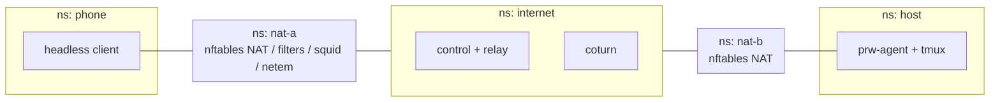

# Testing Strategy

**Status:** Draft v1. These are the testing rules for every component. Test IDs (`T-<CAT>-###`) are stable and referenced from task and release checklists.

## Principles

1. **Deterministic first.** Protocol, authorization and terminal logic are tested in-process with fake clocks, fake transports and seeded randomness. Real networks prove reachability, not correctness.
2. **Denials are asserted explicitly.** Every security test checks for the specific error code and audit event. The absence of success is not enough.
3. **No terminal content in test artifacts.** Log-capture tests plant canary secrets and fail if any of them appears in logs, metrics or crash reports.
4. **Every release-critical requirement maps to a test.** When a test cannot be automated, the reason is written next to it.
5. **Golden vectors are the wire contract.** The Go and Dart code must decode and encode the same bytes.

## Test pyramid

| Layer | Share | Scope | Tools |
|---|---|---|---|
| Unit | ~60% | Codecs, policy, state machines, token logic, PTY/tmux adapters | `go test -race`, `flutter test` |
| Contract / golden | ~10% | Binary frames, control envelope, signaling and relay schemas, OpenAPI | `protocol/golden/`, JSON Schema validators |
| Integration | ~20% | Control plane, Postgres, coturn, WSS relay, agent and headless client | testcontainers, `tests/integration/` |
| Device E2E | ~5% | Flutter app on real phones | `integration_test`, scripted manual runs |
| Field | ~5% | Real carriers and hostile networks | Manual, published as the tested-network matrix |

## Environments

| Env | Description | Cadence |
|---|---|---|
| **CI** | GitHub Actions Linux runners. Go and Flutter unit, widget and golden tests. testcontainers for Postgres 16 and coturn 4.18. Go integration harness. | Every PR |
| **netlab** | `tests/netlab/`. Linux network namespaces joined by veth pairs. nftables provides NAT: full-cone, port-restricted and symmetric. Scenarios add UDP drops, a TCP/443-only egress allowlist, a **squid** HTTP CONNECT proxy, an SNI/ALPN-filtering "DPI" proxy, and **`tc netem`** latency, loss and rate limits. The phone side is the headless Go client and the host side is the real agent. | Nightly on a privileged runner, and on demand |
| **Device lab** | At least 2 Android phones (one Android 10–12, one Android 14+) and at least 2 iPhones (iOS N−1 and N), run against staging. | Every release candidate |
| **Field** | At least 2 mobile carriers (CGNAT), hotel or guest Wi-Fi, a corporate network, and a TCP/443-only network | Before beta and at Gate E |
| **Staging** | A production-like EC2 instance with 2 EIPs, deployed from the same Terraform and Compose files, with separate secrets and DNS | Deploy and ops tests |

### netlab topology

## Test categories (representative cases)

### Unit: `T-UNIT`

| ID | Case |
|---|---|
| T-UNIT-001 | Binary frame codec round-trip: 12-byte header, payload ≤ 16 KiB, rejects oversize or unknown versions |
| T-UNIT-007 | Credit flow control: sender stops at window exhaustion and resumes on `flow.credit`; memory stays bounded |
| T-UNIT-009 | Attestation build and verify: JCS canonicalization, ES256, expiry, nonce, fingerprint mismatch |
| T-UNIT-013 | Grant lease: 10-minute validity, renewal every 3 min, refusal of new sessions after expiry |
| T-UNIT-018 | Refresh-token rotation and reuse detection, which revokes the token family |
| T-UNIT-019 | Allowlist and account derivation from a validated Google ID token |
| T-UNIT-025 | UTC timestamps; timeouts use the monotonic clock |

### Integration: `T-INT`

| ID | Case |
|---|---|
| T-INT-010 | Account with 2 hosts and 2 phones, and grants that overlap and are disjoint |
| T-INT-018 | Relay and control plane observe only ciphertext. Canary bytes typed in the terminal never appear on the server side. |
| T-INT-019 / 020 | A direct path carries no TURN bytes; a forced-relay path still works |
| T-INT-027 | Drop the transport for 30 s, reconnect, and confirm the same tmux pane and PID |
| T-INT-028 | `systemctl --user restart prw-agent`; the session survives and reattaches |
| T-INT-032 | Revoke during an active session; the peer closes within 30 s and the tmux session is detached, not killed |
| T-INT-042 | Full pairing flow: create → resolve → approve → wait → complete |
| T-INT-044 | Every API error code in the catalogue is reachable and well-formed |

### Network: `T-NET`

See the [network matrix](#network-matrix).

### Security: `T-SEC`

| ID | Case |
|---|---|
| T-SEC-001 | Unknown device attempts the control WSS and the connections API |
| T-SEC-002 / 003 | A revoked phone tries refresh, connect and reattach; a revoked host tries to reconnect its control WSS |
| T-SEC-004 | Pairing: expired ref, replayed consumed ref, brute-forced manual code (lockout) |
| T-SEC-005 | Expired access token, expired ticket, reused ticket `jti` |
| T-SEC-006 | Cross-account access to devices, sessions, audit events and grants |
| T-SEC-007 | Terminal open without a grant, both through the API and directly against the agent with a forged ticket |
| T-SEC-008 | Spoofed `from_device_id` in signaling, a cross-attempt message, duplicate events |
| T-SEC-009 | Simulated signaling MITM: the server swaps the DTLS or TLS fingerprint, and both peers reject with `peer_identity_mismatch` |
| T-SEC-010 | WSS relay: wrong or expired relay token, mismatched attempt, a third-party join, rate and volume caps |
| T-SEC-011 | TURN: missing or expired credentials; relay to a private or metadata IP is denied |
| T-SEC-012 | Rate limits on login, pairing, connections, TURN credentials and session creation |
| T-SEC-013 | Oversized SDP/ICE (> 64 KiB), control messages (> 16 KiB) and frames |
| T-SEC-014 | Data-channel messages sent before `peer.identity_verified` |
| T-SEC-015 | Fuzzing of the frame codec, control envelope, signaling and attestation parsers |
| T-SEC-016 | Resource exhaustion: 1000 WSS connections, a session-create flood, an output flood with a stalled reader |
| T-SEC-017 | Shell metacharacters in titles are never executed; the agent refuses to run as root |
| T-SEC-018 | Malicious escape sequences: OSC 52, an oversized title, hyperlinks |
| T-SEC-019 | Secret scan of the app bundle, agent binaries and repository |
| T-SEC-020 | Canary leak scan across logs, metrics and crash reports |
| T-SEC-021 | Host key file is mode 0600; the phone key is non-exportable |
| T-SEC-023 | TLS configuration scan of EIP-A:443 and EIP-B:443/5349 |
| T-SEC-024 | Independent review of pairing, attestation, revocation and process handling |
| T-SEC-025 / 026 | A Google subject not on the allowlist is rejected; a refresh without the device signature is rejected |

### Device E2E: `T-E2E`

| ID | Case |
|---|---|
| T-E2E-001 | Fresh install → Google sign-in → pair host → grant → terminal |
| T-E2E-004 | Background the app for 60 s, foreground it, and confirm reconnect and reattach with input frozen while reconnecting |
| T-E2E-006 | Claude Code and Codex in tmux: alternate screen, colours, input, resize, a 1-hour run |
| T-E2E-007 | Revoke a phone from a second phone while it is attached |
| T-E2E-009 | Diagnostics show the path type, RTT and error codes, and no secrets |

### Operational: `T-OPS`, and performance: `T-PERF`

| ID | Case |
|---|---|
| T-OPS-001 | Clean deploy from Terraform; security-group scan shows only the expected ports on each IP |
| T-OPS-005 | Reboot and agent-restart recovery |
| T-OPS-010 | Database restore drill, including revocation replay, with RTO and RPO measured |
| T-OPS-011 | Clean Ubuntu host install of the agent from the signed `.deb` |
| T-PERF-001 | Connect → usable terminal, p95, per path |
| T-PERF-002 | Keystroke echo p95, direct and relayed |
| T-PERF-005 | Load test used for instance sizing |

## Network matrix

| ID | Scenario | Env | Expected path |
|---|---|---|---|
| T-NET-001 | Same LAN | netlab | Direct (host candidate) |
| T-NET-002 | Two cone / port-restricted NATs | netlab | Direct (srflx) |
| T-NET-003 | Symmetric NAT on both sides | netlab | TURN-UDP |
| T-NET-004 | UDP blocked on the phone side | netlab | TURN-TCP or TURNS |
| T-NET-005 | **TCP/443-only egress** | netlab | TURNS:443 or WSS relay |
| T-NET-006 | **HTTP CONNECT proxy only**, UDP dropped | netlab | WSS relay through the proxy, usable in ≤ 10 s |
| T-NET-007 | **SNI/ALPN-filtering DPI proxy** | netlab | WSS relay |
| T-NET-008 | ICE blackholed, measuring the WSS race timing | netlab | WSS within `T_fallback` plus the handshake |
| T-NET-009 | 300 ms RTT, 5% loss, 256 kbit/s | netlab | Stable session; echo latency recorded |
| T-NET-010 | Phone moves to a new NAT ("Wi-Fi → cellular") | netlab | Reattach in ≤ 15 s; same PID |
| T-NET-011 | Signaling outage mid-negotiation | netlab | Fails within 20 s with an error code; retry works |
| T-NET-012 | coturn down | netlab | WSS relay is selected |
| T-NET-013 | WSS relay down while TURN is up | netlab | TURN is used |
| T-NET-014 | IPv6-only and dual-stack phone networks | netlab | Connects |
| T-NET-015 | Real carrier CGNAT (≥ 2 operators) | field | Connects; path recorded |
| T-NET-016 | Real Wi-Fi → cellular handoff | device/field | Reattaches |
| T-NET-017 | Real restrictive networks (hotel, guest, corporate, TCP/443-only) | field | Published in the matrix |
| T-NET-018 | Direct path does not touch TURN or the relay | netlab | Relay byte counters = 0 |

Only networks that have been tested are claimed as supported. The tested-network matrix is published with each release.

## CI pipeline stages

| # | Stage | Contents | Blocking |
|---|---|---|---|
| 1 | Hygiene | `gofmt`/`goimports`, `golangci-lint`, `dart format`, `flutter analyze`, markdown/mermaid lint, **gitleaks** | Yes |
| 2 | Unit | `go test -race ./...`, `flutter test` | Yes |
| 3 | Contract | Golden vectors checked in both Go and Dart; OpenAPI and JSON Schema validation; generated code is up to date | Yes |
| 4 | Migrations | goose up / down-to-0 / up on an empty database; constraint tests | Yes |
| 5 | Integration | testcontainers stack plus headless-client scenarios | Yes |
| 6 | Supply chain | `govulncheck`, `osv-scanner`, SBOM, licence allowlist (no AGPL in shipped artifacts) | Yes, on critical or high findings |
| 7 | Build | Agent `.deb` and tarball, gomobile AAR and xcframework, APK, iOS build, size-budget check | Yes |
| 8 | Fuzz | 60 s per target on each PR, 30 min nightly | A nightly failure opens an issue |
| 9 | netlab | Full network matrix | Nightly; required before a release tag |
| 10 | Sign | Signed checksums, SBOM, provenance | Release tags only |

## Release gates

| Gate | When | Criteria |
|---|---|---|
| **A: transport feasibility** | End of Phase 1 | All of the following: <ul><li>Spike reports S1–S6 are published.</li><li>Terminal bytes flow both ways on real Android and iOS over direct, TURN-UDP, TURNS:443 and the WSS relay through an HTTP CONNECT proxy.</li><li>A tmux session survives an agent restart.</li><li>A 50 MB burst shows no loss and bounded memory.</li><li>Hardware P-256 signing works on both platforms.</li><li>The client transport core decision is recorded.</li></ul> |
| **B: identity and authorization** | Phase 5 | Security tests T-SEC-001…014, 017, 025, 026 and 028 pass. The threat model has been reviewed. Pairing, attestation and revocation have been independently reviewed, with no open critical or high findings. |
| **C: terminal and reconnect** | Phase 5 | T-INT-021…033 pass. T-NET-001…014 and T-NET-018 have passed nightly for 7 consecutive days. T-E2E-004…006 pass on both platforms. |
| **D: operations** | Phase 6 | All operational tests pass. The restore has been rehearsed, with RTO and RPO recorded. The security group has been reviewed. Runbooks are complete. |
| **E: pilot** | Phase 7 | Field matrix published. Performance targets measured. Usability test (≥ 5 users) completed. The owner explicitly accepts every metric that falls below target. |

## Service-level candidates (proposed; to be confirmed with measured data)

| Indicator | Candidate target |
|---|---|
| Control-plane availability (external probe) | 99.0% monthly |
| Connect → usable terminal, p95 | ≤ 10 s on the published matrix |
| Keystroke echo, p95 | < 250 ms direct; < 500 ms relayed |
| Reattach success after a transient drop | ≥ 95% |
| Session establishment success on the matrix | ≥ 98% |
| Revocation enforcement while online | ≤ 30 s |
| Unauthorized terminal opens | 0. This is an invariant, not a target. |
