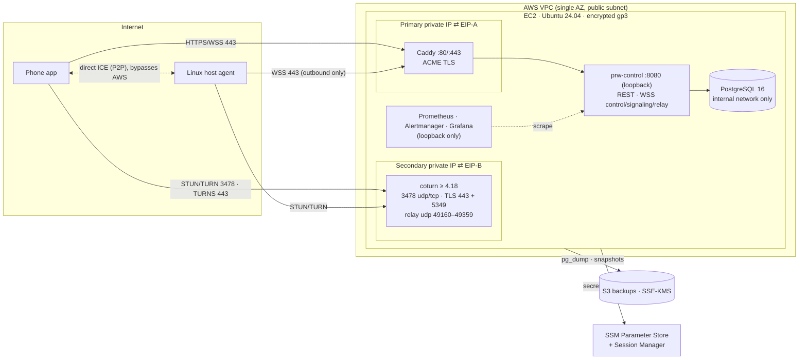

# Deployment (AWS)

**Status:** Draft v1 for the private-beta deployment. None of the files under `deploy/` exist yet. All values here are placeholders until they are validated in staging.

PRW runs on **one EC2 instance with two Elastic IPs**:

| Public IP | Hostname (placeholder) | Serves |
|---|---|---|
| EIP-A | `api.example.invalid` | HTTPS REST API, plus WSS for agent control, signaling and the relay fallback, all on TCP 443 |
| EIP-B | `turn.example.invalid` | coturn: STUN/TURN on UDP/TCP 3478, TURN-over-TLS on TCP **443** and 5349, and the UDP relay range |

The second IP exists so that TURN-over-TLS can listen on port 443, which restrictive networks usually allow, without colliding with HTTPS. This deployment is a **documented single point of failure**. See [Capacity, cost and the split trigger](#capacity-cost-and-the-split-trigger) for when to split it.

---

## Topology



| Component | Placement | Notes |
|---|---|---|
| `caddy` | Host network, bound to the primary private IP | Terminates TLS for `api` and proxies to `127.0.0.1:8080` |
| `prw-control` | Container on loopback ports 8080 (API) and 9090 (metrics) | One Go binary: REST, WSS control, WSS signaling, WSS relay, outbox and retention jobs |
| `postgres` | Container on the internal Docker network | Never published on a host port |
| `coturn` | Host network, bound to the secondary private IP only | Host networking is needed for the relay port range |
| Monitoring | Containers on loopback | Reached through an SSM port-forward |

---

## Instance setup

| Item | Setting |
|---|---|
| AMI | Ubuntu 24.04 LTS (pinned AMI ID in Terraform) |
| Instance type | Chosen from the load test; the candidate is 2 vCPU / 4 GiB. Baseline network must be ≥ 0.5 Gbit/s. |
| Root volume | gp3, encrypted with KMS key `alias/prw-ebs` |
| Data volume | Separate 20 GiB encrypted gp3 volume mounted at `/var/lib/prw`, holding Postgres data and coturn TLS |
| Metadata | IMDSv2 required, hop limit 1 |
| Admin access | SSM Session Manager only. **No SSH port is open.** |
| Patching | `unattended-upgrades`, security updates only. Reboot window Sunday 04:00 UTC. |
| Host firewall | nftables, default drop on input. Each allowed port is accepted only on the IP that serves it. |
| Container runtime | Docker Engine with the Compose plugin and the journald log driver |

### Two public IPs on one instance

1. Add a **secondary private IPv4 address** to the primary ENI. Associate EIP-A with the primary private IP and EIP-B with the secondary one. A second ENI also works, but it needs source-based policy routing.
2. Ubuntu does not configure secondary IPs automatically. Terraform user-data writes a netplan snippet:

   ```yaml
   # /etc/netplan/60-secondary-ip.yaml  (rendered by user-data)
   network:
     version: 2
     ethernets:
       ens5:
         addresses: [10.0.1.11/24]     # secondary private IP (placeholder)
   ```

3. Bind each service to its own private IP so both can use port 443:
   - Caddy uses `bind 10.0.1.10`.
   - coturn uses `listening-ip` and `relay-ip` set to `10.0.1.11`.
4. **Verify in staging:**
   - `openssl s_client -connect turn.example.invalid:443` returns the coturn certificate.
   - `curl https://api.example.invalid/health/ready` returns 200.
   - Relayed UDP leaves the instance through EIP-B.

### Security group (inbound)

A security group applies to the whole ENI. The OS-level binding and nftables decide which IP answers on which port.

| Protocol | Port(s) | Source | Purpose | Answers on |
|---|---|---|---|---|
| TCP | 443 | 0.0.0.0/0 | HTTPS + WSS (Caddy); TURNS (coturn) | EIP-A: Caddy · EIP-B: coturn |
| TCP | 80 | 0.0.0.0/0 | ACME HTTP-01, then redirect | EIP-A: Caddy · EIP-B: certbot during renewal only |
| UDP | 3478 | 0.0.0.0/0 | STUN / TURN | EIP-B |
| TCP | 3478 | 0.0.0.0/0 | TURN over TCP | EIP-B |
| TCP | 5349 | 0.0.0.0/0 | TURNS (alternate port) | EIP-B |
| UDP | 49160–49359 | 0.0.0.0/0 | TURN relay allocations (200 ports, sized by the load test) | EIP-B |
| TCP | 22 | **none** | Administration uses SSM only | — |
| TCP | 5432, 9090, 9093, 3000 | **none** | Postgres, metrics, Alertmanager and Grafana are never public | — |

Outbound traffic:
- TCP 443 to anywhere, for ACME, Google OIDC JWKS, SSM, S3 and package mirrors.
- UDP from the relay range to anywhere, for TURN peer traffic.

---

## DNS and TLS

| Record | Type | Target | TTL |
|---|---|---|---|
| `api.example.invalid` | A | EIP-A | 300 |
| `turn.example.invalid` | A | EIP-B | 300 |

| Endpoint | Certificate source | TLS policy |
|---|---|---|
| `api` (EIP-A:443) | Caddy automatic ACME (Let's Encrypt) | TLS 1.2 and 1.3 with Caddy's modern defaults, HSTS, HTTP/2, WebSocket upgrade pass-through |
| `turn` (EIP-B:443, 5349) | certbot standalone, bound to EIP-B:80 during renewal. A deploy hook copies the certificate to `/var/lib/prw/coturn-tls/` and restarts coturn. | ECDHE + AEAD ciphers only. TLS 1.0 and 1.1 disabled. Server-side DTLS disabled, because WebRTC DTLS runs end to end inside TURN. |
| Peer-to-peer fallback | Ephemeral TLS 1.3 between the phone and host | Needs no CA or certificate management on the server |

An alert fires when either certificate has fewer than 14 days left.

### Caddyfile (draft)

```caddyfile
# deploy/caddy/Caddyfile
{
	email ops@example.invalid
	servers {
		protocols h1 h2
	}
}

api.example.invalid {
	bind 10.0.1.10

	encode zstd gzip
	header {
		Strict-Transport-Security "max-age=31536000"
		X-Content-Type-Options nosniff
		Referrer-Policy no-referrer
		-Server
	}

	request_body {
		max_size 1MB
	}

	# REST + WSS (agent control, signaling, relay). Caddy proxies WebSocket upgrades transparently.
	reverse_proxy 127.0.0.1:8080 {
		header_up X-Request-Id {http.request.uuid}
		flush_interval -1
		transport http {
			read_timeout 0
			write_timeout 0
		}
	}

	log {
		output stdout
		format json
		# Never log query strings or auth headers.
		format filter {
			wrap json
			fields {
				request>uri query {
					delete
				}
				request>headers>Authorization delete
				request>headers>Cookie delete
			}
		}
	}
}
```

### coturn configuration (draft, coturn ≥ 4.18)

Validate option names against the deployed build with `turnserver --help` before use. If `static-auth-secret-file` is not supported, an entrypoint script renders the secret from `/run/secrets` into a config file on tmpfs.

```ini
# deploy/coturn/turnserver.conf
# ---- Listeners (secondary private IP ⇄ EIP-B) ----
listening-ip=10.0.1.11
relay-ip=10.0.1.11
external-ip=203.0.113.20/10.0.1.11        # EIP-B placeholder / secondary private IP
listening-port=3478
tls-listening-port=443
alt-tls-listening-port=5349
min-port=49160
max-port=49359

# ---- Authentication: TURN REST API (time-limited HMAC credentials) ----
realm=turn.example.invalid
use-auth-secret
static-auth-secret-file=/run/secrets/turn_shared_secret
fingerprint
stale-nonce=600

# ---- TLS ----
cert=/etc/coturn/tls/fullchain.pem
pkey=/etc/coturn/tls/privkey.pem
cipher-list="ECDHE+AESGCM:ECDHE+CHACHA20"
no-tlsv1
no-tlsv1_1

# ---- Abuse controls ----
user-quota=8                     # concurrent allocations per username (one username per connection attempt)
total-quota=400
max-bps=262144                   # bytes/s ≈ 2 Mbit/s per session, matching the WSS relay cap
max-allocate-lifetime=3600
channel-lifetime=600
permission-lifetime=300
no-multicast-peers
no-loopback-peers
denied-peer-ip=0.0.0.0-0.255.255.255
denied-peer-ip=10.0.0.0-10.255.255.255
denied-peer-ip=100.64.0.0-100.127.255.255
denied-peer-ip=127.0.0.0-127.255.255.255
denied-peer-ip=169.254.0.0-169.254.255.255      # includes EC2 metadata 169.254.169.254
denied-peer-ip=172.16.0.0-172.31.255.255
denied-peer-ip=192.0.0.0-192.0.0.255
denied-peer-ip=192.168.0.0-192.168.255.255
denied-peer-ip=198.18.0.0-198.19.255.255
denied-peer-ip=224.0.0.0-255.255.255.255
denied-peer-ip=::1
denied-peer-ip=fc00::-fdff:ffff:ffff:ffff:ffff:ffff:ffff:ffff
denied-peer-ip=fe80::-febf:ffff:ffff:ffff:ffff:ffff:ffff:ffff
denied-peer-ip=::ffff:0.0.0.0-::ffff:255.255.255.255   # IPv4-mapped bypass class

# ---- Attack-surface reduction ----
no-cli
no-tcp-relay                     # peers relay UDP only; the client→TURN leg over TCP/TLS still works
no-rfc5780
no-stun-backward-compatibility
secure-stun
# Do NOT enable: web-admin*, redis-*, mobility.

# ---- Logging: allocations and errors only, never payloads ----
log-file=stdout
simple-log
```

---

## Services (Docker Compose draft)

In the real `compose.yaml`, images are pinned **by digest**.

```yaml
# deploy/compose/compose.yaml
services:
  caddy:
    image: caddy:2@sha256:<digest>
    network_mode: host
    volumes:
      - caddy_data:/data
      - ../caddy/Caddyfile:/etc/caddy/Caddyfile:ro
    restart: unless-stopped
    mem_limit: 256m

  control:
    image: ghcr.io/example-invalid/prw-control@sha256:<digest>
    user: "10001:10001"
    read_only: true
    cap_drop: [ALL]
    security_opt: ["no-new-privileges:true"]
    ports: ["127.0.0.1:8080:8080", "127.0.0.1:9090:9090"]
    env_file: /etc/prw/control.env            # non-secret config only
    volumes: ["/run/prw-secrets:/run/secrets:ro"]
    networks: [backend]
    depends_on: [postgres]
    healthcheck:
      test: ["CMD", "/prw-control", "healthcheck"]
      interval: 15s
    restart: unless-stopped
    mem_limit: 768m
    cpus: 1.0

  postgres:
    image: postgres:16-bookworm@sha256:<digest>
    networks: [backend]
    volumes:
      - /var/lib/prw/pgdata:/var/lib/postgresql/data
      - /run/prw-secrets/pg_password:/run/secrets/pg_password:ro
    environment:
      POSTGRES_PASSWORD_FILE: /run/secrets/pg_password
    shm_size: 256m
    restart: unless-stopped
    mem_limit: 1g

  coturn:
    image: coturn/coturn:4.18@sha256:<digest>
    network_mode: host
    volumes:
      - ../coturn/turnserver.conf:/etc/coturn/turnserver.conf:ro
      - /var/lib/prw/coturn-tls:/etc/coturn/tls:ro
      - /run/prw-secrets/turn_shared_secret:/run/secrets/turn_shared_secret:ro
    restart: unless-stopped
    mem_limit: 512m
    cpus: 1.0

  prometheus:        { image: "prom/prometheus@sha256:<digest>", ports: ["127.0.0.1:9091:9090"], mem_limit: 512m }
  alertmanager:      { image: "prom/alertmanager@sha256:<digest>", ports: ["127.0.0.1:9093:9093"] }
  node-exporter:     { image: "prom/node-exporter@sha256:<digest>", network_mode: host, pid: host }
  postgres-exporter: { image: "prometheuscommunity/postgres-exporter@sha256:<digest>", networks: [backend] }
  grafana:           { image: "grafana/grafana@sha256:<digest>", ports: ["127.0.0.1:3000:3000"] }

networks:
  backend: {}
volumes:
  caddy_data: {}
```

### PostgreSQL

| Item | Setting |
|---|---|
| Roles | `prw_owner` runs migrations, `prw_app` is the runtime role, `prw_backup` runs dumps. Each has its own password from SSM. |
| Authentication | `scram-sha-256`, accepted only from the backend Docker network |
| Tuning | `shared_buffers` at 25% of the memory limit and `max_connections=50`. Slow queries over 250 ms are logged **without parameter values** (`log_parameter_max_length=0`). |
| Migrations | goose, forward-only, following the expand/contract pattern. A `pg_dump` is taken before every migration. |

---

## Configuration and secrets

### Environment variables (`/etc/prw/control.env`, non-secret)

| Variable | Example | Purpose |
|---|---|---|
| `PRW_PUBLIC_BASE_URL` | `https://api.example.invalid` | Base URL used to build absolute URLs and WSS endpoints |
| `PRW_LISTEN_ADDR` | `:8080` | API listener inside the container |
| `PRW_METRICS_ADDR` | `:9090` | Prometheus listener |
| `PRW_DATABASE_URL_FILE` | `/run/secrets/database_url` | DSN for the `prw_app` role |
| `PRW_OIDC_ISSUER` | `https://accounts.google.com` | Google OIDC issuer (the only identity provider) |
| `PRW_OIDC_CLIENT_ID` | `<android/ios client ids, comma-separated>` | Accepted `aud` values for Google ID tokens |
| `PRW_ALLOWED_SUBJECTS` | `<google sub>` | Allowlist of Google `sub` values; everyone else is denied |
| `PRW_ACCESS_SIGNING_KEY_FILE` | `/run/secrets/access_signing_key` | Ed25519 key for access tokens |
| `PRW_TICKET_SIGNING_KEY_FILE` | `/run/secrets/ticket_signing_key` | Ed25519 key for connection tickets, grant leases and relay tokens |
| `PRW_PAIRING_HMAC_KEY_FILE` | `/run/secrets/pairing_hmac_key` | Pepper for hashing pairing refs and codes |
| `PRW_TURN_SHARED_SECRET_FILE` | `/run/secrets/turn_shared_secret` | Secret shared with coturn for TURN REST credentials |
| `PRW_TURN_URLS` | `turn:turn.example.invalid:3478?transport=udp,turn:turn.example.invalid:3478?transport=tcp,turns:turn.example.invalid:443?transport=tcp` | ICE servers sent to clients |
| `PRW_TURN_REALM` | `turn.example.invalid` | coturn realm |
| `PRW_RELAY_MAX_BPS` | `262144` | Per-attempt WSS relay rate cap, in bytes/s |
| `PRW_RELAY_MAX_BYTES` | `2147483648` | Per-attempt WSS relay volume cap |
| `PRW_RELAY_MAX_SPLICES` | `32` | Maximum concurrent relay splices |
| `PRW_LOG_LEVEL` | `info` | Log level: `debug`, `info`, `warn` or `error` |

### Secrets (SSM Parameter Store, SecureString)

| Parameter (placeholder path) | Rendered to | Used by |
|---|---|---|
| `/prw/prod/access_signing_key` | `/run/prw-secrets/access_signing_key` | control |
| `/prw/prod/ticket_signing_key` | `/run/prw-secrets/ticket_signing_key` | control |
| `/prw/prod/pairing_hmac_key` | `/run/prw-secrets/pairing_hmac_key` | control |
| `/prw/prod/turn_shared_secret` | `/run/prw-secrets/turn_shared_secret` | control, coturn |
| `/prw/prod/pg/owner`, `/app`, `/backup` | `/run/prw-secrets/pg_*`, `database_url` | postgres, control, backup job |

A systemd oneshot, `prw-secrets.service`, runs at boot and before every deploy. It calls `aws ssm get-parameters-by-path --with-decryption` using the instance role and writes the values to **tmpfs** under `/run/prw-secrets`, with mode `0400` and owned by the consuming UID.

Secrets never appear in:
- Git
- image layers
- `docker inspect` output
- Terraform state (Terraform creates placeholder parameters with `ignore_changes = [value]`)

### IAM

| Principal | Permissions |
|---|---|
| Instance role `prw-instance` | `ssm:GetParameter*` on `/prw/prod/*`, `kms:Decrypt` on the SSM and backup keys, `s3:PutObject` on the backup prefix, and `AmazonSSMManagedInstanceCore` |
| Operator role (human, MFA required) | Terraform apply, Session Manager, read access to backups for restores |
| CI | No AWS permissions. Images are pushed to GHCR. |

The backup bucket policy denies non-TLS requests and unencrypted puts.

---

## Infrastructure as code (Terraform)

```text
deploy/terraform/
  versions.tf            # terraform >= 1.9, aws provider pinned
  backend.tf             # local state to start; S3 + DynamoDB lock if CI ever applies
  variables.tf           # region, instance_type, domain names, relay_port_range
  modules/
    network/             # VPC, one public subnet, IGW, routes
    instance/            # EC2, secondary private IP, EIP-A/EIP-B, SG, user-data (netplan, docker, ssm),
                         # encrypted data volume, IMDSv2, instance profile
    backup/              # S3 bucket (versioning, SSE-KMS, object lock, lifecycle, TLS-only), DLM snapshots
    secrets/             # SSM parameter placeholders, KMS keys
    dns/                 # Route 53 records for api and turn
    monitoring/          # CloudWatch status-check and disk alarms (optional)
  envs/prod/main.tf      # composes modules; outputs EIP-A and EIP-B
```

CI runs `terraform fmt -check`, `terraform validate`, `tflint` and `checkov`. `apply` is run manually by the operator.

---

## CI/CD and release signing

| Workflow | Trigger | Jobs |
|---|---|---|
| `ci.yml` | Pull request, push | Formatting and linting (Go, Dart), unit tests (`-race`), golden vectors in both languages, goose up/down/up on testcontainers, `govulncheck`, `osv-scanner`, gitleaks, licence check |
| `integration.yml` | Labelled PR, nightly | Compose stack plus headless agent and client; netlab subset |
| `mobile.yml` | Path-filtered PR, nightly | Android build and emulator `integration_test`; iOS build without signing on a macOS runner |
| `release.yml` | Tag `v*` | goreleaser builds the agent binaries, `.deb` and tarball; the control image is built and pushed by digest; SBOM (syft, SPDX); signed checksums; provenance attestation; a draft GitHub Release |
| `infra.yml` | PR touching `deploy/terraform` | fmt, validate, tflint, checkov |

- GitHub Actions are pinned by commit SHA, and Renovate or Dependabot opens weekly update PRs.
- Release checksums are signed with **minisign** using an offline key. Cosign keyless signing is the alternative. The agent installer verifies the signature before installing.
- Deploys are manual: the operator runs `deploy/scripts/deploy.sh` through SSM. The [runbooks](runbooks.md#deploy) give the procedure.

**Version compatibility.** The server supports protocol versions N and N−1 for both agents and apps. Always deploy the server first, then agents, then apps. Do not drop N−1 until telemetry has shown no N−1 clients for 14 days.

---

## Monitoring and alerting

| Source | What is collected |
|---|---|
| `prw-control` `/metrics` | HTTP and WSS counters, connected devices, signaling latency, connection attempts by outcome and path (direct, TURN or WSS relay), relay bytes and splices, revocation propagation time, outbox backlog, rate-limit hits |
| node-exporter | CPU, memory, disk, per-interface network |
| postgres-exporter | Connections, transactions, locks, database size |
| coturn | Allocations and bytes, taken from its metrics output or derived from logs |
| External probe | `https://api.example.invalid/health/ready`, checked from outside AWS |

| Alert | Condition | Severity |
|---|---|---|
| APIDown | External probe failing for 3 min | page |
| ReadyFailing | `/health/ready` not 200 for 2 min | page |
| High5xx | 5xx rate above 2% over 10 min | warn |
| DiskHigh | Above 80% (warn) or above 90% (page) on the data or root volume | warn / page |
| CertExpiry | Fewer than 14 days left on the `api` or `turn` certificate | warn |
| BackupMissing | No new backup object in 26 h | page |
| OutboxDeadLetters | Count above 0 | warn |
| RelayBytesHigh | Projected above 20 GB/month, or one device above 2 GB/day | warn |
| TurnAllocsHigh | Allocations above 80% of `total-quota` | warn |
| RevokePropagationSlow | p95 revocation propagation above 30 s | page |
| RateLimitSpike | More than 10× the baseline | warn |
| InstanceStatusCheck | EC2 status check failed | page |

Logs go to journald with 14-day retention. Terminal content is **never** logged. coturn logs contain client IP addresses; they are kept 14 days and never exported.

---

## Backups

| Backup | Schedule | Destination | Retention |
|---|---|---|---|
| `pg_dump -Fc` as `prw_backup` | Nightly at 03:00 UTC **and before every migration** | `s3://prw-backups-example-invalid/pg/YYYY/MM/DD/`, SSE-KMS, versioning, Object Lock in governance mode | 30 days |
| EBS snapshots (root and data) | Daily (Data Lifecycle Manager) | Same region | 7 daily + 4 weekly |
| Configuration | Git (`deploy/`) | — | — |
| Secrets | SSM Parameter Store (versioned) | — | — |

Targets: **RPO ≤ 24 h** and **RTO ≤ 4 h**. Restore steps, including re-applying revocations, are in the [runbooks](runbooks.md#database-restore).

---

## Upgrades and rollback

| Change | Procedure |
|---|---|
| Control-plane release | Follow the deploy runbook: pre-migration dump → `migrate up` → recreate `control` (about 2–5 s of downtime; clients reconnect with jitter) → readiness check → smoke test |
| coturn upgrade | Pin the new digest, recreate the service, then confirm a TURN allocation and a TURNS handshake on port 443 |
| OS patching | `unattended-upgrades`, then a reboot in the weekly window. Every session reconnects afterwards. |
| Rollback | See the [rollback runbook](runbooks.md#rollback). Migrations are additive (expand/contract), so re-pinning the previous image is normally enough. |

---

## Capacity, cost and the split trigger

**Bandwidth.** Terminal traffic is small. Interactive use averages 1–20 kbit/s, with bursts that are capped at 2 Mbit/s on relayed paths.

```text
monthly_relay_GB ≈ Σ_sessions(avg_kbit/s × hours × 3600 / 8 / 1e6) × 2
example: 2 relayed h/day × 30 days × 20 kbit/s ≈ 0.54 GB/month
```

**Cost drivers**, in order: the instance, two public IPv4 addresses, EBS volumes, S3 backups, then relay egress. The per-attempt caps (2 Mbit/s and 2 GiB) bound the worst-case bill.

**Sizing.** The instance type is fixed by a load test. It must sustain all of the following while keeping p95 API latency under 100 ms and CPU under 60%:
- 100 connected agents
- 20 connection attempts per second
- 32 concurrent WSS relay splices at 2 Mbit/s
- 50 TURN allocations

**Support ceiling for the private beta:**
- 100 hosts
- 32 concurrent relayed sessions

**Split trigger.** Move coturn and the WSS relay onto their own instance if any of these happens:
- relay traffic exceeds 30% of instance bandwidth
- p95 API latency degrades under relay load
- monthly relay egress crosses the cost alert threshold

**What a server outage does:**

| During an outage of the instance | Behaviour |
|---|---|
| New connections, pairings and revocations | Not possible |
| TURN and the WSS relay | Unavailable |
| Existing direct P2P sessions | Continue until their 10-minute grant lease expires |
