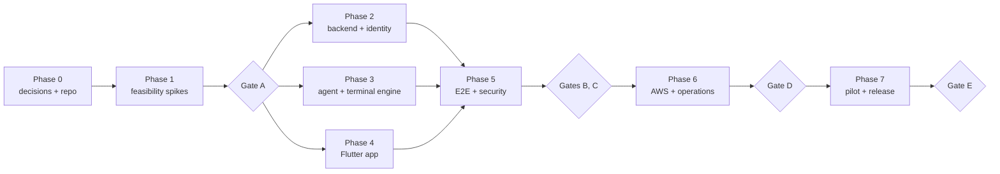

# Roadmap

**Status:** Draft v1. The MVP is not built yet. Development is at Phase 0/1.

## MVP scope

A single operator signs in to a Flutter app on Android or iOS with **Google**. They pair any number of phones and Linux computers, then grant individual phones terminal access to individual computers. From a phone they can open, list, attach, detach and terminate **persistent tmux-backed terminal sessions**. Those sessions survive network loss, the app being killed and agent restarts.

Each connection uses the first path that works:

1. Direct WebRTC
2. TURN relay (UDP, TCP, or TLS on port 443)
3. A WSS relay on port 443, which also works behind HTTP proxies and DPI

Terminal data is end-to-end encrypted on every path and bound to the enrolled device identities.

### In scope

| Area | Included |
|---|---|
| Account | Google sign-in limited to an allowlist of subjects. Device-bound rotating refresh tokens. Logging out one phone does not affect the others. |
| Devices | Any number of hosts and phones. Rename and revoke. Presence derived from heartbeats. Search and filter. |
| Pairing | Host QR code or manual code, fingerprint confirmation, single-use with a 5-minute expiry, lockout after failed attempts. A new phone needs no extra approval but starts with no grants. |
| Authorization | Explicit phone→host grants with optional expiry. Signed short-lived tickets. A 10-minute grant lease on hosts. Revocation takes effect within 30 s and detaches, rather than kills, running sessions. |
| Connectivity | Direct ICE, TURN on UDP/TCP/TLS:443, the WSS relay with inner TLS 1.3, peer identity attestation on every path, and the connection mode shown in the UI. |
| Terminal | Create, list, attach, detach, resize and terminate. Multiple named sessions (20 per host). Several phones attached to one session. Credit-based flow control. Works with coding-agent TUIs. |
| App | All core screens and states, an accessory key bar, a paste guard, escape-sequence safety, light/dark/system themes, accessibility baseline, diagnostics. |
| Audit | Metadata-only events and an Activity feed. |
| Ops | One EC2 instance with 2 EIPs, Terraform and Compose, encrypted backups with a rehearsed restore, alerts, runbooks, signed agent packages. |

### Out of scope

- Full VPN, subnet routing or DNS
- Port forwarding, SSH passthrough or access to arbitrary TCP services
- File transfer and remote file browsing
- Windows and macOS host agents
- Teams, family sharing, multiple users or public sign-up
- Push notifications, session profiles, tags and groups
- Upgrading a relayed connection to direct while it is running
- Automatic agent updates
- Remote one-shot commands or background jobs
- Root shells and privilege escalation
- High availability or multi-region relays

### Known limitations

1. Sessions do **not** survive a host reboot. They are reported as "host rebooted". Restarting the agent is safe.
2. Hosts without tmux 3.0 or newer fall back to non-persistent PTY sessions, which survive phone disconnects but not agent restarts.
3. The control plane is a single point of failure. While it is down:
   - no new connections, pairings or revocations can happen;
   - TURN and the WSS relay are unavailable;
   - existing direct sessions continue for at most 10 minutes (the grant lease).
4. The phone must be in the foreground. Suspension drops the connection, and the app reconnects and reattaches when it comes back.
5. The server sees metadata (device IDs, timing, volume, IP addresses, SDP/ICE) but never terminal content. PRW is not "zero-knowledge".
6. Only networks in the published tested-network matrix are claimed to work.
7. A granted phone has every privilege of the host OS user that runs the agent.
8. When several phones attach to the same session, their keystrokes interleave.
9. After a disaster restore, revocations from up to 24 hours before the failure must be re-applied using the runbook.
10. Relay throughput is capped per session at 2 Mbit/s.
11. Hosts are tested on Ubuntu 22.04 and 24.04 only.

### Acceptance criteria

| ID | Criterion |
|---|---|
| AC-01 | An account holds at least 2 hosts and at least 2 phones, and adding more needs no code or schema change. |
| AC-02 | A granted phone reaches a host on a different network with no inbound port forwarding. |
| AC-03 | A direct path carries no traffic through TURN, and a forced-relay path still works. |
| AC-04 | Neither the relay nor the control plane ever sees terminal plaintext. |
| AC-05 | After a 30-second disconnect, reconnecting restores the same persistent session. |
| AC-06 | A revoked device cannot start a session, and its existing sessions close within 30 s. |
| AC-07 | No permanent secret appears in the app bundle or the repository. |
| AC-08 | Automated tests cover account isolation, grants, pairing replay, expired tickets and duplicate signaling. |
| AC-09 | Install and recovery are documented for Ubuntu. |
| AC-10 | The terminal works on networks that only allow TCP/443, including through HTTP proxies and DPI. |
| AC-11 | A tmux-backed session survives an agent restart. |

## Delivery phases

| Phase | Goal | Exit criteria |
|---|---|---|
| **0: Decisions and repo** | Settle the open decisions, bootstrap the repository, CI hygiene, threat-model review, arrange devices and Apple developer access. | No open decision changes the transport or the data model. |
| **1: Feasibility spikes** | Prove every data path on real phones and prove terminal persistence. Choose the client transport core. Freeze the wire contracts (frames, schemas, golden vectors, OpenAPI). | Gate A |
| **2: Backend and identity** | Control-plane skeleton and migrations. Google OIDC and the allowlist. Devices, pairing, grants, tickets, TURN credentials. Signaling and the WSS relay. Audit, outbox, rate limits, metrics. | Cross-account, replay, expiry and revocation tests pass in CI against real Postgres. |
| **3: Host agent and terminal engine** | Key storage, the `pair` CLI, control WSS, lease cache. Shared-core transports and attestation. tmux and PTY backends, reconciliation, limits, systemd unit, `.deb` package. | A headless client creates a session, detaches, and reattaches after an agent restart, over both transports. |
| **4: Flutter app** | Sign-in and onboarding, dashboard, pairing, host detail and access, connection progress, terminal, sessions, activity, settings and diagnostics, themes and accessibility. | A tester completes pair → grant → terminal → disconnect → reattach without help. |
| **5: E2E and security** | Network matrix, Wi-Fi↔cellular handoff, revocation during a session, fuzzing, leak scans, resource exhaustion, independent review. | Gates B and C |
| **6: AWS and operations** | Terraform, Caddy and coturn hardening, monitoring, backup and restore rehearsal, rollback drill, runbooks, load test for sizing. | Gate D |
| **7: Pilot and release** | Pilot with measured service indicators. Publish the known limitations and the tested-network matrix. Work through the release checklist. | Gate E |

### Phase 1 spikes

| Spike | Question | Success criterion |
|---|---|---|
| **S1** | Can a shared Go core (Pion via gomobile) carry data channels on Android and iOS, and how does it compare with `flutter_webrtc`↔Pion? | Bidirectional echo on both platforms. App size delta, lifecycle behaviour and build reproducibility measured. |
| **S2** | Does coturn on a second EIP serve TURN on UDP and TCP, and TURNS on 443, alongside HTTPS on the first EIP? | Forced relay works over UDP, TCP and TLS:443, including in a namespace with UDP blocked. |
| **S3** | Does the WSS relay with inner TLS 1.3 and attestation work through a squid CONNECT proxy and an SNI-filtering proxy? | Terminal echo through both proxies. A man-in-the-middle fingerprint swap is detected. |
| **S4** | Does a tmux session attached inside a PTY survive detach, reattach and an agent restart under `systemd --user` with `KillMode=process`? | Same PID after a restart. A 50 MB burst with no loss and bounded memory. |
| **S5** | Does xterm.dart render Claude Code and Codex TUIs correctly, including keys, resize and paste? | A defect list, and a decision whether to fork. |
| **S6** | Can phones sign with hardware-backed P-256 keys (Android Keystore/StrongBox, iOS Secure Enclave)? | Signatures verify in Go, and the keys are non-exportable. |

### Release gates

| Gate | Summary |
|---|---|
| A | Transport feasibility on real Android and iOS across direct, TURN, TURNS:443 and WSS-through-proxy. tmux persistence. Hardware keys. |
| B | Identity and authorization security tests pass, plus an independent review with no open critical or high findings. |
| C | Terminal and reconnect integration tests pass, and the netlab matrix has been green for 7 nights. |
| D | Operational tests pass, the restore has been rehearsed, and the runbooks are complete. |
| E | Pilot complete: field matrix published, metrics measured, usability study done. |

The full criteria are in [development/testing.md](development/testing.md#release-gates).

## Post-MVP roadmap

The items are in priority order. Pilot data will be used to re-prioritize them.

| # | Item | Prerequisites | Size |
|---|---|---|---|
| R1 | **Upgrade a relayed connection to direct** without reattaching | ICE restart while traffic is flowing in the connection manager | M |
| R2 | Biometric app lock | — | S |
| R3 | **Session profiles**: working directory, shell, environment preset, title | Profile allowlist stored on the host, never secrets on the server | M |
| R4 | Separate capabilities: `terminal`, `file_transfer`, `port_forward` | Policy and UI; the schema already supports it | S |
| R5 | **File transfer** with chunking, checksums, resume, quotas, safe paths and no auto-execute | R4, a third channel type, a threat-model addendum | L |
| R6 | **Port forwarding** from the phone to the host's `localhost:port` | R4, a per-port allowlist on the host | L |
| R7 | **Push notifications** for host offline and pairing events | FCM and APNs | M |
| R8 | Device tags, groups and favourites | — | S |
| R9 | **Signed agent auto-update** with rollback | Update channel, signature verification, staged rollout | M |
| R10 | **Split the relay** onto its own instance, then multiple regions | Stateless relay; DNS or anycast selection | M → L |
| R11 | Control-plane high availability | Managed Postgres, two app instances, a load balancer, shared state for rate limits and splices | L |
| R12 | **macOS host agent** | launchd agent, macOS PTY and tmux, notarization | L |
| R13 | **Windows host agent** | ConPTY, a service model, a persistence design without tmux | XL |
| R14 | Desktop Flutter client | Desktop builds of the shared core | M |
| R15 | Multi-user and sharing | Roles, invitations, revised threat model | XL |
| R16 | **Local grant confirmation on hosts**, as opt-in | A local store of approved fingerprints on the agent; a "pending host confirmation" UI state. Limits the damage a compromised control plane could do. | M |
| R17 | **General-purpose private network (VPN)**, as a separate program | WireGuard on hosts, Android VpnService, iOS NEPacketTunnelProvider with the Network Extension entitlement, routing, DNS and ACLs. Reuse the control plane for coordination, and compare against adopting existing open-source control planes. | XL |
