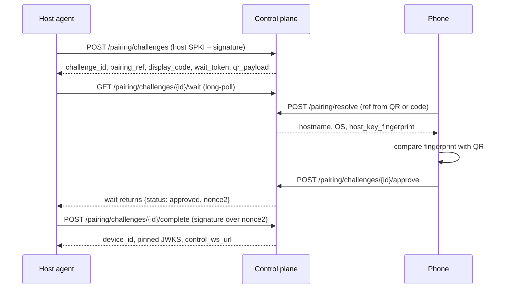

# API Reference

> **Status:** implemented in `services/control` unless a section is marked *planned*. Values marked *proposed* are current defaults that may change.

The control plane exposes a REST API under `/v1` and three WebSocket endpoints. It handles identity, pairing, grants, connection authorization, signaling and relaying of encrypted bytes. **It never carries terminal plaintext.** Opening and attaching terminals happens peer-to-peer over the authenticated data channel. The wire-level details (signature inputs, ticket claims, frames, timers) are specified in [protocol.md](protocol.md).

Related: [Security model](security.md), [Data model](data-model.md).

---

## 1. Conventions

| Topic | Rule |
|---|---|
| Transport | HTTPS only at `https://api.example.invalid` (Caddy on port 443 in production; a Cloudflare quick tunnel in the dev stack). JSON bodies with `Content-Type: application/json`. |
| Body limits | 16 KiB for `/v1/auth/exchange`, 64 KiB for the other `/v1/auth/*` calls, 4 KiB for pairing, device, grant and connection calls. Unknown JSON fields are rejected. |
| IDs | UUIDv7 strings. |
| Time | RFC 3339 timestamps in UTC. |
| Correlation | Every response includes `X-Request-Id`. The same value appears in error bodies and audit events. |
| Device signatures | `sig` fields are **ES256 JWS** made with the device's P-256 key, over the JCS-canonical (RFC 8785) JSON of a purpose-tagged object. |
| Server tokens | Access JWTs, tickets, relay tokens and leases are **EdDSA (Ed25519) JWS**. |
| Pagination | Requests take `?limit=1..100` (default 50) and `?cursor=<opaque>`. Responses look like `{"items":[…],"next_cursor":"…"\|null}`. |
| Idempotency | Endpoints marked **Idem** require an `Idempotency-Key` header of 16–128 characters (400 `validation_failed` without one). Today only `POST /v1/connections` is Idem; its keys are scoped to the phone and stored on the attempt row. See §7.1 for the replay rules. |
| Concurrency | Devices and grants return an `ETag` with their `version`. `PATCH` and revoke calls require `If-Match`; a mismatch returns 412 `precondition_failed`. |
| Anti-enumeration | Resources belonging to another account return 404 `not_found`, never 403. |

### Authentication schemes

| Scheme | Used by | Description |
|---|---|---|
| `UserBearer` | Phone | `Authorization: Bearer <access JWT>`. EdDSA-signed, valid 10 minutes. Claims: `sub` (account), `did` (phone device), `sid` (auth session), `kid`, `aud=connrelay-api`. |
| `WaitToken` | Host during pairing | `Authorization: Bearer <wait_token>`, returned when a pairing challenge is created. |
| `AgentSocket` | Host agent | Challenge/response on `/v1/agent/control` using the host device key. |
| `None` | — | Unauthenticated. The sign-in and pairing-create endpoints are rate-limited per IP. |

Tokens never appear in URLs. `UserBearer` is re-checked on every request: a revoked phone gets 403 `device_revoked` immediately, even with an unexpired access token.

**Rate limits.** Per-IP token buckets (burst 10) apply to `POST /v1/auth/challenge` (1 per 2 s), `POST /v1/auth/exchange` (1 per 6 s) and `POST /v1/pairing/challenges` (1 per 2 min). Behind a proxy the client IP is the rightmost `X-Forwarded-For` hop, trusted only when the direct peer is loopback. `POST /v1/connections` is limited to 10 per minute per phone. Exceeding a limit returns 429 `rate_limited` (with `Retry-After` on the IP limits).

### Error envelope

```json
{
  "error": {
    "code": "access_grant_missing",
    "message": "This phone is not authorized to open a terminal on this computer.",
    "retryable": false,
    "request_id": "req_01J...",
    "details": {}
  }
}
```

`details` never contains tokens, codes, SDP or IP addresses. Validation errors list only field names, in `details.fields`.

### Client retry policy

| Situation | Behaviour |
|---|---|
| `retryable: true`, or a 5xx on an idempotent or **Idem** call | Exponential backoff with full jitter: 500 ms base, 30 s cap, at most 5 attempts. |
| 429 | Wait as long as `Retry-After` says. |
| 401 `unauthenticated` | Refresh once, then retry once. |
| Anything else | Do not retry automatically. |

---

## 2. Endpoint catalog

| # | Method and path | Auth | Idem | Purpose |
|---|---|---|---|---|
| 1 | `POST /v1/auth/challenge` | None | – | Get a single-use proof-of-possession nonce, valid 120 s |
| 2 | `POST /v1/auth/exchange` | None (Google ID token in the body) | – | Sign in, and register or match this phone |
| 3 | `POST /v1/auth/refresh` | Refresh token + device signature | – | Rotate tokens |
| 4 | `POST /v1/auth/logout` | UserBearer | – | Revoke this phone's token family |
| 5 | `GET /v1/me` | UserBearer | – | Account and current device |
| 6 | `GET /v1/devices` | UserBearer | – | List devices with derived presence |
| 7 | `GET /v1/devices/{id}` | UserBearer | – | Device detail |
| 8 | `PATCH /v1/devices/{id}` | UserBearer + If-Match | – | Rename a device |
| 9 | `POST /v1/devices/{id}/revoke` | UserBearer + If-Match | – | Revoke a device |
| 10 | `POST /v1/pairing/challenges` | None (host signature) | – | Host creates a pairing challenge |
| 11 | `GET /v1/pairing/challenges/{id}/wait` | WaitToken | – | Host long-polls for approval |
| 12 | `POST /v1/pairing/resolve` | UserBearer | – | Phone looks up a challenge by QR reference or code |
| 13 | `POST /v1/pairing/challenges/{id}/approve` | UserBearer | – | Phone approves after the fingerprint check |
| 14 | `POST /v1/pairing/challenges/{id}/cancel` | UserBearer or WaitToken | – | Abort pairing |
| 15 | `POST /v1/pairing/challenges/{id}/complete` | WaitToken + host signature | – | Host proves key possession and enrolls |
| 16 | `GET /v1/access-grants` | UserBearer | – | List grants |
| 17 | `POST /v1/access-grants` | UserBearer | – | Grant a phone access to a host |
| 18 | `PATCH /v1/access-grants/{id}` | UserBearer + If-Match | – | Change a grant's capabilities or expiry |
| 19 | `POST /v1/access-grants/{id}/revoke` | UserBearer + If-Match | – | Revoke a grant |
| 20 | `POST /v1/connections` | UserBearer | ✓ | Create a connection attempt (returns ticket, ICE config, relay token) |
| 21 | `GET /v1/connections/{id}` | UserBearer | – | Attempt state |
| 22 | `PATCH /v1/connections/{id}` | UserBearer | – | Report status, path or failure, or cancel |
| 23 | `POST /v1/connections/{id}/turn-credentials` | UserBearer | – | Fresh TURN credentials for an ICE restart |
| 24 | `GET /v1/hosts/{id}/terminal-sessions` | UserBearer | – | Session metadata for a host (*planned*) |
| 25 | `GET /v1/terminal-sessions/{id}` | UserBearer | – | Session metadata (*planned*) |
| 26 | `GET /v1/audit-events` | UserBearer | – | Activity feed (*planned*; events are already written) |
| 27 | `GET /v1/meta/compat` | None | – | Supported versions |
| 28 | `GET /health/live`, `GET /health/ready` | None | – | Health probes |

There is deliberately **no REST endpoint for creating, attaching or terminating a terminal**. Those operations are sent as `terminal.*` messages over the attested peer connection, so the server cannot start or drive a shell.

---

## 3. Authentication

### 3.1 `POST /v1/auth/challenge`

Response `200`:
```json
{"nonce": "b64url-32-bytes", "expires_at": "2026-06-17T10:02:00Z"}
```

The nonce is single-use and expires after 120 s. Rate limit: 1 per 2 s per IP, burst 10.

### 3.2 `POST /v1/auth/exchange`

The phone first gets a nonce from `/v1/auth/challenge`, then obtains a Google ID token bound to that same nonce through the platform Google Sign-In SDK (`google_sign_in`, initialised with the server's web client ID). Then it sends:

```json
{
  "provider": "google",
  "id_token": "<Google OIDC ID token>",
  "oidc_nonce": "<nonce used in the Google auth request>",
  "device": {
    "platform": "android",
    "display_name": "Pixel 9",
    "app_version": "0.1.0",
    "proto": {"min": 1, "max": 1},
    "public_key_spki": "<b64url DER, P-256>",
    "key_protection": "strongbox"
  },
  "pop": {
    "nonce": "<from /v1/auth/challenge>",
    "sig": "<ES256 JWS over JCS({purpose:'connrelay.auth.v1',nonce,spki_fp,iat})>"
  }
}
```

Response `200`:
```json
{
  "access_token": "<EdDSA JWT, 10 min>",
  "access_expires_at": "…",
  "refresh_token": "<opaque, 30 d sliding / 90 d absolute>",
  "refresh_expires_at": "…",
  "account": {"id": "…", "display_name": "…"},
  "device_id": "…",
  "device": {"kind": "phone", "key_fingerprint": "…", "created": true}
}
```

**Validation, in order:**
1. Shape: `provider` is `google`, `platform` is `android` or `ios`, the protocol range includes 1, `display_name` is NFC-normalized, contains no control characters and is 1–120 characters, and the SPKI is a P-256 key.
2. ID token: `iss` is Google, `aud` is one of `CONNRELAY_GOOGLE_CLIENT_IDS`, the signature verifies against Google's JWKS, `exp` is valid, and `nonce` matches `oidc_nonce`.
3. The Google `sub` is in `CONNRELAY_ALLOWED_SUBJECTS`. A denied sign-in is audited with a hash of the subject, and the server log records `google:<sub>` so the operator can add it to the allowlist.
4. The proof-of-possession nonce is unused.
5. The JWS verifies with the presented key.

A newly enrolled phone needs no further approval. It starts with **no access grants**, and the enrollment is recorded in the audit log. Signing in again with an already-enrolled key matches the existing device (`created: false`).

**Errors:**

| Status | Code |
|---|---|
| 400 | `validation_failed`, `nonce_invalid` |
| 401 | `unauthenticated` (invalid Google token or proof of possession) |
| 403 | `account_not_allowed` |
| 426 | `unsupported_client_version` |
| 429 | `rate_limited` |

### 3.3 `POST /v1/auth/refresh`

```json
{"refresh_token": "…",
 "pop": {"nonce": "<from /v1/auth/challenge>",
         "sig": "<ES256 JWS over JCS({purpose:'connrelay.refresh.v1',nonce,device_id,iat})>"}}
```

The response has the same shape as the exchange response, without `account` and `device`.

**Errors:**

| Status | Code |
|---|---|
| 401 | `unauthenticated` |
| 401 | `refresh_reuse_detected` (the whole token family is revoked) |
| 400 | `nonce_invalid` |
| 403 | `device_revoked` |

The client must store the new refresh token before it discards the old one.

### 3.4 `POST /v1/auth/logout`

Returns `204`. Revokes this phone's token family only. Other phones stay signed in.

### 3.5 `GET /v1/me`

```json
{"account": {"id": "…", "display_name": "…", "email": "…"},
 "device": {"id": "…", "kind": "phone", "platform": "ios", "display_name": "…", "key_fingerprint": "…"}}
```

---

## 4. Devices

### 4.1 `GET /v1/devices`

Query parameters:
- `kind`: `host` or `phone`.
- `state`: `active` or `revoked`.
- `q`: name prefix.
- `limit` (1–100, default 50) and `cursor`.

Item:
```json
{
  "id": "…", "kind": "host", "platform": "linux", "display_name": "workstation",
  "key_fingerprint": "<hex sha256 of the SPKI>", "software_version": "0.1.0",
  "admin_state": "active",
  "presence": "online",
  "last_seen_at": "…",
  "enrolled_at": "…",
  "capabilities": {"tmux": true, "peers": 0},
  "my_grant": {"id": "…", "phone_device_id": "…", "host_device_id": "…", "capabilities": ["terminal"],
               "expires_at": null, "version": 1, "created_at": "…"},
  "version": 3
}
```

`revoked_at` is added for revoked devices. `capabilities` is whatever the agent reported in its last heartbeat.

`presence` is derived, never stored:

| Value | Condition |
|---|---|
| `online` | Last seen under 75 s ago and, for a host, an authenticated agent socket is registered |
| `stale` | Last seen under 150 s ago but not online (for example, a recent heartbeat but no live socket) |
| `offline` | Older than that, or the device is revoked |
| `unknown` | Never seen |

`my_grant` is the calling phone's active grant on this host, or `null`. A per-device `compat` field is *planned*. The app refetches this list every 30 s while it is on screen.

### 4.2 `GET /v1/devices/{id}`

Returns the same item. Responds 404 for unknown devices and for devices in other accounts.

### 4.3 `PATCH /v1/devices/{id}`

Request: `{"display_name": "…"}` with `If-Match: "3"`.

Returns `200` with the updated device and its new `ETag`. Errors: 400, 404, 412.

### 4.4 `POST /v1/devices/{id}/revoke`

Request: `{"reason": "lost" | "user" | "compromised" | "replaced"}` with `If-Match`.

Response `200`:
```json
{"device": {"…": "…", "admin_state": "revoked"}, "grants_revoked": 3, "sessions_notified": true}
```

- Revoking a device revokes all of its grants and refresh tokens, and marks its live connection attempts (those without `ended_at`) as `revoked`.
- Online peers are notified. Connected peers are closed within 30 s. tmux sessions on hosts are **detached, not killed**. A revoked host's control socket is closed with `4403`.
- Revoking the last active phone requires `?confirm_last_phone=true`; without it the call returns 409 `last_phone`. Recovery from that is a fresh Google sign-in, which enrolls a new phone.
- Revoking an already-revoked device returns 409 `device_revoked`.

---

## 5. Pairing



### 5.1 `POST /v1/pairing/challenges` (host)

Rate limit: 1 per 2 minutes per IP, burst 10.

```json
{"host_public_key_spki": "<b64url>", "hostname": "workstation",
 "os": {"id": "ubuntu", "version": "24.04"}, "agent_version": "0.1.0",
 "proto": {"min": 1, "max": 1},
 "pop_sig": "<ES256 JWS over JCS({purpose:'connrelay.pair.create.v1',spki_fp,iat})>"}
```

Response `201`:
```json
{"challenge_id": "…",
 "pairing_ref": "<b64url 16 bytes>",
 "display_code": "7KQ2-M9XT",
 "expires_at": "…(+5 min)",
 "wait_token": "<b64url 32 bytes>",
 "qr_payload": "connrelay://pair?v=1&ref=<ref>&fp=<host spki_fp>&api=https://api.example.invalid"}
```

The display code is 8 Crockford base32 characters (40 bits). The server stores only HMACs of the pairing ref, the code and the wait token.

### 5.2 `GET /v1/pairing/challenges/{id}/wait` (host)

The server holds the request for up to 25 s, then returns one of:

| Response | Meaning |
|---|---|
| `200 {"status":"pending"}` | Not approved yet; the host polls again |
| `200 {"status":"approved","nonce2":"…"}` | Approved |
| `410 pairing_expired` | The challenge expired |
| `409 pairing_used` or `pairing_rejected` | The challenge was already used or was canceled |
| `423 pairing_locked` | Too many fingerprint mismatches |
| `401 unauthenticated` | Wrong or missing wait token |

### 5.3 `POST /v1/pairing/resolve` (phone)

Request: `{"pairing_ref": "…"}` or `{"display_code": "7KQ2M9XT"}`.

Codes are normalized before lookup: case-insensitive, hyphens ignored, and `I`, `L` and `O` mapped to `1`, `1` and `0`.

Response `200`:
```json
{"challenge_id": "…", "hostname": "workstation", "os": "ubuntu 24.04",
 "agent_version": "0.1.0", "host_key_fingerprint": "…", "expires_at": "…", "compat": "ok"}
```

The phone compares `host_key_fingerprint` with the `fp` value from the QR code. A mismatch is a hard failure: the phone cancels the challenge with reason `pairing_fingerprint_mismatch`. When the code was typed in manually, the app shows the fingerprint so the user can compare it with the agent's output.

**Errors:**

| Status | Code |
|---|---|
| 404 | `not_found` (wrong ref or code) |
| 410 | `pairing_expired` |
| 409 | `pairing_used` or `pairing_rejected` |
| 423 | `pairing_locked` |

A wrong code cannot be tied to a challenge, so it does not count toward the lock. Guessing is bounded by the 40-bit code space and the 5-minute expiry; a per-account resolve rate limit is *planned*.

### 5.4 `POST /v1/pairing/challenges/{id}/approve` (phone)

```json
{"host_key_fingerprint": "…", "display_name": "workstation", "grant_to_this_phone": false}
```

Returns `200 {"status": "approved"}`.

- No grant is created unless `grant_to_this_phone` is `true`. The grant is created when the host completes enrollment.
- A fingerprint that does not match returns 409 `pairing_fingerprint_mismatch` and counts as a failed attempt. The fifth failure locks the challenge.

### 5.5 `POST /v1/pairing/challenges/{id}/cancel`

Returns `200 {"status": "canceled"}`. Callable by the phone or by the host (using its wait token). A challenge that is no longer pending or approved returns 409 `pairing_used`.

### 5.6 `POST /v1/pairing/challenges/{id}/complete` (host)

```json
{"sig": "<ES256 JWS over JCS({purpose:'connrelay.pair.complete.v1',challenge_id,nonce2,spki_fp,iat})>"}
```

Response `200`:
```json
{"device_id": "…", "account_id": "…",
 "jwks": {"keys": [{"kid": "…", "kty": "OKP", "crv": "Ed25519", "x": "…", "use": "sig"}]},
 "control_ws_url": "wss://api.example.invalid/v1/agent/control"}
```

The host pins `jwks` and uses it to verify tickets and leases.

**Errors:**

| Status | Code | Retry? |
|---|---|---|
| 409 | `pairing_not_approved` | Retryable: keep waiting |
| 410 | `pairing_expired` | No |
| 409 | `pairing_used` | No |
| 409 | `device_exists` (this key is already enrolled) | No |
| 403 | `signature_invalid` | No |

---

## 6. Access grants

### 6.1 `GET /v1/access-grants`

Filters: `phone_device_id`, `host_device_id`, `state=active|revoked`. The response is `{"items": […], "next_cursor": null}`; grants are not paginated.

### 6.2 `POST /v1/access-grants`

```json
{"phone_device_id": "…", "host_device_id": "…", "capabilities": ["terminal"], "expires_at": null}
```

Returns `201` with the grant.

- In V1, `capabilities` must be `["terminal"]`. Anything else returns 400 `capability_not_supported`.
- `expires_at`, when set, must be in the future.
- Both devices must be active, belong to the caller's account, and be of the correct kind (one phone, one host).
- The host receives a fresh grant lease right away.

**Errors:**

| Status | Code |
|---|---|
| 400 | `capability_not_supported`, `validation_failed` |
| 409 | `grant_exists` |
| 404 | `not_found` (a device is missing, revoked, in another account or the wrong kind) |

### 6.3 `PATCH /v1/access-grants/{id}`

Request: `{"expires_at": "…"}` (or `null` for no expiry) with `If-Match`.

Returns `200`. Errors: 404, 412, and 409 `grant_revoked` for a revoked grant.

### 6.4 `POST /v1/access-grants/{id}/revoke`

Returns `200` with the grant, now including `revoked_at`.

- An outbox event sends the host a fresh lease and a `revoke_notice`, and notifies the phone.
- The host closes affected peer connections within the 30 s target. Their tmux sessions keep running.
- A revoked grant is never reactivated. Re-granting creates a new grant. Revoking it again returns 409 `grant_revoked`.

---

## 7. Connections

### 7.1 `POST /v1/connections` (Idem)

```json
{"host_device_id": "…", "capability": "terminal", "target_terminal_session_id": "…"}
```

`target_terminal_session_id` is optional and signals an intent to attach.

Response `201`:
```json
{
  "connection_attempt_id": "…",
  "status": "authorized",
  "expires_at": "…(+60 s)",
  "ticket": "<EdDSA JWS, typ=connrelay-ticket+jwt>",
  "relay": {"url": "wss://api.example.invalid/v1/relay", "token": "<relay token, role=client, exp +90 s>"},
  "ice_servers": [
    {"urls": ["stun:turn.example.invalid:3478"]},
    {"urls": ["turn:turn.example.invalid:3478?transport=udp",
              "turn:turn.example.invalid:3478?transport=tcp",
              "turns:turn.example.invalid:443?transport=tcp"],
     "username": "<unix_expiry>:<attempt_id>", "credential": "<b64 HMAC-SHA1>"}
  ],
  "attestation_nonce": "<b64url 32 bytes>",
  "signaling_url": "wss://api.example.invalid/v1/signaling",
  "fallback": {"wss_race_after_ms": 4000},
  "host": {"device_id": "…", "key_fingerprint": "…", "public_key_spki": "…"}
}
```

**Ticket claims:**

| Claim | Value |
|---|---|
| `iss` | Server |
| `aud` | Host device |
| `sub` | Phone device |
| `acct` | Account |
| `att` | Attempt ID |
| `cap` | Capability (`terminal`) |
| `sess` | Target session, optional |
| `nonce` | Attestation nonce |
| `jti` | Unique ticket ID |
| `iat`, `nbf`, `exp` | `exp = iat + 60 s` |
| `pv` | Protocol version |

The host receives `attempt.incoming` on its control socket. Its `payload` carries `attempt_id`, `phone_device_id`, the same ticket, a host relay token (`relay.url`, `relay.token` with `role=server`) and the ICE servers.

**Checks, in order:**

| # | Check | Error |
|---|---|---|
| 1 | Phone token valid and phone active (every request) | 401 `unauthenticated` / 403 `device_revoked` |
| 2 | `capability` is `terminal` | 400 `capability_not_supported` |
| 3 | `Idempotency-Key` present, 16–128 characters | 400 `validation_failed` |
| 4 | Host exists in this account and is a host | 404 `not_found` |
| 5 | Host is active | 409 `device_revoked` |
| 6 | Idempotent replay (below) | 422 `idempotency_conflict` |
| 7 | An active, unexpired grant includes `terminal` | 403 `access_grant_missing` |
| 8 | Host has a live agent socket | 409 `agent_offline` |
| 9 | Rate limit: 10 per minute per phone | 429 `rate_limited` |

Host capacity (20 sessions, 8 peers) is enforced by the agent: the attempt then fails with `host_capacity_reached`. A minimum agent version check (426 `unsupported_agent_version`) is *planned*.

**Idempotent replay.** A retry with the same `Idempotency-Key` for the same host, within 60 s and while the attempt is still `authorized`, returns the same attempt with freshly signed tokens. The tokens are re-signed from the stored claims and attestation nonce; raw tokens are never stored. Any other reuse of the key returns 422 `idempotency_conflict`.

### 7.2 `GET /v1/connections/{id}`

```json
{"id": "…", "status": "connected_direct", "path_type": "direct", "failure_code": null,
 "created_at": "…", "connected_at": "…", "ended_at": null}
```

Never returns tickets or tokens. `ended_at` is set when the attempt fails or is canceled, when it is revoked, and when a connected session ends (the host reports `attempt.status` `ended`). An ended connected attempt keeps its `connected_*` status and `path_type`, so the history shows how it connected.

### 7.3 `PATCH /v1/connections/{id}`

The phone reports progress with:
```json
{"status": "connected_direct", "path_type": "direct"}
```

or a failure or cancellation:
```json
{"status": "failed", "failure_code": "connect_timeout"}
```

The host reports the same information as `attempt.status` messages on its control socket, plus `ended` when a connected session closes.

Allowed `status` values are `connected_direct`, `connected_relay`, `connected_wss`, `failed` and `canceled`. Only valid state-machine transitions are accepted, and only for the calling phone's own attempts; anything else returns 409 `invalid_transition`. Canceling is idempotent, ends signaling for that attempt and sends `attempt.cancel` to the host.

Attempt state machine: `authorized → signaling → ice_checking → (relay_fallback) → connected_direct | connected_relay | connected_wss`, with terminal states `failed`, `canceled`, `expired` and `revoked`.

### 7.4 `POST /v1/connections/{id}/turn-credentials`

Returns fresh TURN credentials (`{"ice_servers": […]}`) for a live attempt. Used for an ICE restart after a network change. Fails with 409 `attempt_not_live` if the attempt has ended or its grant has been revoked.

---

## 8. Terminal session metadata (*planned*)

These endpoints and the agent's `session.event` reports are not built yet; the `terminal_sessions` table exists but is unused. Today the app lists sessions with `terminal.list` over the peer connection.

The server's copy is metadata the agent reports. The live state comes from `terminal.list` on the peer connection.

### 8.1 `GET /v1/hosts/{id}/terminal-sessions` and `GET /v1/terminal-sessions/{id}`

```json
{"id": "…", "host_device_id": "…", "title": "claude", "backend": "tmux", "persistent": true,
 "status": "detached", "attached_clients": 0, "shell_kind": "zsh", "working_directory_label": null,
 "created_at": "…", "last_attached_at": "…", "ended_at": null, "exit_code": null,
 "metadata_freshness": "live"}
```

`metadata_freshness` is `cached` when the host is offline. The app then shows the session as "Host unavailable".

## 9. Audit events

The server writes audit events today (sign-in, denied sign-in, enrollment, pairing, grants, revocations, connection attempts). The read endpoint below is *planned*.

### 9.1 `GET /v1/audit-events`

Filters: `device_id`, `event_type`, `since`, `until`, `limit`, `cursor`.

Items contain only allowlisted metadata. They never contain terminal content, tokens or codes.

```json
{"id": 1042, "event_type": "grant.revoked", "outcome": "success", "actor_kind": "phone",
 "actor_device_id": "…", "target_device_id": "…", "reason_code": null,
 "request_id": "req_…", "occurred_at": "…"}
```

## 10. Compatibility and health

### 10.1 `GET /v1/meta/compat`

```json
{"protocol": {"min": 1, "max": 1}, "server": "connrelay-control"}
```

Minimum app and agent versions are *planned*.

### 10.2 Health checks

| Endpoint | Behaviour |
|---|---|
| `GET /health/live` | Returns `200` with body `ok` while the process is up. |
| `GET /health/ready` | Returns `200` with body `ready` when the database answers a ping within 2 s, otherwise `503` with body `database unavailable`. Migrations run at startup, so a running server always has the expected schema. |

The readiness response never includes errors or connection strings.

---

## 11. WebSocket endpoints

Rules shared by the WebSocket endpoints:
- Subprotocol `connrelay.v1` on `/v1/agent/control` and `/v1/signaling`.
- Those two endpoints reject any request with an `Origin` header, so browsers cannot drive them.
- Frames are at most 64 KiB.
- The server derives the sender's identity from the authenticated socket and overwrites any `from_device_id` the client sends.

| Endpoint | Client | Authentication | Client → server | Server → client |
|---|---|---|---|---|
| `/v1/agent/control` | Host agent | The server sends `auth.challenge{nonce, exp}`. The agent replies `auth.response` with `payload: {device_id, sig, agent_version}`, where `sig` is an ES256 JWS over `{purpose:'connrelay.agent.v1',nonce,device_id,iat}`. The server answers `auth.ok{device_id, account_id, jwks}` and then a `grant.lease`. A failed login gets `auth.error{code}` and close `4401` (`4403` for a revoked host). A newer login for the same host closes the older socket with `4400`. | `heartbeat` every 25 s (`payload: {agent_version, capabilities: {tmux, peers}}`), answered with `heartbeat.ack`; `attempt.status` (including `ended` when a connected session closes); signaling for its own attempts | **Allowlist only:** `auth.*`, `heartbeat.ack`, `attempt.incoming`, `attempt.cancel`, `grant.lease` (signed, 10 min, renewed every 3 min), `revoke_notice`, relayed `signal`. `jwks.update`, `pairing.approved` and `server.notice` are allowlisted but not sent yet. |
| `/v1/signaling` | Phone | First frame `{"type":"auth","payload":{"access_token":"…"}}`, answered with `auth.ok` | `signal` with `kind` `offer`, `ice_candidate`, `ice_complete`, `tls_fingerprint` or `attempt_cancel` | `signal` (`answer`, `ice_candidate`, `ice_complete`, `tls_fingerprint`, `attempt_cancel`), `attempt_status`, `revoke_notice` |
| `/v1/relay` | Phone and host | First text frame `{"type":"join","attempt_id":"…","relay_token":"…","role":"client\|server"}`. The relay token is an EdDSA JWS with claims `{att, role, dev, exp: +90 s, jti}`; its `jti` is single-use. | After `{"type":"joined"}`: **opaque binary frames only** (the inner TLS 1.3 stream) | `joined`, then close codes |

**Liveness.** The server closes an agent socket that has sent nothing for 75 s (three missed heartbeats) with `4408 no heartbeat`. The agent likewise abandons a socket on which it has received nothing for 75 s and reconnects. Both rules exist for half-open connections, where writes still appear to succeed after a NAT remap or proxy failure. Re-challenging long-lived sockets is *planned*.

The control channel can never carry terminal operations. Any message type outside the allowlist is dropped and audited.

### Message envelope

Every WebSocket text message is one JSON object. Routing fields sit at the top level and the body sits under `payload`:

```json
{"type": "signal", "attempt_id": "…", "kind": "offer", "from_device_id": "…", "payload": {"sdp": "…"}}
{"type": "auth.response", "payload": {"device_id": "…", "sig": "…", "agent_version": "0.1.0"}}
{"type": "attempt.status", "attempt_id": "…", "payload": {"status": "connected_direct", "path_type": "direct"}}
{"type": "grant.lease", "lease": "<EdDSA JWS, typ connrelay-lease+jwt>"}
```

- **Signaling** uses `type: "signal"` with `kind` set to `offer`, `answer`, `ice_candidate`, `ice_complete`, `tls_fingerprint` or `attempt_cancel`. The server sets `from_device_id` from the socket.
- **`attempt.status`** from the agent carries `status` (`connected_direct`, `connected_relay`, `connected_wss`, `failed` or `ended`), `path_type` and `failure_code`.
- **Early messages for a phone.** Host messages sent to a phone that has not yet opened its signaling socket are buffered for up to 15 s (32 messages per attempt). Clients should still open `/v1/signaling` *before* `POST /v1/connections`.

### Limits

| Scope | Limit |
|---|---|
| Signaling | 100 messages and 50 ICE candidates per attempt. Exceeding a limit closes the socket with 4429 `signaling_limit`. A per-socket messages-per-second limit is *planned*. |
| Relay | The second peer must join within 15 s. Other limits: 120 s idle timeout, 64 KiB per message, `CONNRELAY_RELAY_MAX_BPS` (default 2 Mbit/s) and 2 GiB per attempt. Per-account and global splice caps (`relay_unavailable`) are *planned*. |

### Close codes

| Code | Meaning |
|---|---|
| 4400 | Bad request or protocol error; also an agent socket replaced by a newer login |
| 4401 | Authentication failed (including an invalid or reused relay token) |
| 4403 | Revoked |
| 4408 | Timeout: agent silent for 75 s, or relay peer did not join within 15 s |
| 4409 | Relay attempt already has both peers |
| 4429 | Rate limited |
| 4500 | Internal error (reserved) |

---

## 12. Error codes

| Code | HTTP / channel | Retryable | Meaning |
|---|---|---|---|
| `unauthenticated` | 401 | After refresh | Token missing, invalid or expired |
| `account_not_allowed` | 403 | No | Google subject is not on the allowlist |
| `nonce_invalid` | 400 | Get a new challenge | Proof-of-possession nonce unknown, already used or expired |
| `refresh_reuse_detected` | 401 | No | Refresh token reused; the family is revoked |
| `device_revoked` | 403 / 409 | No | The calling device has been revoked (403), or the target device already is (409) |
| `last_phone` | 409 | Confirm | Revoking the last active phone needs `?confirm_last_phone=true` |
| `device_exists` | 409 | No | The host key is already enrolled |
| `not_found` | 404 | No | Resource missing, or belongs to another account |
| `validation_failed` | 400 | No | Field names are listed in `details.fields` |
| `capability_not_supported` | 400 | No | Capability not available in V1 |
| `pairing_expired` | 410 | No | |
| `pairing_used` | 409 | No | |
| `pairing_locked` | 423 | No | Too many failed attempts |
| `pairing_fingerprint_mismatch` | 409 | No | |
| `pairing_rejected` | 409 | No | Challenge was canceled |
| `pairing_not_approved` | 409 | Yes | Keep waiting |
| `signature_invalid` | 403 | No | |
| `grant_exists` | 409 | No | |
| `grant_revoked` | 409 | No | The grant is revoked; create a new one |
| `access_grant_missing` | 403 | No | |
| `invalid_transition` | 409 | No | Invalid attempt state change |
| `agent_offline` | 409 | Yes | |
| `attempt_not_live` | 409 | No | The attempt has ended or its grant was revoked |
| `host_capacity_reached` | Attempt failure / peer `terminal.error` | Yes | The host is at its session or peer limit |
| `rate_limited` | 429 | Yes | Honour `Retry-After` |
| `precondition_failed` | 412 | Refetch | Version mismatch |
| `idempotency_conflict` | 422 | No | |
| `unsupported_client_version`, `unsupported_agent_version` | 426 | No | Update required (sign-in and pairing) |
| `relay_unavailable` | 503 | Yes | WSS relay at capacity (*planned*) |
| `internal_error` | 500 | Yes | |
| `peer_identity_mismatch` | Peer error | No (start a new attempt) | Attestation failed |
| `ticket_invalid` | Peer error | No (start a new attempt) | Host rejected the ticket |
| `lease_expired` | Peer error | Yes, when the control plane is back | Host's grant lease is stale |
| `connect_timeout` | Client | Yes | No verified path within 20 s |
| `signaling_limit` | WSS 4429 | Yes, with backoff | |
| `protocol_error` | WSS 4400 / peer | No | |
| `unsupported_version` | Peer `hello` | No | No common protocol version |
| `session_not_found`, `pty_unavailable`, `bad_request`, `confirm_required` | Peer `terminal.error` | No | Host-side terminal errors |

## 13. Versioning and compatibility

| Surface | Mechanism | Policy |
|---|---|---|
| REST | URL prefix `/v1`; fields are only ever added | A breaking change goes to `/v2`. `/v1` stays available for at least one app release cycle. |
| WebSocket and data channel | Integer `protocol_version` in hello messages and in the attestation | The server supports protocol versions N and N−1 for both app and agent. |
| Minimum versions | `/v1/meta/compat` and 426 errors | The app prompts the user to update. The agent logs the problem and `connrelay-agent doctor` reports it. |
| Contracts | Golden frame vectors in `protocol/vectors/`; OpenAPI 3.1 and JSON Schemas are *planned* | CI runs the Go tests against the vectors. |
