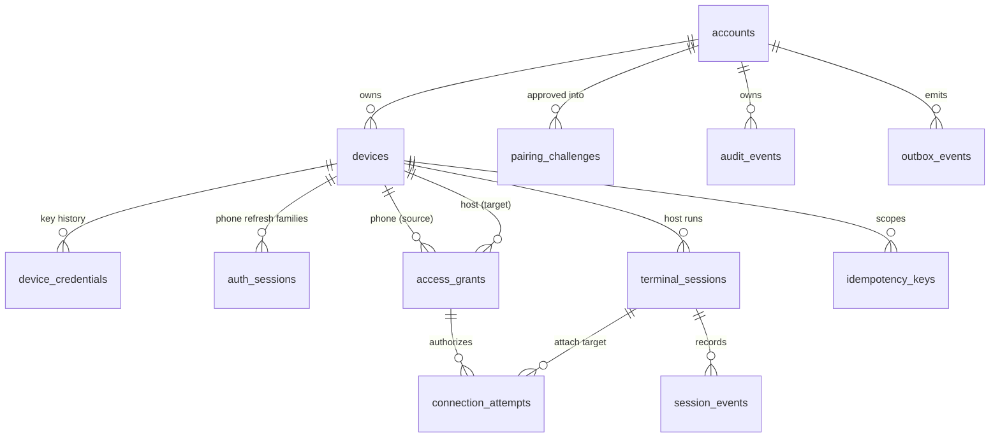

# Data Model

> **Status:** implemented. The schema lives in goose migrations under `services/control/migrations/` (`00001_init.sql` to `00003_attempt_nonce.sql`), embedded in the binary and applied at startup. Some tables exist ahead of the features that will use them; they are marked *unused* below.

PRW keeps account, device, grant, connection and session **metadata** in PostgreSQL 16 or later. It never stores terminal input or output, command lines, environment variables, private keys, raw tokens, or permanent TURN credentials.

Related: [Security model](security.md), [API reference](api.md).

---

## 1. Design principles

| Principle | How it is enforced |
|---|---|
| **N phones × M hosts** | A single `devices` table with a `kind` column. There is no fixed number of devices. |
| **Same-account, right-kind references** | `devices` has a `UNIQUE (account_id, id, kind)` constraint. Child tables point to it through composite foreign keys that include generated constant columns (`phone_kind = 'phone'`, `host_kind = 'host'`). A grant therefore cannot link a phone in one account to a host in another, or put a host where a phone belongs. |
| **Administrative state is separate from presence** | `devices.admin_state` is one of `pending`, `active` or `revoked`. Presence (`online`, `stale`, `offline`) is **derived** from the live agent WebSocket registry and `last_seen_at`. It is never stored as a status. |
| **History is preserved** | Revocation is a soft state change. Foreign keys to `devices` are `ON DELETE RESTRICT`, so deleting a device never cascades through grants, attempts, sessions or audit records. |
| **No usable secrets at rest** | Refresh tokens are stored as SHA-256 hashes. Pairing refs, codes and wait tokens are stored as HMAC-SHA-256 with a server pepper kept outside the database. Signed tickets are never stored, only their `jti`. Private keys never reach the database. |
| **IDs** | UUIDv7, generated by the application. They are time-ordered, which suits indexes. There is no `pgcrypto` dependency. |
| **Time** | Every timestamp is `timestamptz` in UTC. The application measures timeouts with monotonic clocks. |
| **Optimistic concurrency** | Mutable rows carry a `version` column. Updates send `If-Match` and get 412 when the version has changed. |

## 2. Entity relationships



## 3. Tables

| Table | Purpose | Key constraints |
|---|---|---|
| `accounts` | One row per operator identity. | `UNIQUE (identity_provider, identity_subject)`. Provider is limited to `google`. The allowlist lives in configuration (`PRW_ALLOWED_SUBJECTS`), not in the database. |
| `devices` | Phones and hosts. | `kind` is `phone` or `host`. Platform is `android`, `ios` or `linux`. A P-256 SPKI public key with its fingerprint. A live fingerprint is unique per account among non-revoked devices. `admin_state` must be `revoked` exactly when `revoked_at` is set. `capabilities` JSONB holds only host-reported features (for example `tmux`) and is capped at 4 KiB. |
| `device_credentials` | Public-key history for rotation and audit. A row is written for every enrolled device. | At most one `active` key per purpose. Composite FK to the device. |
| `auth_sessions` | Refresh-token families, phones only. | `refresh_token_hash UNIQUE`. `rotated_from_id` chains rotations; presenting an already-rotated token is reuse and revokes the whole family. Composite FK, kind fixed to `phone`. |
| `pairing_challenges` | One-time host enrollment. | `ref_hmac`, `code_hmac` and `wait_token_hmac` are each `UNIQUE`. Status moves through `pending`, `approved`, `consumed`, `expired`, `canceled` and `locked`. `failed_attempts` (fingerprint mismatches at approval) triggers the lock at 5. `account_id` is set only on approval. `grant_to_device_id` (migration 00002) remembers which phone asked for a grant when the host completes. |
| `access_grants` | An explicit phone → host capability. | Composite FKs check same account and correct kinds. Partial unique index allows one active grant per pair. Optional `expires_at`. `version`. A revoked grant is never reactivated; re-granting creates a new row. |
| `connection_attempts` | Authorized connection negotiations. | `ticket_jti UNIQUE`. `grant_id` references the authorizing grant. `path_type` is one of `direct`, `turn_udp`, `turn_tcp`, `turn_tls`, `wss_relay` or `unknown`. Idempotency key is unique per phone. Optional `target_terminal_session_id` records an attach intent. `attestation_nonce` (migration 00003) is kept so an idempotent retry can re-sign the same ticket. `ended_at` is set when the attempt fails, is canceled or revoked, or when a connected session ends (the status keeps its `connected_*` value). |
| `terminal_sessions` | Metadata about host processes (*unused*: the agent does not report session metadata yet). | `UNIQUE (host_device_id, host_session_handle)` (the tmux session name). `UNIQUE (host_device_id, client_request_id)` for idempotent creation. `backend` is `tmux` or `pty`. `persistent` flag. `version`. |
| `session_events` | Append-only session lifecycle log (*unused*). | Metadata JSON capped at 2 KiB and limited to an allowlist of keys. |
| `audit_events` | Security and administrative events. | Includes `request_id` and `attempt_id` for correlation and an `actor_kind`. Metadata is allowlisted and capped at 2 KiB. The application role cannot update these rows; the retention job is the only thing that deletes them. |
| `idempotency_keys` | Makes create requests safe to retry (*unused*: the only Idem endpoint, `POST /v1/connections`, keeps its key on the attempt row). | `UNIQUE (device_id, operation, idempotency_key)`. Stores a digest of the request and a reference to the resulting resource, not the response body. |
| `outbox_events` | Transactional delivery of revocation and grant events. | `dedupe_key UNIQUE`. Includes `dead_lettered_at` (not used yet: delivery is a single best-effort attempt). |
| `signing_keys_meta` | Public metadata for the server signing keys, used for JWKS and key pinning (*unused*: the JWKS is derived from the key files). | Private keys are never stored here. |

## 4. Initial migration

The DDL below is `00001_init.sql`. Two later migrations add columns:

| Migration | Change |
|---|---|
| `00002_pairing_grant_intent.sql` | `pairing_challenges.grant_to_device_id`, with an account-scoped FK to `devices`, for "grant this phone access" at approval time |
| `00003_attempt_nonce.sql` | `connection_attempts.attestation_nonce` (32 bytes) and `host_relay_jti`, so an idempotent retry of `POST /v1/connections` can re-sign the same ticket |

```sql
-- +goose Up
-- +goose StatementBegin
CREATE FUNCTION set_updated_at() RETURNS trigger LANGUAGE plpgsql AS $$
BEGIN NEW.updated_at := now(); RETURN NEW; END $$;
-- +goose StatementEnd

CREATE TABLE accounts (
  id                UUID PRIMARY KEY,                       -- app-generated UUIDv7
  identity_provider TEXT NOT NULL CHECK (identity_provider IN ('google')),
  identity_subject  TEXT NOT NULL CHECK (length(identity_subject) BETWEEN 1 AND 255),
  email             TEXT CHECK (length(email) <= 320),       -- only if verified by Google
  display_name      TEXT CHECK (length(display_name) <= 120),
  status            TEXT NOT NULL DEFAULT 'active'
                    CHECK (status IN ('active','suspended','deletion_pending','deleted')),
  created_at        TIMESTAMPTZ NOT NULL DEFAULT now(),
  updated_at        TIMESTAMPTZ NOT NULL DEFAULT now(),
  UNIQUE (identity_provider, identity_subject)
);
CREATE TRIGGER trg_accounts_updated BEFORE UPDATE ON accounts
  FOR EACH ROW EXECUTE FUNCTION set_updated_at();

CREATE TABLE devices (
  id               UUID PRIMARY KEY,
  account_id       UUID NOT NULL REFERENCES accounts(id) ON DELETE RESTRICT,
  kind             TEXT NOT NULL CHECK (kind IN ('phone','host')),
  platform         TEXT NOT NULL CHECK (platform IN ('android','ios','linux')),
  display_name     TEXT NOT NULL CHECK (length(display_name) BETWEEN 1 AND 120),
  public_key       BYTEA NOT NULL,                          -- SPKI DER, ECDSA P-256
  public_key_alg   TEXT NOT NULL DEFAULT 'ecdsa-p256' CHECK (public_key_alg IN ('ecdsa-p256')),
  key_fingerprint  TEXT NOT NULL,                           -- hex(sha256(SPKI))
  software_version TEXT CHECK (length(software_version) <= 64),
  protocol_version INT  NOT NULL DEFAULT 1,
  capabilities     JSONB NOT NULL DEFAULT '{}'::jsonb CHECK (pg_column_size(capabilities) <= 4096),
  admin_state      TEXT NOT NULL DEFAULT 'active' CHECK (admin_state IN ('pending','active','revoked')),
  last_seen_at     TIMESTAMPTZ,                             -- presence is derived from this + live WSS
  enrolled_at      TIMESTAMPTZ NOT NULL DEFAULT now(),
  revoked_at       TIMESTAMPTZ,
  revoke_reason    TEXT CHECK (revoke_reason IN ('user','lost','compromised','replaced','admin')),
  version          INT  NOT NULL DEFAULT 1,
  created_at       TIMESTAMPTZ NOT NULL DEFAULT now(),
  updated_at       TIMESTAMPTZ NOT NULL DEFAULT now(),
  CHECK ((admin_state = 'revoked') = (revoked_at IS NOT NULL)),
  UNIQUE (account_id, id),
  UNIQUE (account_id, id, kind)
);
CREATE UNIQUE INDEX uq_devices_live_fingerprint ON devices(account_id, key_fingerprint)
  WHERE admin_state <> 'revoked';
CREATE INDEX idx_devices_inventory ON devices(account_id, kind, admin_state);
CREATE INDEX idx_devices_recent    ON devices(account_id, last_seen_at DESC NULLS LAST);
CREATE TRIGGER trg_devices_updated BEFORE UPDATE ON devices
  FOR EACH ROW EXECUTE FUNCTION set_updated_at();

CREATE TABLE device_credentials (
  id              UUID PRIMARY KEY,
  account_id      UUID NOT NULL,
  device_id       UUID NOT NULL,
  key_purpose     TEXT NOT NULL CHECK (key_purpose IN ('identity_signing')),
  alg             TEXT NOT NULL CHECK (alg IN ('ecdsa-p256')),
  public_key      BYTEA NOT NULL,
  key_fingerprint TEXT NOT NULL,
  status          TEXT NOT NULL DEFAULT 'active' CHECK (status IN ('active','rotating','revoked','expired')),
  created_at      TIMESTAMPTZ NOT NULL DEFAULT now(),
  expires_at      TIMESTAMPTZ,
  revoked_at      TIMESTAMPTZ,
  CHECK ((status = 'revoked') = (revoked_at IS NOT NULL)),
  UNIQUE (device_id, key_fingerprint),
  FOREIGN KEY (account_id, device_id) REFERENCES devices(account_id, id) ON DELETE RESTRICT
);
CREATE UNIQUE INDEX uq_device_cred_active ON device_credentials(device_id, key_purpose)
  WHERE status = 'active';

CREATE TABLE auth_sessions (                                -- phones only
  id                 UUID PRIMARY KEY,
  account_id         UUID NOT NULL,
  device_id          UUID NOT NULL,
  device_kind        TEXT GENERATED ALWAYS AS ('phone') STORED,
  token_family_id    UUID NOT NULL,
  refresh_token_hash BYTEA NOT NULL UNIQUE,                 -- SHA-256 of 256-bit random token
  rotated_from_id    UUID REFERENCES auth_sessions(id) ON DELETE SET NULL,
  created_at         TIMESTAMPTZ NOT NULL DEFAULT now(),
  last_used_at       TIMESTAMPTZ,
  expires_at         TIMESTAMPTZ NOT NULL,
  revoked_at         TIMESTAMPTZ,
  revoke_reason      TEXT CHECK (revoke_reason IN
                       ('logout','rotated','reuse_detected','device_revoked','admin','expired')),
  user_agent_summary TEXT CHECK (length(user_agent_summary) <= 255),
  CHECK (expires_at > created_at),
  FOREIGN KEY (account_id, device_id, device_kind) REFERENCES devices(account_id, id, kind) ON DELETE RESTRICT
);
CREATE INDEX idx_auth_sessions_family ON auth_sessions(token_family_id) WHERE revoked_at IS NULL;
CREATE INDEX idx_auth_sessions_device ON auth_sessions(device_id, expires_at) WHERE revoked_at IS NULL;

CREATE TABLE pairing_challenges (
  id                    UUID PRIMARY KEY,
  ref_hmac              BYTEA NOT NULL UNIQUE,              -- HMAC-SHA256(pepper, 'ref:'||ref)
  code_hmac             BYTEA NOT NULL UNIQUE,              -- HMAC-SHA256(pepper, 'code:'||normalized code)
  wait_token_hmac       BYTEA NOT NULL UNIQUE,              -- authenticates host wait/complete/cancel
  host_public_key       BYTEA NOT NULL,
  host_key_fingerprint  TEXT NOT NULL,
  host_name             TEXT NOT NULL CHECK (length(host_name) BETWEEN 1 AND 120),
  host_platform         TEXT NOT NULL CHECK (host_platform IN ('linux')),
  host_os               TEXT CHECK (length(host_os) <= 64),
  agent_version         TEXT NOT NULL CHECK (length(agent_version) <= 64),
  server_nonce          BYTEA NOT NULL CHECK (length(server_nonce) = 32),
  approve_nonce         BYTEA CHECK (approve_nonce IS NULL OR length(approve_nonce) = 32),
  status                TEXT NOT NULL DEFAULT 'pending'
                        CHECK (status IN ('pending','approved','consumed','expired','canceled','locked')),
  failed_attempts       INT NOT NULL DEFAULT 0 CHECK (failed_attempts BETWEEN 0 AND 100),
  account_id            UUID REFERENCES accounts(id) ON DELETE RESTRICT,
  approved_by_device_id UUID,
  approved_at           TIMESTAMPTZ,
  consumed_at           TIMESTAMPTZ,
  resulting_device_id   UUID REFERENCES devices(id) ON DELETE RESTRICT,
  requester_ip_hash     BYTEA,
  expires_at            TIMESTAMPTZ NOT NULL,
  created_at            TIMESTAMPTZ NOT NULL DEFAULT now(),
  CHECK (expires_at > created_at),
  CHECK (status NOT IN ('approved','consumed') OR account_id IS NOT NULL),
  FOREIGN KEY (account_id, approved_by_device_id) REFERENCES devices(account_id, id) ON DELETE RESTRICT
);
CREATE INDEX idx_pairing_live_expiry ON pairing_challenges(expires_at) WHERE status IN ('pending','approved');

CREATE TABLE access_grants (
  id                   UUID PRIMARY KEY,
  account_id           UUID NOT NULL REFERENCES accounts(id) ON DELETE RESTRICT,
  phone_device_id      UUID NOT NULL,
  phone_kind           TEXT GENERATED ALWAYS AS ('phone') STORED,
  host_device_id       UUID NOT NULL,
  host_kind            TEXT GENERATED ALWAYS AS ('host') STORED,
  capabilities         TEXT[] NOT NULL DEFAULT ARRAY['terminal'],
  expires_at           TIMESTAMPTZ,                         -- NULL = no expiry
  created_by_device_id UUID,
  revoked_at           TIMESTAMPTZ,
  revoked_by_device_id UUID,
  revoke_reason        TEXT CHECK (length(revoke_reason) <= 64),
  version              INT NOT NULL DEFAULT 1,
  created_at           TIMESTAMPTZ NOT NULL DEFAULT now(),
  updated_at           TIMESTAMPTZ NOT NULL DEFAULT now(),
  CHECK (cardinality(capabilities) > 0),
  CHECK (capabilities <@ ARRAY['terminal','file_transfer','port_forward']::TEXT[]),
  CHECK (expires_at IS NULL OR expires_at > created_at),
  FOREIGN KEY (account_id, phone_device_id, phone_kind) REFERENCES devices(account_id, id, kind) ON DELETE RESTRICT,
  FOREIGN KEY (account_id, host_device_id,  host_kind)  REFERENCES devices(account_id, id, kind) ON DELETE RESTRICT,
  FOREIGN KEY (account_id, created_by_device_id) REFERENCES devices(account_id, id) ON DELETE RESTRICT,
  FOREIGN KEY (account_id, revoked_by_device_id) REFERENCES devices(account_id, id) ON DELETE RESTRICT
);
CREATE UNIQUE INDEX uq_grant_active_pair ON access_grants(phone_device_id, host_device_id) WHERE revoked_at IS NULL;
CREATE INDEX idx_grants_host_active ON access_grants(host_device_id) WHERE revoked_at IS NULL;
CREATE INDEX idx_grants_account ON access_grants(account_id, created_at DESC);
CREATE TRIGGER trg_grants_updated BEFORE UPDATE ON access_grants
  FOR EACH ROW EXECUTE FUNCTION set_updated_at();

CREATE TABLE terminal_sessions (
  id                         UUID PRIMARY KEY,
  account_id                 UUID NOT NULL REFERENCES accounts(id) ON DELETE RESTRICT,
  host_device_id             UUID NOT NULL,
  host_kind                  TEXT GENERATED ALWAYS AS ('host') STORED,
  created_by_phone_device_id UUID,
  phone_kind                 TEXT GENERATED ALWAYS AS ('phone') STORED,
  host_session_handle        TEXT NOT NULL CHECK (length(host_session_handle) <= 128),  -- e.g. prw-<uuid>
  client_request_id          UUID NOT NULL,
  backend                    TEXT NOT NULL CHECK (backend IN ('tmux','pty')),
  persistent                 BOOLEAN NOT NULL,
  title                      TEXT NOT NULL DEFAULT 'Terminal' CHECK (length(title) <= 120),
  shell_kind                 TEXT CHECK (length(shell_kind) <= 32),                    -- basename only
  working_directory_label    TEXT CHECK (length(working_directory_label) <= 255),      -- opt-in
  status                     TEXT NOT NULL DEFAULT 'starting' CHECK (status IN
                               ('starting','attached','detached','exited','terminated','failed',
                                'host_rebooted','revoked','unknown')),
  attached_clients           INT NOT NULL DEFAULT 0 CHECK (attached_clients >= 0),
  started_at                 TIMESTAMPTZ,
  last_attached_at           TIMESTAMPTZ,
  ended_at                   TIMESTAMPTZ,
  exit_code                  INT,
  version                    INT NOT NULL DEFAULT 1,
  created_at                 TIMESTAMPTZ NOT NULL DEFAULT now(),
  updated_at                 TIMESTAMPTZ NOT NULL DEFAULT now(),
  UNIQUE (host_device_id, host_session_handle),
  UNIQUE (host_device_id, client_request_id),
  FOREIGN KEY (account_id, host_device_id, host_kind) REFERENCES devices(account_id, id, kind) ON DELETE RESTRICT,
  FOREIGN KEY (account_id, created_by_phone_device_id, phone_kind)
    REFERENCES devices(account_id, id, kind) ON DELETE RESTRICT
);
CREATE INDEX idx_tsess_host_status    ON terminal_sessions(host_device_id, status, last_attached_at DESC);
CREATE INDEX idx_tsess_account_recent ON terminal_sessions(account_id, updated_at DESC);
CREATE TRIGGER trg_tsess_updated BEFORE UPDATE ON terminal_sessions
  FOR EACH ROW EXECUTE FUNCTION set_updated_at();

CREATE TABLE connection_attempts (
  id                         UUID PRIMARY KEY,
  account_id                 UUID NOT NULL REFERENCES accounts(id) ON DELETE RESTRICT,
  phone_device_id            UUID NOT NULL,
  phone_kind                 TEXT GENERATED ALWAYS AS ('phone') STORED,
  host_device_id             UUID NOT NULL,
  host_kind                  TEXT GENERATED ALWAYS AS ('host') STORED,
  grant_id                   UUID NOT NULL REFERENCES access_grants(id) ON DELETE RESTRICT,
  requested_capability       TEXT NOT NULL CHECK (requested_capability IN ('terminal')),
  target_terminal_session_id UUID REFERENCES terminal_sessions(id) ON DELETE SET NULL,
  status                     TEXT NOT NULL DEFAULT 'authorized' CHECK (status IN
                               ('authorized','signaling','ice_checking','relay_fallback',
                                'connected_direct','connected_relay','connected_wss',
                                'failed','canceled','expired','revoked')),
  ticket_jti                 UUID NOT NULL UNIQUE,          -- signed ticket itself is never stored
  ticket_expires_at          TIMESTAMPTZ NOT NULL,
  attestation_nonce_hash     BYTEA NOT NULL,                -- SHA-256 of the server nonce
  idempotency_key            TEXT CHECK (length(idempotency_key) <= 128),
  path_type                  TEXT CHECK (path_type IN
                               ('direct','turn_udp','turn_tcp','turn_tls','wss_relay','unknown')),
  failure_code               TEXT CHECK (length(failure_code) <= 96),
  created_at                 TIMESTAMPTZ NOT NULL DEFAULT now(),
  connected_at               TIMESTAMPTZ,
  ended_at                   TIMESTAMPTZ,
  CHECK (ticket_expires_at > created_at),
  UNIQUE (phone_device_id, idempotency_key),
  FOREIGN KEY (account_id, phone_device_id, phone_kind) REFERENCES devices(account_id, id, kind) ON DELETE RESTRICT,
  FOREIGN KEY (account_id, host_device_id,  host_kind)  REFERENCES devices(account_id, id, kind) ON DELETE RESTRICT
);
CREATE INDEX idx_attempts_host_live ON connection_attempts(host_device_id, ticket_expires_at)
  WHERE status IN ('authorized','signaling','ice_checking','relay_fallback');
CREATE INDEX idx_attempts_account_recent ON connection_attempts(account_id, created_at DESC);
CREATE INDEX idx_attempts_live_by_grant  ON connection_attempts(grant_id)
  WHERE status IN ('connected_direct','connected_relay','connected_wss');

CREATE TABLE session_events (
  id                    BIGINT GENERATED ALWAYS AS IDENTITY PRIMARY KEY,
  account_id            UUID NOT NULL REFERENCES accounts(id) ON DELETE RESTRICT,
  terminal_session_id   UUID NOT NULL REFERENCES terminal_sessions(id) ON DELETE RESTRICT,
  connection_attempt_id UUID REFERENCES connection_attempts(id) ON DELETE SET NULL,
  actor_device_id       UUID REFERENCES devices(id) ON DELETE RESTRICT,
  event_type            TEXT NOT NULL CHECK (event_type IN
                          ('requested','started','attached','attach_denied','detached','reconnected',
                           'terminated','exited','failed','revoked','host_rebooted')),
  occurred_at           TIMESTAMPTZ NOT NULL DEFAULT now(),
  metadata              JSONB NOT NULL DEFAULT '{}'::jsonb CHECK (pg_column_size(metadata) <= 2048)
);
CREATE INDEX idx_sevents_session ON session_events(terminal_session_id, occurred_at DESC);
CREATE INDEX idx_sevents_account ON session_events(account_id, occurred_at DESC);

CREATE TABLE audit_events (
  id               BIGINT GENERATED ALWAYS AS IDENTITY PRIMARY KEY,
  account_id       UUID REFERENCES accounts(id) ON DELETE RESTRICT,   -- NULL for pre-auth events
  actor_kind       TEXT NOT NULL CHECK (actor_kind IN ('user','phone','host','system','anonymous')),
  actor_device_id  UUID REFERENCES devices(id) ON DELETE RESTRICT,
  target_device_id UUID REFERENCES devices(id) ON DELETE RESTRICT,
  event_type       TEXT NOT NULL CHECK (length(event_type) <= 80),
  outcome          TEXT NOT NULL CHECK (outcome IN ('success','denied','failure')),
  reason_code      TEXT CHECK (length(reason_code) <= 100),
  request_id       TEXT CHECK (length(request_id) <= 64),
  attempt_id       UUID,
  occurred_at      TIMESTAMPTZ NOT NULL DEFAULT now(),
  metadata         JSONB NOT NULL DEFAULT '{}'::jsonb CHECK (pg_column_size(metadata) <= 2048)
);
CREATE INDEX idx_audit_account_time ON audit_events(account_id, occurred_at DESC);
CREATE INDEX idx_audit_target_time  ON audit_events(target_device_id, occurred_at DESC);
CREATE INDEX idx_audit_time         ON audit_events(occurred_at);

CREATE TABLE idempotency_keys (
  id                   UUID PRIMARY KEY,
  account_id           UUID NOT NULL REFERENCES accounts(id) ON DELETE RESTRICT,
  device_id            UUID NOT NULL REFERENCES devices(id) ON DELETE RESTRICT,
  operation            TEXT NOT NULL CHECK (length(operation) <= 100),
  idempotency_key      TEXT NOT NULL CHECK (length(idempotency_key) BETWEEN 16 AND 128),
  request_digest       BYTEA NOT NULL,
  response_status      INT,
  response_resource_id UUID,
  created_at           TIMESTAMPTZ NOT NULL DEFAULT now(),
  expires_at           TIMESTAMPTZ NOT NULL,
  UNIQUE (device_id, operation, idempotency_key),
  CHECK (expires_at > created_at)
);
CREATE INDEX idx_idem_expiry ON idempotency_keys(expires_at);

CREATE TABLE outbox_events (
  id               UUID PRIMARY KEY,
  account_id       UUID REFERENCES accounts(id) ON DELETE RESTRICT,
  aggregate_type   TEXT NOT NULL,
  aggregate_id     UUID NOT NULL,
  event_type       TEXT NOT NULL,
  dedupe_key       TEXT NOT NULL UNIQUE,                    -- e.g. grant_revoked:<id>:<version>
  payload          JSONB NOT NULL CHECK (pg_column_size(payload) <= 4096),
  created_at       TIMESTAMPTZ NOT NULL DEFAULT now(),
  available_at     TIMESTAMPTZ NOT NULL DEFAULT now(),
  processed_at     TIMESTAMPTZ,
  dead_lettered_at TIMESTAMPTZ,
  attempts         INT NOT NULL DEFAULT 0 CHECK (attempts >= 0),
  last_error_code  TEXT
);
CREATE INDEX idx_outbox_pending ON outbox_events(available_at)
  WHERE processed_at IS NULL AND dead_lettered_at IS NULL;

CREATE TABLE signing_keys_meta (
  kid        TEXT PRIMARY KEY,
  purpose    TEXT NOT NULL CHECK (purpose IN ('ticket','access_token')),
  alg        TEXT NOT NULL CHECK (alg IN ('EdDSA')),
  public_key BYTEA NOT NULL,                                -- Ed25519 public key only
  not_before TIMESTAMPTZ NOT NULL,
  not_after  TIMESTAMPTZ,
  retired_at TIMESTAMPTZ,
  created_at TIMESTAMPTZ NOT NULL DEFAULT now()
);

-- +goose Down
DROP TABLE signing_keys_meta, outbox_events, idempotency_keys, audit_events, session_events,
           connection_attempts, terminal_sessions, access_grants, pairing_challenges,
           auth_sessions, device_credentials, devices, accounts;
DROP FUNCTION set_updated_at();
```

## 5. Index rationale

| Index | Serves |
|---|---|
| `idx_devices_inventory` | The device list, filtered by kind, excluding revoked devices |
| `idx_devices_recent` | Sorting the device list by "recently seen" |
| `uq_devices_live_fingerprint` | Guarding against enrolling the same key twice during pairing |
| `uq_grant_active_pair` | One active grant per pair, and the grant lookup when a ticket is issued |
| `idx_grants_host_active` | Building the grant-lease snapshot sent to an agent |
| `idx_attempts_host_live` | Finding pending incoming attempts when an agent reconnects |
| `idx_attempts_live_by_grant` | Revocation fan-out: finding live connections for a grant |
| `idx_tsess_host_status` | The per-host session picker |
| `idx_audit_*` | The activity feed, per-device audit views, and retention pruning |
| `idx_outbox_pending` | Outbox workers polling with `FOR UPDATE SKIP LOCKED` |

Every query plan is checked with `EXPLAIN (ANALYZE, BUFFERS)` against a seeded dataset of 100 devices, 10k attempts and 100k audit rows.

## 6. Transaction patterns

| Operation | Locking | Steps (one transaction unless noted) |
|---|---|---|
| **Sign-in (auth exchange)** | Read committed | 1. Verify the Google ID token and the subject allowlist, outside the transaction. 2. Upsert `accounts`. 3. Verify the device proof of possession against the server nonce. 4. Insert the phone's `devices` and `device_credentials` rows, or match an existing non-revoked device by fingerprint. 5. Insert `auth_sessions` with a new family. 6. Write the audit event. The new phone gets **no grants**. |
| **Refresh rotation** | `FOR UPDATE` on the session row, found by hash | If the row was already rotated, this is reuse: revoke the whole family and return 401. Otherwise verify the device signature, revoke the old row, insert the successor with `rotated_from_id`, and update `last_used_at`. |
| **Pairing create** | Single `INSERT` | Store the HMACs. Retry on a unique-key collision. |
| **Pairing approve** (phone) | `FOR UPDATE` on the challenge | Require `pending` and unexpired. If the request fingerprint differs from the stored one, increment `failed_attempts` in the same transaction (at 5, set `locked`), write an audit event and return 409. Otherwise set `approved`, `account_id`, `approve_nonce` and `grant_to_device_id`, and write an audit row. |
| **Pairing complete** (host) | `FOR UPDATE` on the challenge | Require `approved` and unexpired. Verify the wait-token HMAC and the host signature over the approve nonce. Insert the host's `devices` and `device_credentials` rows, set `consumed`, and create the requested grant. A replay sees `consumed` and fails. |
| **Grant create** | — | Composite FKs enforce the account and kinds. Both devices must be `active`. A unique violation returns 409 `grant_exists`. Write outbox (`grant_created`, which pushes a fresh lease) and audit rows. |
| **Grant revoke** | `UPDATE … WHERE id, account_id, version, revoked_at IS NULL` | Zero rows updated returns 404, 409 `grant_revoked` or 412. Write outbox (`grant_revoked`) and audit rows. Delivery happens after commit. Marking the grant's live attempts `revoked` is *planned*; the host closes the connections. |
| **Device revoke** | Version-checked `UPDATE` | Set `admin_state='revoked'`. Revoke all of its grants and auth sessions, and mark its live attempts (no `ended_at` yet) `revoked`. Write outbox and audit rows. Revoking `device_credentials` rows is *planned*. |
| **Connection attempt create** | — | Check idempotency: the same key for the same host within 60 s, while the attempt is still `authorized`, returns the stored attempt with re-signed tokens; any other reuse returns 422. Re-read the grant and the device states, check host presence and rate limits. Insert the attempt with its `jti` and nonce, sign the ticket from the stored claims, notify the host, and write audit. |
| **Attempt status** (from phone or agent) | `FOR UPDATE` on the attempt | Apply only valid transitions; set `connected_at` on the first `connected_*` and `ended_at` on `failed` or `canceled`. An agent `ended` report sets `ended_at` on a connected attempt without changing its status. |
| **Session metadata ingest** (from agent) | Upsert on `(host_device_id, client_request_id)` | *Planned.* The agent will be the source of truth; `version` drops stale updates. |

One-time consumption (pairing challenges, ticket `jti`) always relies on row locks or unique constraints, never on in-memory checks alone.

## 7. Database roles (*planned*)

The dev stack and tests use a single database user that owns the schema and runs the migrations at startup. The split below is the production target.

| Role | Rights |
|---|---|
| `prw_owner` | Owns the schema. Used only by the migration job. |
| `prw_app` | Read and write data. No DDL, no `TRUNCATE`. `DELETE` only on tables managed by the retention job. No `UPDATE` on `audit_events`. |
| `prw_backup` | `pg_read_all_data`, for `pg_dump`. |

Row-level security is **deferred**. With a single operator account, tenant isolation comes from three things: account-scoped queries (the account ID always comes from the auth context), composite foreign keys, and a two-account isolation test suite. RLS becomes mandatory if PRW ever becomes multi-user.

## 8. Retention (*planned*)

No retention jobs run yet. All values are *proposed*; the jobs will run inside the control plane.

| Data | Rule | Cadence |
|---|---|---|
| `pairing_challenges` | Delete 24 h after reaching a terminal state or expiring | Hourly |
| `connection_attempts` | Mark `expired` when the ticket expired without connecting; delete after 30 d | Every minute / daily |
| `idempotency_keys` | Delete after `expires_at` (24 h) | Hourly |
| `terminal_sessions` and `session_events` | Delete 90 d after `ended_at` | Daily |
| `audit_events` | Delete after 180 d | Daily |
| `auth_sessions` | Delete 30 d after revocation or expiry | Daily |
| `outbox_events` | Delete processed rows after 7 d; keep dead-lettered rows for 30 d | Daily |

## 9. Migrations

- **Tooling:** [goose](https://github.com/pressly/goose) SQL migrations under `services/control/migrations/`, embedded with `go:embed` and applied by `prw-control serve` at startup. Queries are hand-written SQL on pgx v5 in `internal/store`; there is no ORM and sqlc was not adopted.
- **Forward-only in production.** Changes use expand/contract: add a nullable column, backfill it, then enforce `NOT NULL` in a later release. Down sections exist only so CI can run up → down → up.
- **Tests** run against a throwaway `postgres:16-alpine` container started by `internal/dbtest` (`PRW_REQUIRE_DB=1` turns a missing Docker into a failure instead of a skip, as CI does). They cover the migrations, composite-FK rejection (a cross-account grant and a wrong-kind grant must both fail at the database) and every store and API path.
- **Concurrent migrators** are not locked out: the provider runs without goose's session locker, which is safe while a single control-plane instance migrates at startup. Enabling the advisory lock is *planned* before running more than one instance.
- **Startup check:** migrations run before the server listens, so `/health/ready` only has to check that the database answers.

## 10. Backup and restore (*planned* with the AWS deployment)

- A nightly `pg_dump` is encrypted and sent to S3 with SSE-KMS. EBS snapshots are also taken. A dump is taken immediately before every migration.
- The restore runbook has three steps:
  1. Restore the dump.
  2. **Re-apply every revocation made after the snapshot.** The deploy log and the outbox and audit export are the sources. This keeps a restore from resurrecting a revoked device or grant.
  3. Rotate the pepper and refresh families if exposure is suspected.
- Backups contain metadata and hashes only. Private keys and raw tokens are never in the database.
