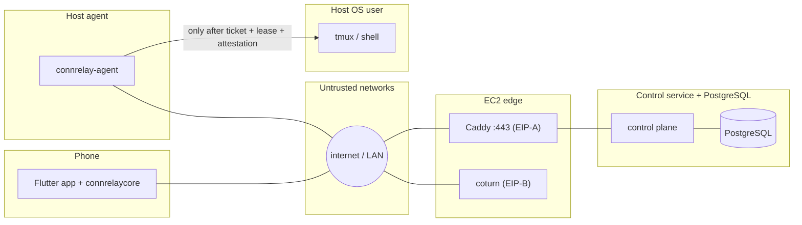
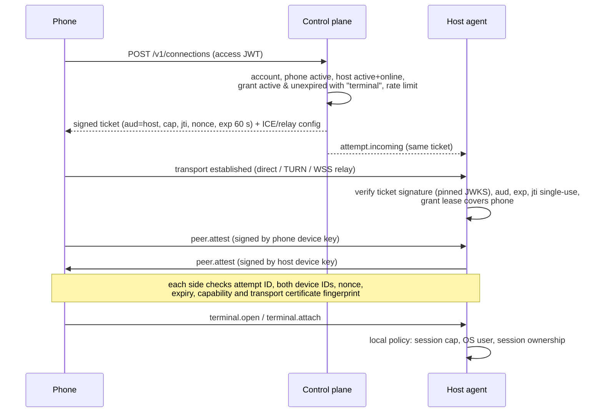

# Security Model

> **Status:** the authorization chain (§5), revocation (§6) and key handling (§4) are implemented for Linux hosts and Android. Controls that are not built yet are marked *planned*; production controls tied to the AWS deployment (Caddy, coturn, SSM, backups) are the target design. Items marked *proposed* have not been confirmed and may change.

ConnRelay lets a phone open a shell on a computer. A shell runs with the full privileges of the host user, so the whole design rests on one rule. **Nothing a phone sends reaches the shell unless the control plane authorized it, the host checked it independently, and both peers proved their device identities on the live transport.**

Related documents: [Architecture overview](../architecture/overview.md), [Protocol](protocol.md), [Data model](data-model.md), [API](api.md).

---

## 1. Assets

| ID | Asset | Sensitivity |
|---|---|---|
| AS-01 | Host shell: the user's OS privileges, files and any credentials on disk | Critical |
| AS-02 | Terminal input and output, including secrets that tools and coding agents print | Critical |
| AS-03 | Phone device private key (Android Keystore; iOS Secure Enclave when the iOS build exists) | High |
| AS-04 | Host device private key (`~/.config/connrelay/host_key.pem`) | High |
| AS-05 | Server signing keys (Ed25519) for access tokens, tickets, relay tokens and leases | Critical |
| AS-06 | Refresh, access and agent tokens | High |
| AS-07 | Pairing references, pairing codes and the pairing HMAC pepper | High (short-lived) |
| AS-08 | TURN shared secret | Medium (risk is bandwidth abuse) |
| AS-09 | Device inventory, presence, IP addresses and audit history | Medium (privacy) |
| AS-10 | Database backups | High |
| AS-11 | Release artifacts (agent packages, app builds) | Critical (supply chain) |
| AS-12 | The owner's Google account | High |

## 2. Actors

| Actor | Capability |
|---|---|
| Unauthenticated internet attacker | Can reach both public IPs, scan, flood and guess codes |
| Phone thief | Has physical possession of an enrolled phone |
| Holder of stolen Google credentials | Can sign in to Google as the owner |
| Malicious device on the same network | Can intercept unauthenticated LAN traffic |
| Compromised host | Controls the agent, its key and its tmux sessions |
| Compromised or curious control plane or relay | Sees metadata and can tamper with signaling |
| Malicious dependency or build | Gets code execution in the agent, app or server |
| Malicious terminal output | A program or file content that emits escape sequences to the phone |

ConnRelay has a **single operator**, so there are no other account members. Multi-user accounts would need a new threat review.

## 3. Trust boundaries

The critical boundary is **agent → shell**. Every terminal operation crosses it only after the checks in §5. The control plane, TURN and the WSS relay never see terminal plaintext.

---

## 4. Identity and keys

| Key | Algorithm | Generated on | Stored at | Used for |
|---|---|---|---|---|
| Phone device key | ECDSA P-256 | Phone | Android Keystore (StrongBox when available, otherwise TEE). Not exportable. iOS Secure Enclave is *planned* with the iOS build. | Proof of possession at sign-in and refresh, and peer attestation |
| Host device key | ECDSA P-256 | Host | `$XDG_CONFIG_HOME/connrelay/host_key.pem` (default `~/.config/connrelay/`), PKCS#8 PEM, mode 0600 in a 0700 directory, owned by the agent user. The agent refuses to load it if group or others can read it. TPM storage is *proposed* for later. | Pairing proof of possession, agent WSS authentication, and peer attestation |
| Server signing keys | Ed25519 | Operator (`connrelay-control keygen`) | Files referenced by `CONNRELAY_ACCESS_SIGNING_KEY_FILE` and `CONNRELAY_TICKET_SIGNING_KEY_FILE`; in production, SSM Parameter Store mounted as files. Never in the database or image. | Access JWTs (access key); connection tickets, relay tokens and grant leases (ticket key) |
| Ephemeral transport certificates | ECDSA P-256 (DTLS/TLS) | Per connection | Memory only | WebRTC DTLS and the inner TLS 1.3 of the WSS relay |
| TURN secret | HMAC-SHA1 shared secret (TURN REST) | Operator | SSM, shared by the control plane and coturn | Short-lived TURN credentials |
| Pairing pepper | 256-bit HMAC key | Operator | SSM | Hashing pairing references, codes and wait tokens |

Private device keys never leave the device. The database stores only public keys (SPKI), fingerprints and hashes. When a host enrolls, it pins the server's ticket-verification public keys (JWKS). Key rotation, with a statement signed by the previous key, is *planned*; until then rotating the ticket key means re-pairing hosts.

**Account sign-in** uses **Google OIDC only**. The phone obtains an ID token through the platform Google Sign-In SDK, bound to a single-use server nonce. The server validates the ID token (`iss`, `aud`, signature, expiry, nonce) and then checks the Google subject against an allowlist (`CONNRELAY_ALLOWED_SUBJECTS`). There is no open sign-up. A denied sign-in is audited with a hash of the subject, and the server log records the subject itself so the operator can allowlist their own account.

**New phones.** Signing in with an allowlisted Google account enrolls the phone as a new device. No further approval is needed. A new phone starts with **no grants**: it can see the inventory but cannot open a terminal until the owner grants it access to a host. Every phone enrollment is audited and appears in the Activity feed.

---

## 5. Authorization chain

Four independent layers:

1. **Control-plane grant check** when the ticket is issued.
2. **Host-side ticket verification** against keys pinned at enrollment, with single-use `jti` and the host's grant lease. Tickets are verified on the host, so a forged or replayed ticket fails even if the API is bypassed.
3. **Peer attestation.** Each peer signs a statement that binds its enrolled device key to the certificate fingerprint of the live DTLS or TLS transport. A signaling server that swaps fingerprints is caught here.
4. **Host local policy.** Session caps, the non-root OS user, and the rule that a session belongs to this host.

The host accepts `terminal.*` messages only after both sides have sent `peer.identity_verified`. **No generic command-execution endpoint exists.** The control channel to the agent uses an allowlist of message types and can never carry terminal operations. A device appearing online grants nothing.

---

## 6. Revocation and grant leases

| Event | Effect |
|---|---|
| Grant revoked | One DB transaction marks the grant revoked and writes an audit row and an outbox event. The outbox sends the host a fresh lease and a `revoke_notice`, and notifies the phone. The agent closes the affected peer connections. |
| Phone revoked | All of the phone's grants and refresh tokens are revoked, and its live attempts are marked `revoked`, in the same transaction. Every host it could reach gets a fresh lease and a `revoke_notice`; the phone's sockets are closed with `4403`, and its API calls return `device_revoked` from then on. |
| Host revoked | All grants to the host are revoked. Its control socket is closed with `4403` and it can no longer authenticate; the agent closes every peer and exits. |

- **Target:** active connections close within **30 seconds** of revocation while the host is online.
- **Effect on terminals:** revocation **detaches** the revoked phone and closes its transport. The tmux session itself keeps running on the host, and can be reattached or terminated by an authorized phone.
- **Grant lease:** the agent holds a signed grant lease (10 min, renewed every 3 min) listing the phones allowed to connect. If revocation pushes are lost, or the control plane is unreachable, the lease expires. The agent then refuses new sessions and closes existing peer connections.
- **Immediate refusal:** new tickets are refused at once. Authorization checks always read the database (the phone's device state is re-checked on every API request); the push only speeds up enforcement.
- **Delivery:** A failed send to a connected agent is retried with backoff (1 s, doubling, capped at 60 s) and dead-lettered after 8 attempts with an error log. An agent that was offline receives a lease reflecting the change when it reconnects, and an agent whose control socket went half-open notices within 75 s and reconnects. Agent acknowledgements are *planned*.

---

## 7. Threat register

Ratings: likelihood (L) and impact (I) on an H/M/L scale. C means critical.

| ID | Threat | L | I | Mitigation | Verification |
|---|---|---|---|---|---|
| TM-01 | Account takeover (stolen Google credentials) | M | H | Allowlist, enrollment bound to the device key, new phones start with zero grants, every enrollment audited and visible in Activity. Refresh tokens are bound to the device key. Google 2-step verification is recommended. | New-device enrollment emits an audit event; refresh without the device signature fails |
| TM-02 | Device impersonation | M | H | P-256 device keys with proof of possession at sign-in, refresh and agent authentication. Attestation binds the transport to the device key. | Wrong key gives `peer_identity_mismatch`; a substituted DTLS fingerprint is rejected |
| TM-03 | Unauthorized pairing | M | H | 128-bit QR reference. 40-bit manual code with a 5-attempt lock and a 5-minute TTL. Only the authenticated owner can approve. The phone checks the host fingerprint. | Replayed, expired, guessed, locked and concurrent-approve cases |
| TM-04 | Stolen phone | M | H | OS lock, optional biometric app lock (*proposed*). The hardware key cannot be exported. Revoke from another phone; sessions detach within 30 s. | Revoke while attached closes within 30 s; a stolen refresh token without the key fails |
| TM-05 | Compromised PC | L | H | Damage is limited to that host. There are no host-to-host grants; device kind is enforced in the schema. Revoke the host. | A host token cannot call phone endpoints or obtain tickets |
| TM-06 | Unauthorized command execution | M | C | Four-layer chain (§5). No exec endpoint. | Open without a grant, with an expired or replayed ticket, with the wrong audience, or before attestation: all refused |
| TM-07 | Signaling tampering | L | H | Attestation verifies the transport fingerprint against the pinned device key. | A man-in-the-middle signaling proxy that swaps fingerprints is detected |
| TM-08 | Replay of pairing artifacts, tickets, signaling or attestations | M | H | Single-use `jti` cache on the host and single-use relay-token `jti` on the server. Server nonce, attempt ID and expiry inside the attestation. Pairing consumption is transactional. Signaling is accepted only for a live attempt between its two devices (`message_id` deduplication is *planned*). | Replay of each artifact |
| TM-09 | TURN credential misconfiguration | M | M | TURN REST HMAC credentials per attempt, TTL ≤ 10 min. The secret exists only on the server. CI scans the app for embedded credentials. | String scan of the app binary; an expired credential is rejected by coturn |
| TM-10 | Relay abuse and excessive bandwidth | M | M | TURN credentials need a valid attempt. Quotas and `max-bps`. `denied-peer-ip` for internal and metadata ranges. The WSS relay only splices the two parties of one attempt, with per-attempt rate and byte caps and an idle timeout. Byte alerts. | Allocation to 169.254.169.254 is denied; byte caps are enforced |
| TM-11 | Denial of service on API, WSS or TURN | M | M | Per-IP token buckets on sign-in and pairing, 10 attempts per minute per phone, body and frame caps, signaling caps per attempt, relay rate and byte caps. Caddy limits and per-account caps are *planned*. Established direct sessions survive until their lease expires. | Rate-limit tests return 429 and the service stays up |
| TM-12 | Token leakage | M | H | Tokens are sent only in headers or the first WebSocket message, never in URLs. The debug request log records only method, path, status and duration, never query strings or bodies. Hashed storage. | Access-log test checks that query strings are omitted; log corpus scan after an end-to-end run (*planned*) |
| TM-13 | Terminal output leaking into logs | M | C | Server components never handle terminal bytes; the relay copies opaque ciphertext. The agent logs only lifecycle events. | End-to-end canary string absent from all logs and the database (*planned*) |
| TM-14 | Secrets printed by coding agents | H | M | Scrollback lives only in memory (10 000 lines) and dies with the process. Clearing it on app lock, `FLAG_SECURE` on Android and snapshot blur on iOS are *planned* (*proposed* default on). | Scrollback is gone after the process dies |
| TM-15 | Malicious escape sequences | M | M | The vendored renderer has no clipboard-write (OSC 52) handler, so programs cannot set the phone clipboard. Nothing auto-opens. OSC 8 link confirmation, title sanitizing and a corpus test are *planned*. Pastes into the terminal need confirmation. | Escape-sequence corpus tests (*planned*) |
| TM-16 | API authorization failures (IDOR, cross-account access) | M | H | The account ID is derived from the token in every query. Composite same-account foreign keys. 404 responses for other accounts' resources. | Cross-account matrix over every route |
| TM-17 | Dependency or supply-chain compromise | M | C | Lockfiles and `govulncheck` in CI. `osv-scanner`, Dependabot, SBOM, pinned image digests and a license inventory are *planned*. | CI fails on known vulnerabilities |
| TM-18 | Secrets committed to Git | M | H | gitleaks in CI over the full history. `.gitignore` for keys and `.env`. Placeholders only in docs and tests. | gitleaks job |
| TM-19 | Over-permissive Linux service | M | H | `systemd --user` service with `NoNewPrivileges=yes` and `UMask=0077`. The agent refuses UID 0 and refuses a key file readable by group or others. | Running as root exits; bad permissions exit |
| TM-20 | Compromised agent update | L | C | Manual updates in V1. Signed packages, checksums and signature checks in the install script are *planned*. | The installer rejects a bad signature (*planned*) |
| TM-21 | Persistent outbound channel abused as command and control | L | C | The control channel accepts only allowlisted message types and cannot carry terminal operations. Terminal operations need an attested phone key. | Unknown control message types are dropped and logged |
| TM-22 | Resource exhaustion | M | M | Credit-based flow control (≤ 256 KiB in flight). Per host: 20 sessions and 8 peers. Message caps. tmux `history-limit`. Phone scrollback capped at 10k lines. | 50 MB burst, `yes` flood, a 21st session refused |
| TM-23 | Protocol downgrade | L | M | Version negotiation with a minimum supported version. The protocol version is included in the attestation. | An old version gets `unsupported_version` |
| TM-24 | Control plane compromised | L | C | It can deny service, observe metadata, and enroll and grant a new attacker phone. It cannot impersonate an *existing* enrolled phone. Host-side confirmation of newly granted phones is *proposed* for a later release. | Tabletop exercise |
| TM-25 | Database or backup leak | L | H | Only public keys and hashes are stored. Refresh tokens are SHA-256 hashed; pairing secrets are HMACed with a pepper held outside the DB. Backups are encrypted. | Scripted inspection of a dump for secrets |

---

## 8. Compromise playbooks

| Scenario | Impact | Containment | Recovery |
|---|---|---|---|
| **Stolen Google account** | The attacker can enroll a new phone, which starts with zero grants. They could then grant it access through the API. | A new device shows up in Activity. Revoke it, revoke other refresh families, change the Google password and enable 2-step verification. | Review the audit log for grants and connections. |
| **Lost phone** | The attacker still needs the OS unlock, and the app lock if enabled. | Revoke the phone from another phone. A server-side break-glass command (`connrelay-admin device revoke`) is *planned*. | New tickets are denied at once and sessions detach within 30 s. Enroll the replacement phone. |
| **Compromised host** | That host's shell and key are exposed. | Revoke the host. Phones then reject its key. | Rebuild the host, generate a new key and re-pair. Other hosts are unaffected. |
| **Control plane down** | No new connections can be made. WSS-relayed and TURN-relayed sessions drop, while direct sessions continue. | None needed. Existing direct sessions run until the grant lease expires (≤ 10 min), then the agent closes them. tmux sessions keep running. | Restore the EC2 instance. Agents reconnect automatically. |
| **Control plane compromised** | See TM-24. | Lock down the security groups and keep a disk snapshot. | Rebuild from IaC with pinned images. Rotate the signing keys, TURN secret and pairing pepper, and revoke all refresh families. Agents re-pin keys via a signed rotation statement, or re-pair if trust is lost. |
| **Database leak** | Metadata is exposed. Token hashes cannot be reversed, and pairing secrets are either expired or HMAC-protected. | Rotate the pepper and the refresh families. | Review what was exposed. |

---

## 9. Logging and redaction policy

| Never logged anywhere | Allowed |
|---|---|
| Terminal input or output, command lines, environment variables | `request_id`, `attempt_id`, `device_id`, `terminal_session_id` |
| Access, refresh and agent tokens; tickets; relay tokens | Error codes, HTTP status, durations, byte counts |
| Pairing references and codes | Path type (`direct`, `turn_*`, `wss_relay`) and ICE candidate *types* |
| TURN credentials or secrets | Coarse platform, app version and agent version |
| Raw SDP and candidate IP addresses | Public IP for login and pairing audit events (retained 30 days, *proposed*) |
| Private keys and signatures | Key fingerprints, truncated to 16 hex characters in the UI |
| Query strings and request bodies | Request method, path, status and duration (debug-level access log) |
| | The Google subject of a **denied** sign-in, so the operator can allowlist it. It identifies an account, not a credential; the audit record stores only a hash. |

Enforcement:
- Logging uses `slog` with JSON output and explicit attributes. The control plane's access log runs only at debug level (`CONNRELAY_LOG_LEVEL=debug`, which the dev stack sets) and omits query strings, which can carry cursors.
- A lint rule forbidding request-body logging is *planned*.
- An end-to-end canary test that checks terminal content never reaches any log is *planned*.

## 10. coturn hardening

coturn must be version **4.18 or later**, because 4.18 fixes the 2026 advisories: ACME-redirect memory disclosure, MOBILITY allocation takeover, admin-panel SQL injection, loopback ACL bypass, DTLS pre-cookie DoS, OAuth token overflow, and weak RNG.

Required configuration:
- `use-auth-secret` with short-lived credentials;
- no web admin, CLI, Redis or database backend, OAuth, or mobility;
- DTLS listener off;
- no `acme-redirect`;
- `denied-peer-ip` covering RFC 1918, loopback, link-local, CGNAT `100.64.0.0/10`, `169.254.169.254`, IPv4-mapped IPv6 (`::ffff:0:0/96`), ULA and IPv6 loopback;
- `no-multicast-peers`;
- per-user and total quotas, plus `max-bps`;
- a narrow relay port range that matches the security group;
- no payload logging.

Subscribe to coturn security advisories. Patch critical issues within 7 days (*proposed*).

## 11. Supply chain and release signing

- Use lockfiles (`go.sum`, `pubspec.lock`) and pin container images by digest.
- CI runs `govulncheck` and gitleaks. `osv-scanner` and an SBOM (syft) are *planned*.
- Signed agent `.deb` packages and tarballs are *planned*. minisign with an offline key is *proposed*, with SHA-256 checksums published and the install script verifying the signature before installing. Today `agents/host/packaging/install.sh` installs a locally built binary and the user unit.
- No auto-update in V1. Signed automatic updates, with planned key rotation, are a later item.
- The vendored fork of the terminal renderer (xterm.dart, `apps/mobile/third_party/xterm`) is reviewed like first-party code.

## 12. Incident response

1. **Detect.** Alerts on 5xx spikes, TURN and relay bytes, authentication failures, and new-device enrollments.
2. **Triage.** Match the incident against the playbooks in §8.
3. **Contain.** Revoke devices, lock down the security groups, and stop coturn if it is being abused.
4. **Eradicate.** Rebuild, then rotate keys in this order: signing keys, TURN secret, pepper, refresh families.
5. **Recover.** Restore from backup, then re-apply any revocations made after the snapshot.
6. **Learn.** Write a postmortem and update this document.

## 13. Residual risks

- A compromised, authenticated phone can do anything its grants allow.
- The relay, TURN and the control plane can observe metadata: who connects, when, how much data, and from which IPs. ConnRelay is **not** zero-knowledge.
- A compromised control plane can enroll and grant a new attacker phone, unless host-side grant confirmation (*proposed*) is adopted.
- The shell runs with the user's full privileges. Commands are not sandboxed.
- Whatever a coding agent prints is shown on the phone.
- The single EC2 instance is a single point of failure for new connections and for relayed sessions.
- Revocation pushes are retried for a few minutes, then dead-lettered; the grant lease (10 min) is the backstop.
